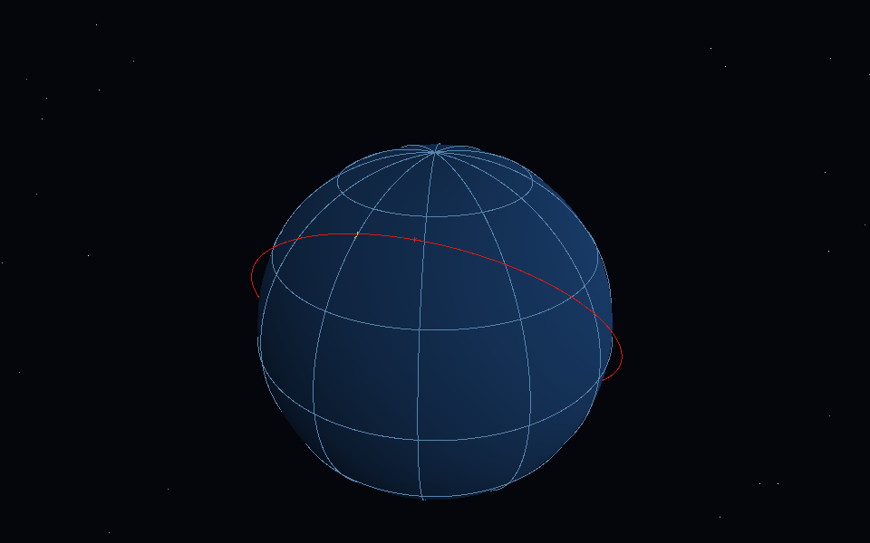

# Changelog

All notable changes to STKCraft are recorded here.

The format follows [Keep a Changelog](https://keepachangelog.com/en/1.1.0/), and the project
adheres to [Semantic Versioning](https://semver.org/spec/v2.0.0.html).

Versions in the `0.0.x` series are early alpha. Each one states what it can and cannot do,
so a reader is never left guessing whether a missing capability is a bug or simply not built
yet.

## [0.1.118] — The planner gets exactly one correction

### Added

- `Planner::plan_corrected`: validate the first graph; if it is invalid, send the model its own
  answer and the validation errors once, then validate the second graph. Never more than two model
  requests.
- `stkcraft plan` uses the corrected path, so an unknown command or a dependency mistake in the
  first graph gets one chance to be fixed.

### Changed

- The correction is bounded and explicit. A second invalid graph is an error that lists both sets of
  validation errors; the planner does not loop, retry on transport failures, or execute a partially
  valid graph.

### Not built yet

- Budgeted multi-correction planning, parallel task execution, cancellation propagation and durable
  task state.
- Expression-level dimension algebra and formula decomposition.
- `ask` still uses the tool loop; `plan` is a separate command.

### Verification

- Planner tests: a fenced JSON answer becomes a graph; an invalid first graph is corrected once; a
  second invalid graph is refused.
- `cargo xtask ci` at 0.1.118 passes all twelve steps.

## [0.1.117] — A formula's unit and dimension must agree

### Added

- The expert validator maps known units (`km`, `m`, `s`, `min`, `century`, `rad`, `deg`,
  `rad/min`, `1`, …) and known dimension labels (`length`, `time`, `time offset`, `angle`,
  `angular rate`, `ratio`, `integer`, …) to one base dimension and rejects a symbol whose two
  declarations disagree.
- `experts check` applies the check to all 18 formulas; the current set passes.

### What this is not

- It is a unit/dimension **pair** check, not expression-level dimensional analysis. It does not
  parse the formula's expression, so it cannot yet prove that both sides of an equation balance.
  Unknown units or labels are left alone rather than guessed, which keeps future expert packages
  from being rejected by a vocabulary this build has not seen.

### Not built yet

- Expression-level dimension algebra and the PhyE2E decomposition pipeline.
- Planner correction, budgets, parallelism, cancellation and durable task state.

### Verification

- Expert test: a symbol with unit `km` and dimension `time` is refused.
- `cargo xtask experts check`: 3 packages, 11 sources, 18 formulas, 16 verified, 2 implemented.
- `cargo xtask ci` at 0.1.117 passes all twelve steps.

## [0.1.116] — The model proposes a graph; Rust validates and executes it

### Added

- `stkcraft-agent-runtime::task::Planner`: one model completion with the command catalogue, a
  strict "JSON graph only" instruction, and extraction of the first `{…}` object. The planner does
  not dispatch commands.
- `stkcraft plan "<question>"`: asks the model for a graph, validates it with `TaskGraph::validate`
  and executes it against a fresh scenario. The graph is printed to stderr and the task outcomes,
  including their numeric results, to stdout.
- A planner unit test: a fenced JSON answer becomes a graph.

### Changed

- A model's plan is data, not authority. An unknown command, missing dependency, cycle, depth
  overflow or bad JSON is refused before execution.

### Not built yet

- Planner retries/correction when the first graph is invalid; budgets, parallelism, cancellation and
  durable task state.
- Formula dimension algebra.
- The `plan` command is not yet the default `ask` path; `ask` remains the tool loop.

### Verification

- Real DeepSeek planner run at 0.1.116: the question supplied the ISS elements and London
  coordinates; the model's graph added both objects and computed access, and `stkcraft plan` exited
  0 with five windows and their start/end/duration seconds.
- `cargo xtask ci` at 0.1.116 passes all twelve steps.

## [0.1.115] — A deterministic task graph composes commands

### Added

- `stkcraft-agent-runtime::task`: `TaskGraph`, `TaskSpec`, `TaskOutcome` and `TaskStatus`.
  A graph validates ids, commands, dependencies and cycles before running; it bounds the graph at
  64 tasks and a chain at 16, then executes in a deterministic topological order.
- Outcomes are `completed`, `needs_input`, `failed` and `blocked`. A blocked task names the
  dependency that did not complete.
- `stkcraft workflow --file <graph.json>` runs a graph against a fresh scenario and prints the
  outcomes and their structured results.
- `share/workflows/iss-london.json`: add ISS, add London, compute access; the sample returns five
  windows with start/end/duration seconds.

### Changed

- The executor is deterministic and does not call a model. It is the composition substrate a planner
  will target, not a planner itself.

### Not built yet

- A model planner that proposes a graph, budgets, parallelism, cancellation and durable task state.
- Formula dimension algebra.
- A real-provider run of a planned graph (the CLI workflow is model-free).

### Verification

- Five task tests: dependency order and numeric windows, cycle refusal, unknown command/missing
  dependency, failed dependency blocks its child, disabled command is `needs_input`.
- `stkcraft workflow --file share/workflows/iss-london.json` exits 0 and prints five windows.
- `cargo xtask ci` at 0.1.115 passes all twelve steps.

## [0.1.114] — Known gaps are refused before the model runs

### Added

- `share/capabilities/limits.toml`: RF link budget, manoeuvre and attitude are domains with no
  command in this build, with the phrases that ask for them and the reason.
- `CapabilityLimit`, `load_limits` and `matched_limit`. A single word matches as a whole token, so
  `RF` does not match `performance`; a phrase matches as a substring.
- The MCP server carries the limits, and the agent checks them **before** the model call. A match
  returns `unsupported` with the reason and a `capability.guard(<id>)` trace line.
- `agent-eval` loads the limits too, so the RF case no longer spends a model call.

### Changed

- The RF fixed case now passes through `capability.guard(rf-link)` rather than a model conclusion.
  The model path still exists for requests the guard does not know; this is a known-domain guard,
  not a general semantic planner.

### Not built yet

- A general capability preflight that derives the required capability from any request.
- Formula dimension algebra and the task-graph orchestrator.

### Verification

- Real DeepSeek run at 0.1.114: `PASS iss-passes (complete)` and
  `PASS out-of-scope-link-budget (unsupported)`; the second case produced only
  `capability.guard(rf-link)` and no model call.
- Knowledge test: phrase match, whole-word match, and `performance` not matching `RF`.
- Runtime test: a guarded question returns `unsupported` before the scripted model is consulted.
- MCP test: an unsupported-domain helper installs the limit without naming the knowledge type.
- `cargo xtask ci` at 0.1.114 passes all twelve steps.

## [0.1.113] — The model concludes with a status the platform can check

### Added

- `agent.report`, a control tool with `status` (`complete`, `needs_input`, `unsupported`,
  `failed`) and an optional `reason`. It is listed with the engine tools, accepted by the MCP
  dispatch and allowed to every expert role.
- The system prompt requires the report before the final message and says plainly: never report
  `complete` for a computation that does not answer the question.
- `ResultEnvelope.reason`, and `needs_input` as a status. A reported `complete` with no structured
  result is `failed`, not `complete`.
- A session that never calls `agent.report` keeps the old inference (results → complete, none →
  unsupported); the report takes precedence when present.

### Changed

- `verify_results` remains the independent check on the numbers. The model's status is a conclusion,
  not evidence: `complete` still has to pass the duration/citation/limitation checks.

### Not built yet

- A deterministic capability preflight before tool execution. The current status is model-declared
  and therefore still relies on the prompt; a model that ignores it falls back to inference.
- Formula dimension algebra and the task-graph orchestrator.

### Verification

- Real DeepSeek run at 0.1.113: `PASS iss-passes (complete)` and
  `PASS out-of-scope-link-budget (unsupported)`; 2 of 2 passed.
- The RF run called `access.compute`, then reported `unsupported` with the reason that no registered
  command computes a link margin; the geometry windows stayed in the trace but not in the answer's
  status.
- MCP test: `agent.report` is listed, returns its structured status, and rejects an invalid status.
- Runtime test: reported `unsupported` overrides a present result; reported `complete` without one
  becomes `failed`.
- `cargo xtask ci` at 0.1.113 passes all twelve steps.

## [0.1.112] — Fixed agent cases, and the capability gap they exposed

### Added

- `share/evals/agent/basic.jsonl`: fixed cases with an expected `status`, result `kind`, minimum
  window count and required formula id.
- `stkcraft agent-eval [--file <jsonl>]`: runs those cases against the configured provider and
  reports PASS/FAIL. It needs a real key and network, so it is not part of the offline CI gate.
- `ask --json` now writes its tool trace to stderr, leaving stdout as one parseable envelope.

### Found, not fixed

- The `out-of-scope-link-budget` case asked for an RF link margin, which no command implements.
  The agent called `access.compute` (5 windows), returned `status: complete`, and the expected
  `unsupported` failed. The envelope currently means "some structured result exists", not "the
  question was answered". A capability preflight or planner is required; the failure is recorded
  rather than hidden by changing the expectation.

### Not built yet

- Capability preflight and `needs_input`/`unsupported` classification before tool execution.
- Formula dimension algebra; the task-graph orchestrator.
- A real-provider CI run (it would need a secret and network, so the fixed cases stay a manual
  task until a deliberately gated environment exists).

### Verification

- Real DeepSeek run at 0.1.112: `PASS iss-passes (complete)`, `FAIL out-of-scope-link-budget
  (complete): status complete, expected unsupported`; 1 of 2 passed.
- Unit test for the expectation checker: status, kind, window count and formula citation.
- `cargo xtask ci` at 0.1.112 passes all twelve steps; the real evaluation is not in that gate.

## [0.1.111] — Every tool call can be replayed from the computation ledger

### Added

- Schema version 3: `computation.result` and `computation.errors`. The result is the structured JSON
  the platform rendered; the errors are the verifier's verdict. A version-2 record migrates forward
  without losing its rows.
- `Agent::with_ledger`: every successful tool call is written with its command, parameters, scenario
  digest, engine version, summary, result JSON and verification errors.
- `ask` and `chat` open the installation's record automatically, and the `passes` CLI stores its
  structured answer instead of only a summary.
- The storage test suite proves a version-2 database gains the columns and can still record a row.

### Changed

- A ledger write failure does not fail the answer; the answer is the user's, the record is
  best-effort. The code says so where the result is ignored.

### Not built yet

- Formula dimension algebra and the offline PhyE2E-style discovery pipeline.
- The task-graph orchestrator and the fixed real-provider evaluation set.
- A ledger read view in the desktop app; `stkcraft history` reads the existing computation table.
- Sub-daily EOP; release packaging; macOS CI.

### Verification

- Storage tests: 35 pass, including the version-2 migration and the result/errors round trip.
- Runtime test: an agent with an in-memory ledger records `satellite.add` with its result and `[]`
  errors.
- `cargo xtask ci` at 0.1.111 passes all twelve steps.

## [0.1.110] — A role is restricted to the objects it may touch

### Added

- `ExpertRole::with_objects` and the optional `objects` list in `role.toml`. A role can now say
  which object types it may act on, not only which tools it may call.
- `time-frames` is restricted to `scenario`, `sgp4` to `satellite` and `station`, and
  `access-geometry` to `satellite`, `station`, `target` and `planet`.
- The MCP dispatch checks the role's object list against the capability manifests. A tool that the
  role lists but no allowed object declares is refused at `tools/call`, not merely hidden from
  `tools/list`. `knowledge.*` reads remain available.

### Fixed

- A role with object restrictions and no loaded manifests now fails closed for object commands;
  it does not silently fall back to the unrestricted list.

### Not built yet

- A computation ledger, formula dimension algebra and the task-graph orchestrator.
- Object filtering for a session without a role is still the manifests' declaration, not an
  authorization boundary.
- Sub-daily EOP; release packaging; macOS CI.

### Verification

- MCP test: a satellite-only role lists `satellite.add`, `access.compute` and `knowledge.search`,
  omits `station.add`, and `station.add` is refused at dispatch.
- Existing role tests still pass: a role without objects keeps its full tool list.
- `cargo xtask experts check` accepts the three role files; `cargo xtask ci` at 0.1.110 passes all
  twelve steps.

## [0.1.109] — Object capabilities are declared, checked and readable

### Added

- `share/capabilities/*.toml`: satellite, station, target, scenario and planet each declare their
  command ids, the evidence a result must carry and the limitations it must state.
- `stkcraft-agent-knowledge::capability::load_all`: parses every manifest and rejects an empty
  command list, an empty limitation, a duplicate command or a duplicate object id.
- `cargo xtask capabilities check`: every command id must exist in the engine registry. It is the
  twelfth gate step.
- MCP exposes the manifests at `stkcraft://capabilities`; `mcp`, `ask`, `chat` and the control
  session load them. A model can read what an object may do before it calls a tool.

### Changed

- The command registry remains the only schema and the only dispatch path. A manifest is a
  declaration: filtering a call by object type is not implemented yet, and the document says so.

### Not built yet

- Dispatch-time object filtering, the computation ledger, formula dimension algebra and the
  task-graph orchestrator.
- Sub-daily EOP; release packaging; macOS CI.

### Verification

- Five manifests, 17 command references, all resolved by the registry.
- Knowledge tests: valid manifest, duplicate command, empty limitation.
- MCP test: the capability resource is readable and carries the object id and command.
- `cargo xtask ci` at 0.1.109 passes all twelve steps.

## [0.1.108] — A deterministic verifier checks the numbers before display

### Added

- `stkcraft-agent-runtime::verify::verify_results`: checks structured access and planet-pass results
  before the envelope is returned. A window's `duration_seconds` must match the span of its UTC
  instants within two seconds, every instant must parse, and an access result must carry formula
  citations and limitations.
- `ResultEnvelope.errors` and the `failed` status. A result that breaks an invariant is reported
  with the reasons instead of being shown as `complete`.
- `docs/design/reference-systems.md`: what STKCraft takes from PhyE2E (formula decomposition,
  dimensional consistency, held-out verification) and CosmoAgent (proposer/verifier separation,
  enumerated actions, bounded rejection, blackboard state), and what it deliberately does not copy.

### Changed

- The assistant panel and `ask --json` now consume a result with an explicit status and errors. The
  model's text remains a note; it is never the evidence for a number.

### Not built yet

- Object capability manifests and the task-graph orchestrator.
- A computation ledger (the CosmoAgent "stick" equivalent).
- Formula dimension algebra and the offline PhyE2E-style discovery pipeline.
- The 2026 `CosmoAgent` theoretical-cosmology project is a different system from the multi-agent
  paper studied here; it has not been reviewed.

### Verification

- Five verifier tests: a consistent result passes; a mismatched duration, a missing formula, a
  missing limitation, an unparseable instant and an unknown kind are handled.
- A real DeepSeek run returned `status: complete` for the five ISS/London windows through the
  verifier.
- `cargo xtask ci` at 0.1.108 passes all eleven steps.

## [0.1.107] — The assistant panel renders the numbers, not the article

### Added

- The assistant panel now draws structured tool results as tables: satellite/station or
  satellite/target pair, start (UTC), end (UTC), duration. A planet pass is the same table without a
  window array. An unknown result shape falls back to a collapsible raw JSON view.
- The model's text is a collapsed "Model note" when a structured result exists; it is still the
  answer when no result exists.

### Changed

- `Reply` carries the structured results alongside the text and the scenario; the worker sends them
  in one message rather than a second channel.
- The table headers and the note/raw labels are translatable (`Results`, `Start (UTC)`,
  `End (UTC)`, `Duration`, `Model note`, `Raw result`). The Chinese catalog covers them; the report
  is 69/69 with 0 missing.

### Not built yet

- Object-level capability manifests and the task-graph orchestrator.
- A `needs_input`/`failed` classification for a model run with no structured result.
- Sub-daily EOP; release packaging; macOS CI.

### Verification

- `cargo test -p stkcraft assistant` passes 21 tests, including the Stop/adoption races with the
  new reply shape.
- `cargo xtask ci` at 0.1.107 passes all eleven steps.

## [0.1.106] — The agent can return a result envelope instead of prose

### Added

- `Answer::results`: the structured content every tool returned, in call order.
- `ResultEnvelope { status, question, results, trace }` in `stkcraft-agent-runtime`.
- `stkcraft ask --json <question>` prints that envelope and suppresses the model's prose. The status
  is `complete` when at least one structured result exists, `unsupported` otherwise.

### Fixed

- A successful tool call's `structuredContent` no longer disappears after the model reads its text.
  The platform now has the windows, formulas and limitations as data, not only as sentences.

### Not built yet

- The desktop assistant panel still renders the model text; the envelope is CLI/MCP data for now.
- Object-level capability manifests and the task-graph orchestrator.
- A model request whose answer has no structured result is marked `unsupported`; it is not yet a
  clean `needs_input`/`failed` classification.
- Sub-daily EOP; release packaging; macOS CI.

### Verification

- Real DeepSeek test at 0.1.106: `ask --json` for the ISS-over-London demo returned `complete`, five
  windows with UTC start/end/duration, the access limitations and the formula citations.
- The same access question without `--json` still prints the model text, for compatibility.
- `cargo xtask ci` at 0.1.106 passes all eleven steps.

## [0.1.105] — Expert roles restrict the runtime tool surface

### Added

- `share/experts/*/role.toml`: each package declares its id, version and allowed tools.
- `stkcraft-agent-knowledge::expert::{ExpertRole, load_role}`; the validator requires a valid role
  for every package.
- `stkcraft mcp --expert <id>` opens an MCP session as that role. `tools/list` is filtered to the
  allowlist and `tools/call` rejects any tool outside it at dispatch, not only in the description.
- The time-frames, SGP4 and access-geometry roles are the first three runtime roles.

### Not built yet

- The role is an allowlist over the existing MCP transport; task graphs, budgets, durable recovery
  and multi-agent scheduling are still not built.
- The `ask`/`chat` model loop does not yet take a role; only the MCP session does.
- Sub-daily EOP; the release workflow and platform packaging; command parameter descriptions;
  `ui.json` as the app's configuration file; coverage, a browser shell, the extension store and
  DOCX/XLSX; macOS is still outside the CI matrix.

### Verification

- Knowledge tests: a role loads and allows only its tools; an id mismatch is refused.
- MCP test: a role lists only `knowledge.search` and `access.compute`, and `satellite.add` is
  refused at dispatch.
- `cargo xtask experts check` and `experts eval` pass; `cargo xtask ci` at 0.1.105 passes all
  eleven steps.

## [0.1.104] — Expert evaluation cases are checked

### Added

- `stkcraft-agent-knowledge::expert::evaluate`: parses every `evaluations/*.jsonl`, checks that a
  named formula exists in the same package with status `verified` or `implemented`, and fails when a
  formula has no case at all.
- `cargo xtask experts eval`, the eleventh step of `cargo xtask ci`.
- Two cases were added so every formula is exercised: `time.ut1-from-utc` and
  `access.window-sampling`.

### Changed

- `docs/design/experts.md`, `README.md` and `AGENTS.md` describe the evaluation step.

### Not built yet

- The evaluation runner checks structure and coverage, not a live model answer; the case's
  `question` is data for a later role evaluation.
- Runtime expert roles and tool allowlists.
- Sub-daily EOP; the release workflow and platform packaging; command parameter descriptions;
  `ui.json` as the app's configuration file; coverage, a browser shell, the extension store and
  DOCX/XLSX; macOS is still outside the CI matrix.

### Verification

- `cargo xtask experts eval`: `3 package(s), 27 case(s), 18 formula(s), 18 covered`.
- Five validator/evaluator tests pass, including unknown-formula and missing-coverage refusals.
- `cargo xtask ci` at 0.1.104 passes all eleven steps.

## [0.1.103] — Answers cite the formulas they used

### Added

- `CommandOutcome::formulas` with `FormulaCitation { id, source }`. The access commands cite
  `sgp4.kepler`, `frames.teme-to-itrf`, `access.geodetic-to-itrf`, `access.look-angles`,
  `access.occultation`, `access.sensor-cone` and `access.window-sampling`, each with the source a
  reader can follow.
- The text answer ends with a `Formulas:` list, the JSON answer has a `formulas` array, and MCP's
  `structuredContent` carries the same array. `passes` and `planet` print the list as `formula:`
  lines.

### Fixed

- An access answer can no longer show numbers whose formula records are invisible. A reader sees
  which formula records were used and where they come from.

### Not built yet

- The formula citation is a static list on the command, not read from the expert package at run
  time; the validator and the package remain the authority on whether the records are current.
- An expert evaluation runner; sub-daily EOP; the SGP4/Access runtime roles.
- The release workflow and platform packaging; command parameter descriptions; `ui.json` as the
  app's configuration file; coverage, a browser shell, the extension store and DOCX/XLSX; macOS is
  still outside the CI matrix.

### Verification

- Engine tests assert the formula ids on `access.compute` and `access.targets`.
- The answer-formatter test proves the list appears in text and JSON.
- `cargo xtask ci` at 0.1.103 passes all ten steps.

## [0.1.102] — The IERS Earth-orientation series is in the kernel path

### Added

- `stkcraft-astro-frames::Finals2000A`: an IERS `finals2000A.all` loader with a 64 MiB bound, the
  fixed daily columns, linear interpolation between rows, and an out-of-range error instead of a
  silent fallback.
- `Propagator::with_eop_model`: the series is queried at each instant, because EOP changes across a
  multi-day scenario; `Scenario` carries the loaded series outside its saved document.
- `stkcraft passes --eop <file>` and `stkcraft run … --eop <file>` load the series. Without it the
  answer keeps the zero-EOP limitation; with it the limitation is removed.

### Fixed

- `Propagator::itrf_state` now converts the instant to UTC before the EOP lookup and the UT1 Julian
  Date. It previously used `at.julian()` directly, which is wrong for a TDB epoch; the periodic
  TDB-TT term would shift the EOP lookup instead of being applied where it belongs.

### Not built yet

- Sub-daily EOP and tidal terms; the loader interpolates daily values.
- The release workflow and platform packaging; command parameter descriptions; `ui.json` as the
  app's configuration file; coverage, a browser shell, the extension store and DOCX/XLSX; macOS is
  still outside the CI matrix.

### Verification

- Three loader tests: daily interpolation, out-of-range refusal, a file with no EOP row.
- A propagation test proves a loaded series changes the Earth-fixed position by more than 10 m.
- `stkcraft passes --tle … --eop data/finals2000A.all` ran against the real 3.7 MB file and printed
  the pass table with the sampling and geometric notes, without the zero-EOP note.
- `cargo xtask ci` at 0.1.102 passes all ten steps.

## [0.1.101] — SGP4 and Access experts join the foundation

### Added

- `share/experts/sgp4/`: three sources, five formula records and eight evaluation cases. The
  records cover the TLE checksum and epoch window, the un-Kozai mean motion, the SGP4 Kepler
  iteration and the deep-space lunar-solar/resonance branch. They point at the AIAA 2006-6753
  verification vectors.
- `share/experts/access-geometry/`: three sources, five formula records and seven evaluation cases
  for WGS84 geodetic positions, topocentric look angles, occultation, the sensor cone and sampled
  windows.
- The formula validator accepts an optional `verification.test_path` for a test that lives in a
  separate test file, which is how the SGP4 vector tests are organised.

### Changed

- `cargo xtask experts check` now reports three packages, ten sources, eighteen formulas,
  sixteen verified and two implemented.
- Phase 4 of the expert plan is complete.

### Not built yet

- An IERS `finals2000A` loader; `Propagator::new` still uses zero Earth-orientation parameters.
- The release workflow and platform packaging; command parameter descriptions; `ui.json` as the
  app's configuration file; coverage, a browser shell, the extension store and DOCX/XLSX; macOS is
  still outside the CI matrix.

### Verification

- `cargo xtask experts check`: `3 package(s), 10 source(s), 18 formula(s), 16 verified, 2
  implemented`.
- `cargo xtask ci` at 0.1.101 passes all ten steps.

## [0.1.100] — Access answers carry their limitations

### Added

- `CommandOutcome::limitations`: sentences that must travel with a computed answer. The text
  answer ends with a `Limitations:` list, the JSON answer has a `limitations` array, and MCP's
  `structuredContent` carries the same array.
- Earth access answers now say that windows are sampled at the requested step (a short window
  between samples can be missed), that the line of sight is geometric (no refraction, light time or
  aberration), and that Earth orientation is zero, so ground positions carry that approximation.
- Target access adds that its windows are the union of the vertex windows, not polygon-interior
  coverage.
- Planet-centred access says the orbit is a circular Keplerian orbit with no perturbations, and that
  its passes are sampled.

### Changed

- The `passes` and `planet` command-line paths print the same notes after their tables, so a
  person does not get a more confident answer than a program.

### Fixed

- The access layer's real limits no longer live only in comments and design documents. An answer
  that lists windows now states what was and was not modelled.

### Not built yet

- The SGP4 and Access expert packages (the Time & Frames package is the first).
- An IERS `finals2000A` loader; `Propagator::new` still uses zero Earth-orientation parameters.
- The release workflow and platform packaging; command parameter descriptions; `ui.json` as the
  app's configuration file; coverage, a browser shell, the extension store and DOCX/XLSX; macOS is
  still outside the CI matrix.

### Verification

- Engine tests assert the sampling and zero-EOP notes on `access.compute`, the vertex-union note on
  `access.targets`, and the Keplerian note on `planet.access`.
- The answer-formatter test proves the limitations appear in both text and JSON.
- MCP tests assert the `limitations` array in `target-access` and `planet-passes`.
- `cargo xtask ci` at 0.1.100 passes all ten steps.

## [0.1.99] — Expert packages and formula records are validated

### Added

- `share/experts/time-frames/`: the first authored expert package. It holds four source records,
  eight formula records, ten evaluation cases and the limitations every answer must carry. The
  records cover the leap-second offset, TT from TAI, TDB minus TT, UT1 with DUT1, IAU-82 GMST,
  IAU-77 precession, IAU-80 nutation and TEME to ITRF.
- `stkcraft-agent-knowledge::expert`: reads `sources.toml` and `formulas/*.toml` and checks source
  references, implementation paths, test names, status rules and local SHA-256 digests.
- `cargo xtask experts check`, the tenth step of `cargo xtask ci`. It reports
  `1 package(s), 4 source(s), 8 formula(s), 7 verified, 1 implemented`.

### Changed

- The agent quality-gate description in `AGENTS.md` and the gate table in `README.md` list the
  expert check.
- `docs/design/experts.md` records the validator's exact failure conditions.
- The expert plan is at Phase 2; Phase 3 (limitations in every answer) is next.

### Fixed

- A formula can no longer become a citation without its source, implementation and test. The
  validator fails on a duplicate id, a missing source, a missing implementation, a missing
  reference/tolerance, a missing test name, an empty symbol/assumption/limitation, or a digest
  mismatch.
- `time.ut1-from-utc` is deliberately `implemented`, not `verified`: the contract that missing
  DUT1 is refused is tested, but there is no IERS EOP loader yet.

### Not built yet

- The Phase 3 answer contract (`CommandOutcome.limitations`, formula ids in answers).
- The SGP4 and Access expert packages.
- An IERS `finals2000A` loader, so `Propagator::new` still uses zero Earth-orientation parameters.
- The release workflow and platform packaging; command parameter descriptions; `ui.json` as the
  app's configuration file; coverage, a browser shell, the extension store and DOCX/XLSX; macOS is
  still outside the CI matrix.

### Verification

- `cargo xtask experts check`: `1 package(s), 4 source(s), 8 formula(s), 7 verified, 1 implemented`.
- Three validator tests pass: a complete package validates; a missing test is refused; a missing
  source is refused.
- `cargo xtask ci` at 0.1.99 passes all ten steps.

## [0.1.98] — The release contract is written down

### Added

- [`docs/guides/release.md`](docs/guides/release.md) records the tag policy, the shared
  `release.yml` contract, every path the app's packaging must provide, the signing secrets, and the
  honest current state: CI and house rules are wired, packaging and the release workflow are not.
  A reader can see what a real release needs without reverse-engineering a sibling repository.

### Changed

- The documentation index links the guide.

### Not built yet

- The release workflow and platform packaging (the guide is the contract they must satisfy);
  command parameter descriptions; `ui.json` as the app's configuration file; coverage, a browser
  shell, the extension store and DOCX/XLSX; macOS is still outside the CI matrix.

### Verification

- `cargo xtask ci` at 0.1.98 (fmt, clippy, tests, assets, i18n, api-docs, layers, wasm, version,
  lockfile).

## [0.1.97] — The gate keeps its temporary files inside `target/`

### Changed

- `[profile.dev]` uses `debug = "line-tables-only"`. The shared CI gate already sets
  `CARGO_PROFILE_DEV_DEBUG=line-tables-only`; a local `cargo xtask ci` now builds the same profile,
  with file/line backtraces but without the multi-gigabyte PDBs full debug info produced on Windows.
- `xtask` runs its child `cargo` commands with `TMP`, `TEMP` and `TMPDIR` pointed at
  `target/xtask-tmp`. A terminal that can write the workspace but not the system temp directory no
  longer fails with `LNK1104` on the linker's `.tmp` file.

### Fixed

- The build no longer depends on a writable `%TEMP%` for the gate's clippy, test and wasm steps.
  The failure read as a compiler error, but it was a permission error from `link.exe`.

### Not built yet

- The release workflow and platform packaging; command parameter descriptions; `ui.json` as the
  app's configuration file; coverage, a browser shell, the extension store and DOCX/XLSX; macOS is
  still outside the CI matrix.

### Verification

- With the parent `TEMP`/`TMP` set to the system directory this machine's sandbox cannot write,
  `target/debug/xtask.exe ci` ran the whole gate and passed; the child builds used
  `target/xtask-tmp`.
- `cargo xtask ci` at 0.1.97.

## [0.1.96] — Contributor credits use the shared generator's fields

### Fixed

- `contributors/people.toml` used `name` under `[people.stone]`. The shared
  `refresh-contributors` generator keys entries by **GitHub username** and reads `display_name`;
  `name` is ignored, so the entry would never have been applied. It is now
  `[people.spacelibres]` with `display_name = "stone"` — the GitHub account that owns the
  repository, credited with the name used on the office Linux machine.
- `contributors/README.md` now documents the fields the generator actually reads
  (`display_name`, `real_name`, `consent_source`, `sync_github_name`) and says the key is the
  GitHub account.

### Not built yet

- The release workflow and platform packaging; command parameter descriptions; `ui.json` as the
  app's configuration file; coverage, a browser shell, the extension store and DOCX/XLSX; macOS is
  still outside the CI matrix.

### Verification

- The shared generator's `load_people` accepts the committed file after the change.
- `cargo xtask ci` at 0.1.96.

## [0.1.95] — Chinese is complete, and the extractor reads CRLF continuations

### Fixed

- The i18n extractor treated the `\r` of a CRLF line ending as text when a translated literal
  continued with a trailing backslash. A Windows checkout therefore produced a catalog key with
  `\r\n` in it, which no catalog row could match: those strings stayed English and their catalog
  rows were reported as unused. The extractor now consumes `\r\n` as the line continuation Rust
  does, and a test covers it.
- `cargo xtask i18n report` names every missing string instead of stopping after twelve. A report
  that says "… and 15 more" is not a work list.

### Changed

- The `zh` catalog is complete: **63/63 strings, 0 missing, 0 unused**. The 25 new rows cover the
  command labels, the assistant's fixed failures, the frame-problem sentences, the marker summary
  and the pass-over-station line. The plural row uses the single CLDR form Chinese has.

### Not built yet

- The release workflow and platform packaging; command parameter descriptions; `ui.json` as the
  app's configuration file; coverage, a browser shell, the extension store and DOCX/XLSX; macOS is
  still outside the CI matrix.

### Verification

- `cargo xtask i18n` reports 63 source strings and every catalog well-formed.
- `cargo xtask i18n report` reports `zh (中文): 63/63, 0 missing, 0 unused`.
- `cargo xtask ci` at 0.1.95.

## [0.1.94] — The project no longer claims ArtCraft membership

### Changed

- The README tagline no longer says "By the ArtCraft team." It now says the project is an
  independent Craft-style project applying to join the ArtCraft family.
- Copyright holders in `README.md`, `NOTICE`, `LICENSE-MIT` and `docs/standards.md` are the
  STKCraft contributors, not the ArtCraft Team. `ATTRIBUTION.md` credits the albatross artwork to
  the STKCraft project.
- `AGENTS.md` and `docs/standards.md` describe the relationship as an application to join the
  family, not as existing membership. The family's standards are still followed, which is what the
  application is for; the ArtCraft name and marks remain the ArtCraft Team's.
- The README logo alt text no longer names an "ArtCraft-blue" tile.

### Fixed

- The metadata and legal notices claimed a relationship the project does not yet have. An applicant
  must not present itself as an accepted member, and a copyright line is not the place to anticipate
  acceptance.

### Not built yet

- The release workflow and platform packaging; command parameter descriptions; `ui.json` as the
  app's configuration file; coverage, a browser shell, the extension store and DOCX/XLSX; macOS is
  still outside the CI matrix.

### Verification

- `cargo xtask ci` at 0.1.94 (fmt, clippy, tests, assets, i18n, api-docs, layers, wasm, version,
  lockfile).
- A text search confirms no remaining "By the ArtCraft team", "ArtCraft Team and the STKCraft
  contributors", or "one of the ArtCraft Craft apps" claim.

## [0.1.93] — Parameter kinds are named consistently

### Changed

- `AGENTS.md`, `docs/standards.md` and `docs/design/architecture.md` now list all four parameter
  kinds: `Number`, `Text`, `Degrees` and `DegreesPair`. The fourth was added in 0.1.90 for
  `target.add`, but the rule book still described three, so a reader could believe a target's
  corners were still untyped text.

### Fixed

- The documentation drifted from the code after the typed-target change; the API reference already
  said `degrees-pair`, while the prose said only number/text/degrees.

### Not built yet

- The release workflow and platform packaging; command parameter descriptions; `ui.json` as the
  app's configuration file; coverage, a browser shell, the extension store and DOCX/XLSX; macOS is
  still outside the CI matrix.

### Verification

- `cargo xtask ci` at 0.1.93 (fmt, clippy, tests, assets, i18n, api-docs, layers, wasm, version,
  lockfile).
- `cargo xtask api-docs check` reports the generated reference matches the registry.

## [0.1.92] — Control tokens come from the operating system's RNG

### Fixed

- `new_token` read `/dev/urandom`, which does not exist on Windows, and fell back there to a digest
  of the process id and the clock — guessable by anything that could observe the process table. It
  now calls `getrandom` (`BCryptGenRandom` on Windows, `getrandom(2)` on Linux, the Security
  framework on macOS) for 32 bytes, and still falls back to the process/clock digest only if that
  call fails. The 32-hex-character shape and the constant-time comparison are unchanged.
- The token-file documentation now states the platform difference: `0600` on Unix, and the per-user
  directory's inherited ACL on Windows, where there is no file mode to set.

### Not built yet

- The release workflow and platform packaging; command parameter descriptions; `ui.json` as the
  app's configuration file; coverage, a browser shell, the extension store and DOCX/XLSX; macOS is
  still outside the CI matrix.

### Verification

- `cargo xtask ci` at 0.1.92 (fmt, clippy, tests, assets, i18n, api-docs, layers, wasm, version,
  lockfile).
- The existing token test still proves the 32-hex shape and that two tokens differ.

## [0.1.91] — The window's error sentences are translatable

### Changed

- Frame problems are data (`FrameProblem::Station`, `Satellite`, `SatelliteAt`) instead of finished
  English strings; the window composes the sentence with `tr!`, so the prefix around a station or
  satellite name follows the interface language while the engine's error detail stays as written.
- The assistant's fixed failure messages ("Type a question first.", "The assistant could not
  start.", the stopped/cancelled cases) are translated at render. An unknown runtime error is shown
  as the runtime wrote it rather than hidden or guessed at.
- The source now has 63 extractable interface strings.

### Fixed

- The Diagnostics panel and the assistant's failure line were the last window text that could not
  be translated at all.

### Not built yet

- The release workflow and platform packaging; command parameter descriptions; `ui.json` as the
  app's configuration file; coverage, a browser shell, the extension store and DOCX/XLSX; macOS is
  still outside the CI matrix.

### Verification

- `cargo xtask ci` at 0.1.91 (fmt, clippy, tests, assets, i18n, api-docs, layers, wasm, version,
  lockfile).
- `cargo xtask i18n` extracts 63 strings and every catalog stays well-formed; the `zh` catalog falls
  back to English for the new rows until someone reviews translations.

## [0.1.90] — Target corners are typed pairs

### Changed

- `target.add`'s `points` parameter is `ParameterKind::DegreesPair`, not text. Every transport
  converts it through the declaration: MCP's schema is an array of `[latitude, longitude]` pairs
  with `x-unit: degrees`, the command line's `lat,lon;…` spelling is accepted by `args_from`, and
  the command receives typed `GroundSite` values rather than a string it has to parse itself.
- The schema and the engine both cap a target at 1024 corners, and `args_from` refuses a larger
  array before allocating it.
- The API reference labels the parameter `degrees-pair`; `stkcraft commands` labels it `corners`.

### Fixed

- The `points` mini-language is no longer parsed inside the command: a caller that sent a valid
  array had to know the text form, and the MCP schema could not say what a corner was.

### Not built yet

- The release workflow and platform packaging, assistant/frame translation gaps and `ui.json`
  remain as stated in 0.1.89; macOS is still outside the CI matrix.

### Verification

- `cargo xtask ci` at 0.1.90.
- `args_from` converts both the array form and the terminal spelling to `Arg::Corners`; the MCP
  schema test asserts the nested `x-unit` and the engine test asserts a two-corner target.

## [0.1.89] — Consume offscreen texture updates before dropping the frame

### Fixed

- The offscreen renderer dropped egui's texture deltas before the readback, so a frame that uploaded
  a font or a texture could draw with stale texture state. It now drains the uploads, renders, then
  frees the deferred textures after submission; the drain happens even when the readback fails.
- A native-GPU test (`offscreen_text_frame_applies_and_releases_texture_deltas`, ignored in the
  ordinary gate because it needs a rendering host) proves the text frame draws and that the free list
  is non-empty.

### Not built yet

- Nothing in this version changes the list in 0.1.88: the release workflow and platform packaging,
  a typed `target.add` parameter, the assistant/frame translation gaps and `ui.json` remain as they
  were.

### Verification

- `cargo xtask ci` at 0.1.89.
- The ignored GPU test was run on a Vulkan adapter and passed: text drew, and the texture free list
  was applied after the render.

## [0.1.88] — The albatross mark, a reachable command surface, and a gate that reads the notebook

### Added

- The project's albatross mark, in the family's `assets/app-icon/` layout: the SVG master, the 512 px
  PNG the window embeds, the Windows ICO, and their README/LICENSE. The window icon and the panel
  heading now carry it, and `README.md` opens with it. The mark is the project's own artwork, not
  covered by the code licence.
- `stkcraft commands` lists every command id, its parameters and its menu; `stkcraft run <id>` runs any
  of them against an empty or loaded scenario, with `--scenario`, `--write`, `--json` and
  `--<parameter>`. A scenario document is validated, bounded to 16 MiB, and written back on request.
- A window menu generated from the registry's own `menu_path`, with a small parameter form for
  commands that need one, and `Ctrl+Shift+A` for `access.compute`. A menu click is the only path that
  starts an interactive sequence.
- `stkcraft-framework-storage::transcripts`: session files are opened, read, appended and listed by
  the storage crate, which validates a session id as a file name and bounds a transcript to 64 MiB
  before reading it.
- `Scenario::empty_at` and `Scenario::for_now`: a production path that cannot read the system clock
  reports it instead of dating the mission to J2000.
- `house-rules.yml` checks the AGENTS.md core and Rust blocks against craft-contrib; the gate now runs
  Windows as well as Ubuntu, with the suite's craft-fonts pin.
- MCP tools carry `x-enabled`, so a command whose precondition the scenario does not meet is
  advertised as unavailable before a call.
- `access.targets` returns the merged windows with UTC instants in the text and in
  `structuredContent`; `Degrees` parameters carry `x-unit: degrees`.

### Changed

- The control channel's `engine.execute` returns the summary and every window the command computed,
  through the same answer formatter the command line uses. A launcher is no longer told a count.
- Interface text: the i18n extractor no longer mistakes `&'static str` lifetimes for character
  literals (which had hidden every `tr!` after one), the command labels and the window's status,
  result and diagnostic lines go through `tr!`/`trn!`, and 55 strings are extracted again.
- `cargo xtask release` tags every version but prints a GitHub Release command only for a stable
  version (1.0.0 or later, no pre-release suffix). The 0.x development record is tags and nothing
  else; the 86 historical 0.x Releases were removed and all 94 tags kept.
- The generated API reference keeps documentation lists and tables as Markdown blocks instead of
  joining them into one line, and resolves no relative link into the source tree.
- The asset gate matches whole repository-relative paths and reads `.gitignore` directory entries in
  every spelling git accepts, so `plan/` no longer fails a check about what ships.
- Calendar conversion in storage and the runtime goes through `chrono`; the two hand-written
  `civil_from_days` copies are gone.

### Fixed

- A TLE field spelled `NaN`, `inf` or `-inf` is refused, and `Elements::from_tle` checks the mean
  motion, BStar and the three angles for finiteness; a crafted element set can no longer become a
  silent non-orbit.
- A planetary access search is capped at ten million samples, like the Earth sampler; `hours: 1e12`
  is an error instead of a hang.
- A target is capped at 1024 vertices before any window search, in `add_target`, `validate` and the
  `target.add` parser.
- The control channel bounds one request line to 1 MiB before parsing it, and the DAF reader and
  `julian_to_utc_naive` use checked arithmetic instead of wrapping.
- A `debug_assert!` on the propagation path became a returned error; a debug build no longer panics
  on the propagation path.
- The API reference was stale (it still named 0.1.86 while the workspace was 0.1.87), so the gate
  failed at HEAD; it is current again.
- README, ROADMAP, standards, storage, mathematics, knowledge, CCSDS, sources, architecture and
  CONTRIBUTING were corrected where they described a capability the code does not have, or a command
  the CLI cannot run.

### Not built yet

- The release workflow and the platform packaging scripts; there is no installer, and
  `contributors.json` is generated only by the shared `refresh-contributors` release job.
- `target.add` still takes its corners as the `lat,lon;…` text form rather than a typed parameter.
- Assistant failure messages, frame diagnostics and command parameter descriptions are English; the
  catalogs cover the window chrome and the strings the window itself builds.
- `ui.json` remains the family's configuration file written by the app, not a record table.
- Coverage analysis, a browser shell, the extension store and DOCX/XLSX extraction remain unbuilt.

### Verification

- `cargo xtask ci` on Windows: fmt, clippy, tests, assets, i18n, api-docs, layers, wasm, version and
  lockfile.
- The command line was exercised end to end: `satellite.add`, `station.add` and `access.compute`
  against a written scenario, with `--json` returning the windows.
- The panel screenshot was rendered offscreen and inspected; the menu bar and the albatross are in it.
- The house-rules checker passes against the craft-contrib main checkout.

## [0.1.87] — Test OCR on Windows without a non-ASCII path; api reference check ignores line endings

### Fixed

- `ocr::tests::a_command_reads_a_page_and_its_output_is_the_text` failed on Windows. Its folder name
  contained Chinese characters, which `cmd` printed through the console code page as replacement
  characters, so the assertion failed on the codec rather than on the plumbing it checks. The folder is
  now ASCII. The test still checks that the variables are passed and that standard output is the text.
- `cargo xtask api-docs` reported `docs/api/en/index.md` as stale on any checkout that converts line
  endings to CRLF (Windows with autocrlf), even when the content matched. The check now compares line
  endings, so one committed page passes on every platform.

### Not built yet

- Nothing in this version adds a capability.

### Verification

Checked on Windows with `cargo xtask ci` run in a clean checkout of the previous commit: fmt, clippy,
tests, assets, i18n and the api-docs step were the steps reached before this change; the api-docs
failure is the one this version fixes. The OCR test passed in the knowledge crate after the change
(84 passed, 0 failed). The complete gate must be run on the commit that contains this version.

## [0.1.86] — Assistant rule numbering and the xtask help text

### Fixed

- The assistant's system prompt numbered two rules `2`, so the order of its rules was ambiguous. It now
  numbers its rules 1 to 6, once each. The rules themselves are unchanged.
- `cargo xtask help` listed six commands twice and did not list `release`. Each command now appears once,
  and `release` is documented.

### Not built yet

- Nothing in this version adds a capability. The larger items that `docs/standards.md` and `ROADMAP.md`
  mark as not built remain not built.

### Verification

This version was prepared in an environment without a Rust toolchain, so `cargo xtask ci` was not run
against it. Each code change is a single string literal, checked by reading the diff. The version
consistency check (newest changelog heading against `Cargo.toml`) was checked by hand.

## [0.1.85] — Bounded model output and honest token accounting

### Added

- Configure total generated tokens with `stkcraft model --max-output-tokens N`, saved preferences
  or `DEEPSEEK_MAX_OUTPUT_TOKENS`. DeepSeek connections default to 8192; generic connections keep
  their previous request shape unless a cap is explicitly selected. Invalid caps fail before any
  settings or credential changes.
- Assistant session records retain optional provider usage and completion status. Answer telemetry
  distinguishes known token totals, missing usage, failures and overflow, with summary requests
  accounted separately. Cache and reasoning breakdowns remain optional; telemetry is not a billing
  guarantee or an estimate of missing values.

### Fixed

- Responses stopped at the output limit cannot execute tool calls or appear as successful answers.
  Malformed usage also fails validation before dispatch. Older sessions without metadata remain
  readable, and local telemetry is never replayed as model message content.

### Not built yet

- Supervised transport cancellation, task scheduling and the two specialist execution domains are
  the next programme stages. Scripted regressions establish protocol behaviour, not live model
  quality or account availability.

## [0.1.84] — Invalid saved model settings cannot select a different endpoint

### Fixed

- Model operations report malformed saved preferences instead of discarding the chosen endpoint
  and model while retaining their credential. Wrong-type protocol/thinking fields now fail before
  credential lookup, model initialization or configuration changes. Read-only inspection, key-only
  updates and credential removal preserve the original files on failure.
- The window can still open with default chrome, but saving those defaults cannot overwrite an
  invalid saved connection. Configuration reads and writes have a 64 KiB bound; device/directory
  inputs and growing oversized files are refused. Valid older files and unknown fields remain
  compatible, and a missing file remains a fresh configuration.
- The development-data guide uses absolute paths and all seven SPKs for the real-kernel reference
  test, including a PowerShell example, so it actually exercises the complete 54-state comparison.

## [0.1.83] — Explicit DeepSeek protocol and resumable tool thinking

### Added

- `stkcraft model --protocol deepseek|compatible --thinking enabled|disabled`, with matching
  environment and saved settings, makes the wire protocol a deliberate choice. Saved settings
  win over environment values; invalid modes are rejected before saving. Custom gateways keep
  the original compatible request format unless explicitly opted into DeepSeek extensions.
- DeepSeek reasoning fields survive tool rounds, final turns and local session resume without
  becoming the answer, trace, summary or debug/error text. Enabled-mode tool responses missing
  required protocol state fail before any tool executes; incompatible legacy thinking histories
  are refused with a recovery choice instead of fabricated reasoning.

### Changed

- A fresh shipped configuration selects `deepseek-flash` with thinking explicitly disabled.
  Existing saved model names are preserved. Developer translations share the provider adapter
  and explicitly use ordinary mode; generic provider construction retains its old request shape.
- Conversation-size accounting includes opaque reasoning and uses one saturating Unicode-aware
  calculation for live and persisted messages.

### Not built yet

- This is protocol compatibility, verified with scripted models and request/session fixtures;
  live model quality, usage accounting, output caps and cancellable bounded transport remain
  separate stages. The runtime is still a single-model tool loop.

## [0.1.82] — Assistant results preserve edits made while they run

### Fixed

- A completed assistant request is adopted only while the window still contains its original
  scenario. Edits made through the window or control channel while inference runs are preserved;
  an older result produces a visible conflict instead of silently replacing newer work.
- A conflicted result is consumed once, and a new question can run against the current scenario.

### Added

- The specialist-agent architecture record defines separate product and development permissions,
  task outcomes, evidence requirements and staged acceptance. The roadmap links it and uses the
  generated command catalogue instead of an outdated manual command count. The multi-agent
  executor remains future work; the shipped model loop is still a single-model loop.

## [0.1.81] — The window's assistant reads the configured library

### Fixed

- The assistant now loads the same configured knowledge directory and cache as CLI and MCP
  sessions. Documents that could be searched from the terminal are no longer absent solely
  because a question was asked in the window.
- An explicitly configured missing knowledge directory is reported during assistant initialization;
  a fresh installation without a default library remains a valid empty-library session.

## [0.1.80] — Malformed model calls cannot become default actions

### Fixed

- Invalid model tool arguments now fail before any tool is dispatched, including when an earlier
  call in the same response is valid. Corrupt JSON, missing identifiers and non-object arguments
  no longer silently become an empty parameter object that could execute a command with defaults.
- Reporting a malformed response containing Chinese or other multi-byte text no longer risks a
  string-boundary panic. Valid text answers and valid multiple-tool responses keep their behaviour.

## [0.1.79] — Development data verifies on Windows

### Fixed

- The data and document downloaders compute SHA-256 in Rust instead of invoking `sha256sum`.
  Windows developers no longer need a separate Unix checksum utility, and paths containing
  backslashes, spaces or non-ASCII names no longer make correctly downloaded files fail verification.
  Hashing uses a fixed-size buffer and rejects non-regular files before reading them; published
  URLs and expected checksums remain unchanged.
- The Windows quality gate no longer requires the Unix-only `/dev/urandom` regression to run,
  and accepts the shared fallible permission-setting signature on platforms without Unix modes.
- Configured OCR commands use the native Windows command shell on Windows, with the PDF path and
  page passed through environment variables. Unix keeps its existing shell syntax.

### Changed

- The CCSDS corpus downloader uses `--jobs` for bounded concurrent document downloads. Each document
  still has to match its pinned checksum, and an independent failure no longer prevents the remaining
  documents from being attempted; failures are collected and reported at the end.

### Not built yet

- This changes local verification, not upstream availability: a changed or unavailable source
  still fails acquisition rather than bypassing its recorded checksum.

## [0.1.78] — The arc closes with its evidence in one place

A final verification pass, and the roadmap rewritten to say what is shipped rather than what was planned.

### Verified, on the release binary and the corpora as they stand

```
$ ./target/release/stkcraft version          STKCraft 0.1.77   (tag v0.1.77)
$ stkcraft mcp | tools/list                  14 tools, including station.sensor, target.add, access.targets,
                                             and acme.sgp4.madrid from the installed extension
$ STKCRAFT_KNOWLEDGE=data/standards  knowledge "collision probability definition"
  → [350x1g3.pdf:page 39, formula at (299,282)-(359,282)]
$ STKCRAFT_KNOWLEDGE=data/naif       knowledge "Chebyshev coefficients type 2 record"
  → [spk.html:lines 717-719] "six sets of coefficients instead of three"
$ stkcraft mcp | tools/call target.add {"name":"Madrid","points":"40.4,-3.7"}
  → Added target `Madrid` as TargetId(1) with 1 vertex
```

`cargo xtask formulas` — 9 checked, 9 correct, 0 wrong. `cargo xtask verify-formulas` — 9 re-read, 3
re-classified, 2 with no match, 0 drifted. `cargo xtask ci` — all gates passed.

### Changed

- **`ROADMAP.md`** now records the arc as shipped (formula pipeline, Mathlib, OCR, extensions, sensors and
  targets, both corpora, the sources register) and states what remains at the top of *Next*: the window side of
  F5, targets in the MCP resources, the ECSS corpus and its licence question, the lexicon's size, and a coverage
  grid.
- **`plan/NEXT.md`** is rewritten as the handoff for the next session, with the rules that are easy to forget.

### Not built yet

- **The window does not draw targets and does not offer the two newest commands**, though the CLI and MCP do.
- **ECSS is registered, not fetched** — distributed through DOORS, no program-fetchable URL.

## [0.1.77] — The ECSS gap, stated instead of papered over

The requirement is to take CCSDS, NASA and ESA together. Two of the three are corpora with checksums now; the
third is not, and this release writes down why rather than adding a folder that suggests otherwise.

**Probed, not assumed:** `ecss.nl` serves its catalogue as *pages* (`/active-standards/` answers 200), the
documents themselves are distributed through DOORS (`/doors-download/`), and the obvious
`wp-content/uploads/standards/*.pdf` paths **404**. A program cannot fetch the ECSS set without the
registration the site asks for, and this repository does not scrape past a registration.

So `docs/guides/sources.md` gains an **acquisition status** table with the evidence for each authority —
CCSDS fetched (495 publications), NAIF fetched (27 documents), ECSS **not fetched and why** — and the honest
statement of what the ESA alignment actually is today: by reference (ECSS-E-ST-40C and ECSS-Q-ST-80C for
software assurance, ECSS-U-AS-10 for debris mitigation are cited in the rules) and through the CCSDS 9xx
orange books, which are joint CCSDS/ESA work and *are* in the corpus. A person who owns the ECSS PDFs can drop
them into their knowledge directory and the search reads them like any other document.

### Changed

- **`docs/guides/sources.md`** — the acquisition status, with the probe results, and the single sentence that
  would change it (a licence-and-source check that establishes a stable, program-fetchable URL).

### Not built yet

- **The ECSS corpus**, for the reason above.
- Target rendering in the window; the coverage grid.

## [0.1.76] — NAIF's algorithms are a corpus, and the sources are written down

The requirement: the project follows CCSDS **and** NASA **and** ESA, so the algorithms have to be as available
as the standards are. CCSDS says what a message contains; NAIF's required reading says what the numbers in it
mean, what a kernel file is made of, and which algorithm turns a record into a state. NASA has spent decades
writing that down, and a claim in this repository can now point at the page that defines it.

### Fetched, hashed, searchable

`cargo xtask naif` downloads every page of NAIF's required reading from
`https://naif.jpl.nasa.gov/pub/naif/toolkit_docs/C/req/` into `data/naif/` (`.gitignore`d) and verifies each
against a SHA-256 in `xtask/src/main.rs`: **27 documents, 2.2 MB**. The knowledge base then reads them —
**4 661 passages** — and a search answers from the page:

```
$ STKCRAFT_KNOWLEDGE=data/naif stkcraft knowledge "SPK segment type 2 Chebyshev polynomial"
[spk.html:lines 717-719] score 18.33
    The third SPK data type contains Chebyshev polynomial coefficients for the position and velocity …
    The structure of the segment is nearly identical to that of the SPK data Type 2 (Chebyshev
    polynomials for position only). …
```

### Pages are read as text, not as markup

`crates/agent/knowledge/src/html.rs` strips tags, drops `script`/`style`/`head`, turns block boundaries into
lines and decodes the entities a technical page uses (`&le;`, `&radic;`, `&ne;`, `&nbsp;`). Four rules are
tested: tags are dropped and blocks keep their lines, entities become the characters a reader sees, script
content never reaches the text, and **a comparison is not a tag** — `run when a < b` keeps its `<`, which the
first version deleted along with the rest of the sentence.

### The sources register

`docs/guides/sources.md` states, area by area, which body is the authority and where this project cites it:
time systems (CCSDS 301.0-B-4 + NAIF `time.html`), ephemeris archives (NAIF), body orientation (NAIF + IAU),
frames (IAU + CCSDS), orbit/tracking/attitude/conjunction data (CCSDS 5xx), propagation (published SGP4),
debris mitigation and software assurance (ECSS). It also names the four places the authorities **disagree** —
units, epoch scale, naming — and what this project does about each. A rule that cannot name its source there is
a rule the project is not entitled to assert.

### Added

- **`cargo xtask naif`**, `docs/guides/naif-corpus.md` (all 27 rows), `docs/guides/sources.md`.
- **HTML reading** in the knowledge base, with `.html`/`.htm` among the readable extensions.

### Not built yet

- **ESA/ECSS is registered but not fetched**: ECSS documents need a source and a licence check before they
  become a corpus with checksums, and that is the next acquisition step.
- The 5xx formats are still read from the corpus rather than implemented in the engine.

## [0.1.75] — Targets are in the scenario, and the region's windows are its corners' union

F5's third slice: `target.add` and `access.targets`, with targets in the scenario document.

```sh
stkcraft ... target.add +name=Madrid +points=40.4,-3.7
              target.add +name=Triangle +points=0,0;0,1;1,1
              access.targets +step-seconds=30
```

- **`Target { id, name, vertices, sensor }`** in `Scenario`, with `#[serde(default)]` so a document written
  before targets existed still loads and still means what it meant.
- **A polygon is its corners**, and the geometry is the model: a region is visible while any vertex is, so a
  target's windows are `analysis::union` of its vertices' windows.
- **Corners arrive as one text parameter**, `lat,lon;lat,lon`, because a polygon has as many corners as a person
  drew: one parameter per corner would fix the count, and a command to append one would make a triangle four
  calls.
- **An empty or malformed target is refused**: no vertices, a coordinate that is not a number, or a place no
  latitude reaches.

### Verified at the command level

`a_target_is_added_from_points_and_its_windows_are_the_union_of_its_vertices` builds **three** targets through
the registry — `west` at `(0, -0.5)`, `east` at `(0, 0.5)` and `both` as both corners — then computes target
access and asserts:

- the region's windows are **exactly** `union(west, east)`, compared as a window list;
- the union is **no longer than the sum** of the corners' windows (something merged) and **no shorter than
  either** (nothing was lost).

The engine suite is 51 tests; the four rejection cases (`""`, `"  "`, `"40.4"`, `"north,-3.7"`) are in the same
test.

### Not built yet

- **The window and the agent do not see targets yet**: the panels draw satellites and stations, and the MCP
  `tools/list` will offer the two new commands but no resource describes a target.
- Remaining F5 work: target rendering, a polygon drawn on the globe, and the coverage grid.

## [0.1.74] — A region is visible while any part of it is, and the union is what a test can pin

F5's second slice: the geometry a target rests on. `TargetAccess` and `compute_target_access` compute one
satellite's access to a region made of vertices — a point is one vertex, a polygon is its corners — and the
region's windows are the **union** of its vertices' windows, merged by `analysis::union`.

One propagator serves every vertex: the satellite's positions do not depend on which corner is asking, so a
polygon costs its corners' evaluations and not fifty times a point.

### What is verified, because it can be computed by hand

- **Overlapping windows merge into one**, and so do windows that *touch* at a boundary — "visible, then not,
  then visible at the same instant" is not a thing a reader can act on.
- **A window inside another does not lengthen the union.**
- **Two disjoint windows stay two.**
- **No vertices is an error**, not an empty result: reporting "no windows" for a region with no points would
  hide the mistake.
- **A one-vertex target degenerates exactly to the point case** — same window count, same total, to a
  microsecond — so the region path cannot quietly diverge from the station path.

### Added

- **`analysis::{TargetAccess, compute_target_access, union}`** and three tests over them.

### Not built yet

- **Targets are not in the scenario document yet**, so no command can create one: `target.add` and
  `access.targets` are the next slice, and they are what will make this reachable from the CLI, the MCP tools
  and the menu.
- The window still offers neither `station.sensor` nor any target work.

## [0.1.73] — A sensor is part of the analysis, and a cone that sees nothing proves it

F5's first slice. The access crate has modelled a sensor — a field-of-view cone about a boresight, a minimum
elevation, a maximum slant range — since 0.1.11, and a station has carried one; what was missing is that
**a person or an agent could not change it**. `access.compute` therefore always ran with the whole sky.

`station.sensor` sets it: `id`, `half-angle`, and optionally `max-range-km`, `azimuth` and `elevation` (the
boresight, defaulting to the zenith). A half-angle of 0 or more than 180 degrees is **refused** rather than
stored — a sensor that cannot exist would fail later as a missing window, which is the wrong place to learn.

### The hand-computable acceptance test

`narrowing_a_stations_cone_removes_the_windows_it_cannot_see` runs the same orbit and the same station
twice over one day, at a 30-second step:

1. with the sky-wide sensor, the station sees the satellite — `windows > 0`;
2. with a cone **0.01° wide about the zenith**, the satellite cannot be inside it, and the windows number
   **0**.

A sensor that were wired in but ignored would leave the windows in place, which is exactly the failure the
test exists to catch. It also asserts that 0° and 200° are refused.

### Added

- **`station.sensor`** — the fifth station command, with the boresight and the range as optional parameters.
- **`Scenario::station_sensor_mut`**, so a command changes what a station can see without replacing it.

### Not built yet

- **Targets**: access is still satellite-to-station. A point or polygon target, and a window that is the
  union of its vertices' windows, is the next slice of F5.
- The window's menu does not offer `station.sensor` yet; the MCP tool list does, because it is generated
  from the registry.

## [0.1.72] — An extension's command is a tool, and it runs through the registry

F3's second half. 0.1.71 made a package load and reported what it contributes; the aliases it brings were
read and then ignored. Now they are **tools**: `tools/list` offers them with the schema of the command they
name, and calling one runs that command through the same registry the menus use.

Verified against the installed package on this machine:

```
$ printf '%s\n' '{"jsonrpc":"2.0","id":1,"method":"tools/list","params":{}}' | stkcraft mcp
11 tools; acme: ['acme.sgp4.madrid']
```

Ten engine tools before, eleven now: the extension added one.

### The rules that keep it from becoming a second way to do things

- **An alias cannot invent a capability.** It resolves to a command in the registry, so an extension can
  only name something the engine already does.
- **A preset is a default, not a lock.** Presets are merged *under* the caller's arguments, so a model or a
  person can override any of them.
- **The schema comes from the command**, not from the package: an agent reading the alias is told exactly the
  parameters the command declares, and the conversion its argument goes through is the same one.

### Added

- **`Server::with_extensions` / `Server::alias`**, and `tool_for`, which builds one descriptor from a
  command — used for both the engine's tools and an alias's.
- **`installed_extensions()`** in the CLI, shared by `mcp`, `control` and the listing, so the three cannot
  disagree about what is installed.
- **`an_extension_alias_is_a_tool_and_runs_through_the_registry`** — the alias in `tools/list` with its
  schema, the preset filling an unsent parameter, and the caller's value winning over it.

### Not built yet

- **Menus do not offer aliases**: the window's panels dispatch engine commands directly, and an extension's
  command appears there only after the same registry indirection is applied to them.
- F5 (sensors/targets) is untouched; the mathematics pipeline is complete apart from the lexicon's size.

## [0.1.71] — An extension that loads, and says what it contributes

F3 of the roadmap, first half. Until now `stkcraft-framework-extensions` could **validate** a manifest and
nothing could **load** one: `stkcraft extensions` listed packages and stopped there. This release makes a
package a thing the app reads and uses — as **data**, never as code.

A package is a directory whose `extension.toml` is validated, whose trust tier (assigned by the host, never
stated by the package) decides whether it may run at all, and whose contents are then found beside it:

| Beside the manifest | What it contributes |
|---|---|
| `skills/` | a `SKILL.md` tree, listed like a shipped skill |
| `locales/` | `<locale>.tsv` catalogs |
| `knowledge/` | documents the knowledge base should add |
| `commands.toml` | command aliases: an id of its own over an engine command, with preset parameters |

An alias is **namespaced by its package** (`acme.sgp4.madrid`), so two extensions cannot shadow each other or
an engine command, and a preset is merged *under* the caller's parameters so it can be overridden.

**A package that cannot be used is refused with its reason**, never skipped: a person who installed
something and cannot find it needs to know why.

### Verified with a real directory

```
$ stkcraft extensions
  acme.bad — refused: the manifest is malformed: … missing field `name`
  acme.sgp4 0.1.0 (skills) — SGP4 presets
      acme.sgp4 contributes: skills, documents, acme.sgp4.madrid -> access.compute
```

### Added

- **`stkcraft_framework_extensions::{load, Package, Alias, Loaded}`** — discovery, admission, contributions,
  `aliases()`, `knowledge_roots()`, `skill_directories()`.
- **`extension.toml` is the manifest name**, with `manifest.toml` accepted for a package written before the
  name settled — found by the app and the crate disagreeing about the filename.
- **Three tests**: a package loads with what it contributes, a bad one is refused with its reason, and a
  missing directory is empty rather than an error.

### Not built yet

- **The aliases are not registered yet**: they are read and reported, but the MCP tool list and the menus do
  not offer them. That is the second half of F3, and it has to go through the same registry or it is a second
  way to do things.
- Third-party packages stay behind the non-default feature; F5 (sensors/targets) is untouched.

## [0.1.70] — OCR verified by a real engine, in CI, without a C dependency in the crate graph

The OCR path had plumbing tests and a stand-in command; what it lacked was a run against a real engine.
This release adds the leg that does it — and it is a **workflow job, not a linked library**, which is the
design's own answer to "why not use a mature OCR library": use one, through configuration, so that Tesseract
cannot decide this project's build matrix or break its wasm gate.

- **`crates/agent/knowledge/tests/ocr_real.rs`** — draws a sentence with Pillow, saves it as a one-page PDF,
  and asks the library to read the document. The page has **no text layer**, so the only way text can appear
  is the configured command: `pdftoppm -r 300 -png …` and then `tesseract …-1.png - -l eng`. It asserts the
  words it drew are the words it read.
- **`.github/workflows/ci.yml` gains a job `ocr`** that installs `tesseract-ocr`, `tesseract-ocr-eng`,
  `poppler-utils`, `python3-pil` and `fonts-dejavu-core`, and runs that test with `--ignored`.

### Three failures it took to get there, all of them the job's, none of them the engine's

1. `convert` refused to draw: a bare runner has no default face (`unable to read font (null)`).
2. Naming the face did not help across versions; the page is now drawn with Pillow, which takes a font path.
3. The pipeline hid its own reason: the test redirected `tesseract`'s stderr to `/dev/null`, and `set -o
   pipefail` is an **illegal option in dash**, which is what `/bin/sh` is on Linux — so the command failed
   before doing any work. It is now two stages joined by `&&`, so each failure surfaces.

Green on `main`: `ocr` and `gate` both pass, and the words Tesseract read are the words the test drew.

The test is `#[ignore]`d because the engine is not on a developer's machine by default — this one has
`pdftoppm` and neither `convert`, `img2pdf` nor Tesseract — so locally it reports `1 ignored` and CI is where
it runs. That is the honest split: a developer is not asked to install an OCR stack, and the project does not
claim the path works without one.

### Added

- **The `ocr` CI job**, and the integration test it runs.

### Deliberately not done

- **No `ocr-tesseract` Cargo feature.** Linking Tesseract would put a C toolchain, leptonica and per-language
  data on every platform's build, and would have to be `cfg`-gated off wasm — for an engine the design already
  treats as configuration. The workflow leg is the evidence; a linked feature would be a second, unverified
  path.

### Not built yet

- **OCR quality** is not measured: the test proves the words are read, not that a hard page is read well.
  That is what the transcription table does for formulas.
- F3 (extension runtime) and F5 (sensors/targets) remain.

## [0.1.69] — Two false matches found by running it, and the rule that stops them

The wider operator table was supposed to let polynomial formulas match. It did — **wrongly**, twice, and both
are worth recording because they are the failure mode this project exists to prevent:

1. **Substring matching.** `add` matched inside "addition" and `pow` inside "power", so
   `F(x) = x⁸+x⁷+x²+x+1` was classified as `HasFDerivWithinAt.lim` with a score of **1.00** — a derivative
   lemma, for a polynomial, stated with total confidence.
2. **Symbol matching.** With words fixed, `+` in a statement still counted, because half of `Analysis` is
   written with `+`; the polynomial then matched `abv_add`, an absolute-value addition lemma, at **1.00**.

Both were caught by `cargo xtask verify-formulas` and by reading what it printed, not by a test — which is
the argument for the command existing.

### Changed

- **A token matches a whole word** of the declaration (`words`, split on non-alphanumerics), never a
  substring.
- **A symbol counts only when it cannot be prose**: non-ASCII ones (`√ ∑ ∏ ∫ ∂ ∇ ∞ ≤ ≥ ≠ ≈`). `+` and `^` are
  not evidence.
- **`GENERIC` operators are counted and not scored.** `add`, `pow`, `mul`, `div` are in every equation, so
  they say nothing about which concept a formula is about. A formula whose only operators are arithmetic is
  therefore **no match** — the honest answer for a concept this table cannot name.

### Measured after the fix

```
$ cargo xtask verify-formulas
verify-formulas: 9 row(s) re-read, 3 formula(s) re-classified, 2 with no match, 0 drifted

document        page  mathlib_name  score  domain
101x0b3s.pdf    15    -             -      -
101x0b4s.pdf    15    -             -      -
101x0b4s.pdf    16    listSum_le    0.50   Algebra
```

The two polynomials are honestly unclassified. The product-sum definition matches `listSum_le` at **0.50** —
one of its two distinguishing operators (`∑`, not `∏`) — which is a partial match reported as partial.

### Not built yet

- **The lexicon is four files** (217 declarations). No match means "this lexicon does not cover it", not "this
  formula has no concept" — that sentence belongs in any answer that quotes a classification.
- The linked-OCR feature with its CI leg; then F3 and F5.

## [0.1.68] — Drift is now a command, and the classification says what it cannot know

`cargo xtask verify-formulas` closes step 3: it re-reads every recorded box from the corpus, re-runs the
classifier over the stored lexicon, and fails when a region has moved, vanished, or come back after being
refused. It also writes what it found to `data/mathlib/classifications.tsv`, so a claim like "this formula
is about `Real.sqrt`, score 1.0" has a file a later run can contradict.

```
$ cargo xtask verify-formulas
verify-formulas: 9 row(s) re-read, 3 formula(s) re-classified, 3 with no match, 0 drifted
```

### The zeros are the finding

All three recorded equations classify as **no match**, and the reason is worth stating rather than hiding:
they are polynomials — `F(x) = x⁸+x⁷+x²+x+1` — and the operator table built for the classifiers of 0.1.67
covers `√ ∑ ∏ ∫ ∂ ∇ ∞ ≤ ≥ ≠ ≈ \frac`, **not `+` and `^`**. So a formula whose only operators are arithmetic
finds nothing to match, and the classifier returns `None` rather than the nearest declaration.

That is the rule working as designed (*a classification this project cannot justify is one it does not
make*), and it also marks the next piece of real work: the operator table needs the arithmetic that
polynomial formulas are made of, and the lexicon needs a great many more declarations than the 23 read from
one file before a match means anything.

### Added

- **`cargo xtask verify-formulas`** — re-extract, re-classify, fail on drift, and record.
- **`data/mathlib/classifications.tsv`** — the classification of every recorded formula, written by the run.

### Not built yet

- **The operator table is too narrow** for polynomial formulas, and no `+`/`^` declaration was in the
  lexicon that was read. Both need widening before a match is evidence.
- The linked-OCR feature with its CI leg; then F3 and F5.

## [0.1.67] — A classifier that refuses, and says why it matched

The second half of step 2: `mathlib::classify` scores a formula against the declaration lexicon, and
`operators_in` normalises both renderings to the words a declaration would use (`√` and `\\sqrt` both become
`sqrt`, `∑`/`\\sum` become `sum`, `∂`/`\\partial` become `deriv`).

The rule is blunt and it **refuses**:

- a formula **must use an operator** — `Keyword = Value Notation` has none, so it is never classified, which
  is what keeps prose out of the taxonomy;
- the score is the share of the formula's operators the declaration covers, and anything under **0.5** is
  `None`: an operator no declaration names (`∇f = 0` against this lexicon) is a *no match*, not the first
  declaration that shared nothing;
- ties are broken by name, so the same input gives the same answer on every machine.

### Acceptance table, both directions

`classifier_tests` carries a lexicon shaped like the part of Mathlib a paper about square roots needs and
five cases, two of which **must** classify as nothing:

| Formula | Expected |
|---|---|
| `√ (x ^ 2) = x` | `sqrt`, score 1.0 |
| `∫ √x dx = 1` | `sqrt`, score 0.5 (share, not confidence) |
| `∇f = 0` | **no match** |
| `Keyword = Value Notation` | **no match** |
| `8-BIT WORD = OCTET` | **no match** |

`cargo test -p stkcraft-agent-knowledge mathlib`: 8 tests, including the real-file parser test from 0.1.66.

### Not built yet

- **Writing the match into the store**: `classify` exists and is tested, but `FormulaRecord`'s
  `mathlib_name/score/domain/classifier` columns are not filled by the PDF path yet — that is the next
  step, together with `verify-formulas`.
- The linked-OCR feature with its CI leg; then F3 and F5.

## [0.1.66] — Mathlib becomes a lexicon this program can hold

Step 2 of the mathematics design, first half: `crates/agent/knowledge/src/mathlib.rs` reads Lean source into
a table of **declarations** — name, kind, module, the taxonomy the module implies, statement, docstring and
a SHA-256 of the header — and `cargo xtask mathlib` turns a checkout into `data/mathlib/declarations.tsv`.

Nothing of Lean is linked and no proof is checked. This is a lexicon of names, statements and purposes,
which is what a classifier scores against and what a Rust program can hold. The parser is deliberately
line-oriented about **declaration headers**, and the module documentation says so: Lean lets a declaration
run for a hundred lines, and this records the opening rather than pretending to understand the body.

### Verified on real Mathlib source, not only a fixture

Two files were fetched from `leanprover-community/mathlib4` and the reader was run over them:

```
$ MATHLIB_DIR=/tmp/ml-parent cargo xtask mathlib
mathlib: 23 declaration(s) in 1 domain(s), read in 0.0 s, written to data/mathlib/declarations.tsv
  Analysis: 23

$ head -2 data/mathlib/declarations.tsv
ContDiff.sqrt  theorem  Analysis  Mathlib/Analysis/SpecialFunctions/Sqrt.lean  4db10e…  (hf : ContDi…
```

The test `the_parser_reads_a_real_mathlib_file` asserts the declarations the file actually holds
(`sqPartialHomeomorph`, `hasDerivAt_sqrt`, `deriv_sqrt`), that every row is in `Analysis`, that every digest
is 64 hex characters, and that **at least one docstring was read** — the docstring is the point of the row:
it is what says what a concept is for.

Two defects were found by running it rather than by reading the code: the module path came out as
`Mathlib/Mathlib/…` on a checkout that is already laid out as `Mathlib/…`, and the first test asserted a
declaration name that file does not contain (`sqrt`) because I had guessed at Mathlib's contents instead of
looking.

### Not built yet

- **The classifier**: normalising a formula's operators, scoring candidates against this table, recording
  `mathlib_name/score/domain/classifier`. The acceptance table with rows that must classify as *no match*
  comes with it.
- `verify-formulas`, and the linked-OCR feature with its CI leg.

## [0.1.65] — The table proves both directions now

`share/math/transcriptions.tsv` has **positive rows**: equations the pipeline must find, not only regions it
must refuse. `cargo xtask formulas` reads **9 rows checked, 9 correct, 0 wrong**.

The three positives came from a run, not from memory: `cargo xtask math-regions` over the CCSDS 101-series
books, filtered for regions that read as equations, and then read by eye before being pinned:

| Document | Page | What it is |
|---|---|---|
| `101x0b3s.pdf` | 15 | the field generator polynomial `F(x) = x⁸+x⁷+x²+x+1` |
| `101x0b4s.pdf` | 15 | the same polynomial, set on its own line |
| `101x0b4s.pdf` | 16 | a product-sum definition with `∏` and `∑` |

The arXiv SGP4 paper was tried first and rejected as a source: it is a two-column paper whose equations are
*inline* inside paragraphs, so the regions the pipeline finds there are prose blocks — a separate defect
(the two-column merge) and not evidence for a transcription table.

### Verified

`cargo xtask formulas` — nine rows, both kinds, and the six negative rows from 0.1.64 still pass. The table
now fails when the pipeline stops finding an equation **and** when it starts inventing one.

### Not built yet

- **Mathlib classification**, `verify-formulas`, and the linked-OCR feature with its CI leg.

## [0.1.64] — The table went green, and the false positives are gone

`cargo xtask formulas` reads **6 rows checked, 6 correct, 0 wrong** — the six regions the ODM book used to
report as formulas are recognised as what they are: table rows, numbered-rule prose and keyword lines.

Two structural exclusions did it, neither of which parses a table:

- **A shared edge is a column.** A line whose right edge (within 2 points) or left edge (within 1 point) is
  shared with three or more lines on the page is a cell in a table or a column of labels, not a display
  equation — a formula is set *alone* horizontally. Matching only the right edge took the table from 6 wrong
  to 4; matching the left edge as well took it to zero.
- **A list marker is not a formula.** A line opening with `1)`, `c)`, `No ` or a bullet is a numbered rule;
  the ODM's integer-and-float rules are exactly that, centred and full of `+`/`-`/`<=`.

### Measured after the change

| Document | 0.1.62 | now |
|---|---|---|
| `502x0b1s.pdf` (ODM) | 6 (all false) | **0** |
| `101x0b3s.pdf` | 42 | 35 |
| `101x0b4s.pdf` | 150 | 80 |
| `922x27o1.pdf` | 24 | 24 |

The ODM now reports **no** formulas — which is the truth: it sets its equations in the body face and this
pipeline still cannot see them. The other three lost the regions that were tables, and the transcription
table says the six known false positives are gone.

### Verified

`cargo xtask formulas` — the instrument from 0.1.63 — is green, and it stays outside `cargo xtask ci`
because it needs the corpus.

### Not built yet

- **Positive rows**: the ODM has no equation this pipeline can see, so the table still has no `formula`
  row. They have to come from a document that typesets mathematics (`arxiv-2402.04830` is the candidate),
  and until one is added the table proves only that certain things are *not* formulas.
- Mathlib classification, `verify-formulas`, and the linked-OCR feature with its CI leg.

## [0.1.63] — The transcription table, and it is red on purpose

`share/math/transcriptions.tsv` and `cargo xtask formulas` are the instrument
`docs/design/mathematics.md` asked for: a table of regions the pipeline must find (`formula`) and regions it
must **not** (`not-formula`), checked against the real corpus.

The first table is deliberately made of **negative rows only** — the six regions that 0.1.61's
`math-regions` printed from the ODM book, each a table row, a numbered-rules paragraph or a keyword line.
Running it:

```
formulas: 502x0b1s.pdf:page 17: FALSE POSITIVE (a lone equals sign in a table cell)
formulas: 502x0b1s.pdf:page 19: FALSE POSITIVE (a table row: Maneuver duration (If = 0, ...))
formulas: 502x0b1s.pdf:page 19: FALSE POSITIVE (a table row: Mass change during maneuver)
formulas: 502x0b1s.pdf:page 23: FALSE POSITIVE (numbered rules prose, centred, full of + and -)
formulas: 502x0b1s.pdf:page 33: FALSE POSITIVE (numbered rules prose: integer and float notation)
formulas: 502x0b1s.pdf:page 43: FALSE POSITIVE (a keyword line: Keyword = Value Notation)
formulas: 6 row(s) checked, 0 correct, 6 wrong
```

**This is the point.** The table is red because layer 2 is wrong, and it says so in six specific places
with the reason for each. From here, fixing layer 2 is a matter of making rows go green, and no claim about
formula recognition can be made that the table does not support.

### Added

- **`share/math/transcriptions.tsv`** — the table, with its column meaning written at the top: document,
  page, box, expectation, note.
- **`cargo xtask formulas`** — checks it against `data/standards/`, printing every row that is wrong and
  exiting with a failure. Deliberately **not** part of `cargo xtask ci`: it needs the 548 MB corpus, and a
  red measurement is a fact to report rather than a reason to block a build.

### Not built yet

- **Layer 2 is still wrong for these six**, and the positive rows — the equations that must be found — are
  absent because the ODM book has none set in a way the current pipeline can see. The next step is to fix
  the rule (a table row is not an equation) and add positive rows from a document that does typeset
  mathematics.

## [0.1.62] — OCR that runs, and says how much of a document came from a scan

The OCR interface is no longer a promise: `STKCRAFT_OCR` is a command, and the library runs it on every
page that has no text layer.

```sh
STKCRAFT_OCR='pdftoppm -f $STKCRAFT_OCR_PAGE -l $STKCRAFT_OCR_PAGE -r 300 -png "$STKCRAFT_OCR_FILE" - \
  | tesseract - - -l eng' \
  stkcraft knowledge
```

The command gets `STKCRAFT_OCR_FILE` and `STKCRAFT_OCR_PAGE`, writes text on standard output, and is
otherwise free — rasterising the page is part of the command, because the rasteriser is as much a
packaging decision as the engine. The engine is therefore configuration, exactly as the model transport
is `curl`: Tesseract, PaddleOCR or a model-based reader all fit, and none of them decides this project's
build matrix.

### Verified on a page that is a picture

A PDF whose only content is a filled rectangle — no text layer at all — is **refused as a scan** without a
command and **read with one**:

```
without:  scan.pdf (a PDF with no text layer (a scan needs OCR before it can be searched))
with:     scan.pdf (432 byte(s), 1 page(s), 1 passage(s))
            1 page(s) had no text layer and were read by OCR
```

The test command was a stand-in that names the page it was handed, so the plumbing is what was measured;
the engine is somebody else's program, and its output is passed through unchanged.

### Added

- **`crates/agent/knowledge/src/ocr.rs`** — `available`, `recognise`, `recognise_with`, and a hard bound on
  output (200 000 characters), because a command is a program and a program can print for ever. A failing
  command quotes its own stderr rather than returning empty text.
- **`Document::ocr_pages`** — how many pages came from a scan, printed by `knowledge`. "Eleven of forty
  pages were recognised" is what lets a person weigh an answer.

### Ordering defect, found by the end-to-end run

The first version rejected a text-less PDF *before* trying OCR, so a scan could never be read however the
command was configured — the module's tests passed and the feature did not work. The verdict now comes
after the OCR pass and considers its output: a scan that OCR reads is a document.

### Not built yet

- **The engine itself**: this machine has no Tesseract (no binary, no `libtesseract`, no `tessdata`), so what
  is verified is the interface and the plumbing. Linking Tesseract is a feature-gate plus a CI leg that
  actually builds it; it belongs with the packaging work, not ahead of it.
- The transcription table with negative rows, Mathlib, `verify-formulas`.

## [0.1.61] — The transcription tool, and what it immediately said about layer 2

`cargo xtask math-regions <pdf>` prints the formula regions of a document as TSV — page, box, introducing
sentence, reading — so the transcription table has rows that came from a real extraction rather than from
memory, and so a person can *look* at what the pipeline claims.

The first thing it showed is that **0.1.59's numbers were not what the changelog implied**. The ODM book
reported 7 regions; the tool prints them, and they are:

- two table rows (`Maneuver duration (If = 0, impulsive maneuver)`, `Mass change during maneuver (value is < 0)`);
- two multi-line prose paragraphs from the numbering-rules section, centred and full of `+`/`-`/`<=`;
- two short keyword lines (`Keyword = Value Notation`, `International Terrestrial Reference Frame`);
- one lone `=`.

**No equation.** Layer 2 promotes anything centred or indented that holds a relation, and in a standard
written in numbered prose that is mostly prose and tables. So `502x0b1s.pdf` stands at **0 real
formulas**, and the same doubt now applies to `101x0b4s.pdf`'s 150.

A first tightening was applied and measured: a display region must now be *sentence-like-free* and short
(≤ 80 characters, no `. ` inside), which removed the largest blocks. It did not remove the table rows, and
the count went 7 → 6.

### Added

- **`cargo xtask math-regions <pdf>`** — the transcription tool.

### Changed

- **A display region must be a line, not a paragraph**: `pdf::regions_of` marks a span display only when
  it is short and holds no sentence break.

### Stated plainly

- **Layer 2 is not good enough yet.** Its rule — centred or indented plus a relation — cannot tell an
  equation from a centred table row in a document that has no equations set in mathematics. The next step
  is the transcription table with **negative rows** (these six ODM regions must *not* be formulas), which
  is exactly the instrument for turning this from a judgement into a test.

## [0.1.60] — A formula is a search hit, and its citation is a box

Formulas are in the index. A question about a concept now finds the *equation*, not only the prose around
it, and the hit prints `paper.pdf:page 12, formula at (120,340)-(300,352)` with the sentence that
introduces it — because a page has no lines and the sentence says what the equation solves.

The formulas get their own BM25 index, built over the introducing sentence and the text-layer reading.
`knowledge.search` returns them in a separate list (`Search::formulas`, `FormulaHit::cite`) so one kind of
hit never has to pretend to be the other, and `structuredContent` carries `page`, `box`, `unicode`,
`problem` and `score` for a program.

### Fixed by a test, not by inspection

The first version applied the evidence floor to formulas with `retain(score >= threshold)` while passages
were kept and the floor reported through `missed`. The test caught the difference: the same sentence
scored the same in both lists, was returned as a passage and dropped as a formula. **One rule for both** —
returned, with `missed` saying whether it clears the floor — or a caller has two rules to learn.

### Added

- **`Library::search` fills `Search::formulas`**, from a second interned index over `problem + unicode`.
- **`FormulaHit`**, and `cite`, printing the box.
- **`a_formula_is_a_hit_and_its_citation_is_a_box`** — a formula found through its introducing sentence,
  with a control query that must find none.
- **MCP and CLI output**: formula hits print with `(formula)`, the sentence and the box; the MCP
  `structuredContent` gains a `formulas` array.

### Not built yet

- **A warm open reports no formulas** (the cache predates the formula index), so a corpus searched from
  cache returns passages only until the cache is rebuilt. Stated in the code where it happens.
- The transcription table, OCR and the model, Mathlib, `verify-formulas`.

## [0.1.59] — Layer 2: the page says "display", so an equation in the body face is found

The ODM book's equations are set in Times with no operator, no Greek and no baseline shift — glyph
evidence cannot see them. Layer 2 of `docs/design/mathematics.md` reads the *page* instead: a run is
display mathematics when it is **centred** on the text block or **indented** past the body margin, and it
**holds a relation** (`=` `+` `<` `>` `^` `±` `×` `÷` `≠` `≈` `≤` `≥`). The margin is the page's own most
common left edge, so a two-column page is measured by the column it is in.

### Measured, and one false-positive class found by measuring

| Document | before layout | after |
|---|---|---|
| `502x0b1s.pdf` (ODM) | **0** | **7** |
| `101x0b3s.pdf` | 24 | 47 |
| `101x0b4s.pdf` | 59 | 152 |
| `922x27o1.pdf` | 24 | 26 |

The first attempt reported 42 / 52 / 167 / 31 — and three different documents reported the **same**
centred box `(156,464)-(457,464)` on page 1. That is not three equations; it is three page headers, and
the cause was `-` and `/` in the relation set: every header carries a date or a number like
`502.0-B-3`. Removing them dropped the false positives and kept the real finds. A relation that cannot be
prose is the only useful one.

### Added

- **`math::RELATIONS`** (deliberately without `-`, `/`, `*`), **`Evidence::relations`**, **`Run::display`**.
- **`pdf::regions_of`** computes the body margin as the page's modal left edge, and marks a run centred
  (its middle within an em of the text block's middle, narrower than 80% of it) or indented (past the
  margin by 2 em).
- **`an_equation_in_the_body_face_is_found_by_its_layout`** — the ODM case, with two controls: the same
  text not set as display, and a centred heading with no relation.

### Not built yet

- **152 on a 47-page specification is probably too many**: centred table rows with a `+` are the likely
  remnants, and the transcription table is what will separate them from real equations.
- Formula search, the transcription table, OCR and the model, Mathlib, `verify-formulas`.

## [0.1.58] — A box with an area, not a line

The zero-width citation defect 0.1.57's measurement found is fixed: when a glyph's font reports no
advance, the fragment's box was `(x0)…(x0)` — a *line*, which is what the SANA registry's 24 regions
contained. A citation that points at a line points at nothing a person can select.

The box is now widened by half an em when the advance gives it no width, because half an em is where the
ink of a single character actually is. The regression test draws a lone `±` and asserts the box has an
area — the exact shape of the defect, from the document that found it.

### Fixed

- **`pdf::span`** — a fragment can no longer be zero wide.
- **`a_region_is_never_zero_wide`** — a single-glyph region, the case that produced the defect.

### Not built yet

- **Layer 2 (layout)**, which is what the ODM book needs: its equations are set in the body face with no
  operator, no Greek and no baseline shift, so no glyph evidence distinguishes `r = a (1 - e cos E)` from
  a sentence. Centring and indentation off the body margin are page properties, and they are the next
  step.

## [0.1.57] — The face and the baseline become evidence, and the numbers move

Layer 1 asked the text layer two new questions: **which face drew this** and **how many baselines does the
run use**. The face comes from `OutlineFontData::postscript_name`, which the interpreter had resolved all
along and this layer never read; the baseline count comes from the glyphs a fragment holds, because a
sub- or superscript is a distinct baseline inside a run the line-clustering had already merged.

Fonts are interned per page — a glyph stores a `u16` index rather than a `String` — because a
five-hundred-page corpus cannot afford a name per glyph, and the table is small.

### Measured, before and after, on the same four documents

| Document | Formulas before | after |
|---|---|---|
| `101x0b3s.pdf` | 13 | **24** |
| `101x0b4s.pdf` | 21 | **59** |
| `922x27o1.pdf` (SANA registry) | 0 | **24** |
| `502x0b1s.pdf` (Orbit Data Messages) | 0 | **0** |

Three of four moved, one of the two zeroes is fixed. **The ODM book is still zero**, and the reason is a
fact worth stating rather than hiding: its equations are set in the *body* face — `r = a (1 - e cos E)`
in Times, no `∑`, no `√`, no Greek, no baseline shift. Neither characters, nor face, nor baseline can tell
that line from a sentence. What would tell is **layer 2 of the design — layout**: that line is centred or
indented off the body margin and spaced away from the text, which is a property of the page, not of the
glyphs. It is not implemented yet, and that is the next step.

### Defect found by the measurement, not by a test

The SANA registry's regions include boxes like `(491,146)-(491,146)` — **zero width**, a single glyph
whose advance the span did not carry. A citation that points at a line is not a citation. Fixing it means
extending a one-glyph region by its em, and it is the next thing after layer 2.

### Added

- **`Placed::font`** (an interned index), **`Span::{fonts, baselines}`**, and the device's font table.

### Not built yet

1. **Layer 2 (layout)**: centring and indentation off the body margin, which is what the ODM book needs.
2. **The zero-width box fix.**
3. Then formula search, the transcription table, OCR and the model, Mathlib, and `verify-formulas`.

## [0.1.56] — The library carries its formulas, and the corpus says how few it finds

Formulas now travel with the document: `Document::formulas`, `Library::formulas()`, and a listing that
prints the count next to the first place — `13 formula(s); first at 101x0b3s.pdf:page 16, formula at
(360,150)-(389,150)`.

### Measured on the real corpus, and it is not good enough yet

Cold-opening four CCSDS documents:

| Document | Pages | Passages | Formulas found |
|---|---|---|---|
| `101x0b3s.pdf` | 40 | 343 | **13** |
| `101x0b4s.pdf` | 47 | 418 | **21** |
| `502x0b1s.pdf` (Orbit Data Messages) | 44 | 376 | **0** |
| `922x27o1.pdf` (SANA registry) | 71 | 648 | **0** |

The two that find formulas are the ones whose text layer uses real mathematical Unicode. The ODM book
sets its equations in plain ASCII — `r = a (1 - e cos E)`, no `∑`, no `√`, no Greek in the code points —
and character-only evidence cannot see them. **That is the honest state of layer 1**, and it is why the
design says the font and baseline evidence are needed: those equations are set in a mathematical face and
have real sub/superscript shifts, and both are facts the interpreter has that this layer does not yet
read.

A warm open reports no formulas at all (the cache stores the index, not the regions) — stated in the code
where it happens rather than left for a person to wonder.

### Added

- **`stkcraft_agent_knowledge::library::{Formula, Library::formulas}`** — the box, the text-layer
  reading, the introducing sentence, and `cite`, which prints a place on a page that has no lines.
- **`Document::formulas`**, filled from `pdf::extract`'s regions and problems.

### Not built yet — in order

1. **Font and baseline evidence** in layer 1, so an ASCII-set equation in a mathematical face is found.
   Without it the corpus numbers above stay where they are.
2. **Formula search**: regions are not in the BM25 index yet, so `knowledge.search` cannot return them.
3. Then the transcription table, OCR and the formula model, the Mathlib index and `verify-formulas`.

## [0.1.55] — Segmentation reaches the real PDF pipeline, and the sentence comes with it

Step 1 of `docs/design/mathematics.md` is wired in: `pdf::extract` now runs `math::segment` over the
fragments it already builds, so a real document produces **regions with boxes** as it is read, and each
region carries the sentence above it — the paper's own words answering *what does this formula solve*.

`Extracted` gained `regions` and `problems`, both filled in the same pass that assembles the text. That
sameness is the point: a region that disagreed with the text about where a line is would cite a box a
reader cannot find.

### Added

- **`Extracted::{regions, problems}`**, and `pdf::introducing_sentence`, which takes the nearest line
  above a region within 4 em and returns `None` — not an invented caption — when there is nothing there.
- **`PROBLEM_GAP_EM`**, the bound on "close enough to be the sentence that introduces it".

### Stated, not hidden

- **The evidence used today is the characters, and only the characters.** The font evidence needs a
  face *name*, which the interpreter exposes only as an identifier, and the baseline-shift evidence needs
  the sub/superscript grouping the interpreter performs. Both are recorded as missing in
  `Extracted::regions` rather than quietly assumed — which is why the test that proves the wiring feeds
  the equation a real mathematical operator (`±`): without one, a formula set in body face is
  indistinguishable from prose at this layer, and the test says so instead of pretending otherwise.

### Verified

`cargo test -p stkcraft-agent-knowledge`: 66 tests. Two new ones: a real PDF with a sentence and an
equation yields one region, a single-line box, and the sentence as its `problem`; a page of prose yields
no regions at all. On the real corpus, the 495-document CCSDS index still builds and still reports
393 468 passages — the wiring did not disturb what was already measured.

### Not built yet

- **The index and the reader**: formulas are produced but not yet stored (the store exists; the library
  does not hold one) or searchable, and `knowledge.search` does not return them yet.

## [0.1.54] — Formulas can be written and read back, and the box is the key

0.1.53 added the table; this makes it usable: `Store::record_formula` and `Store::formulas`, with the
citation form the design specifies.

Two decisions show up as tests rather than sentences:

- **The region is the key.** Recording the same box twice — the second time with a LaTeX reading and a
  Mathlib classification — leaves **one** row, updated. A classifier run must not duplicate a formula,
  and two different formulas can never share a box while two formulas can easily share a spelling.
- **Absence is a fact, not an empty string.** A formula found by the text layer carries
  `latex: None`, `mathlib_name: None`, `confidence: None`. The test asserts those are `None` rather than
  `""`, because an empty string is a claim about the recogniser and a `None` is the truth about it.

`FormulaRecord::from_text_layer` is the constructor for the deterministic layer, so nothing can create a
row that pretends to have been recognised.

### Added

- **`crates/framework/storage/src/formula.rs`** — `FormulaRecord`, `record`, `of_document`, and
  `cite`, which prints `paper.pdf:page 12, formula at (120,340)-(200,352)`: a box rounded to whole
  points, because that is what a viewer shows when a person selects the region.
- **`Store::record_formula` / `Store::formulas`**, and the error path: a write failure names the page
  and the document rather than surfacing a bare SQLite code.

### Verified

`cargo test -p stkcraft-framework-storage`: 32 tests, including the round trip with its provenance, the
replace-on-same-box behaviour, and the second-box/second-document controls that prove the query is not
returning everything.

### Not built yet

- **The wiring**: `pdf.rs` calling `math::segment` so a real document produces these rows, and the
  `problem` sentence being captured with the region. Then the index over formulas.

## [0.1.53] — The formula store, with its provenance, as schema version 2

The relational store gains the table `docs/design/mathematics.md` specified: `formula`, keyed by the
region a formula occupies — a document, a page and a box — because two different formulas can never share
a box, while two strings can easily share a LaTeX spelling.

It carries what the design says makes a formula checkable rather than plausible: what the text layer says
and what a recogniser made of it, **what it solves** (`problem` and the lines it came from), the engine
and its `classifier`, the Mathlib declaration and score and the revision the index was built at, and the
two digests — the PDF's and the region's — that let `verify-formulas` prove it is re-reading the same
pixels. Three indexes answer the questions the classification exists for: which formulas are about a
concept, which are in a domain, and what a document contains.

### Changed

- **`SCHEMA_VERSION` is 2**, and `migration(2)` returns `V2`. The migration is forward-only and additive:
  every version-1 table is untouched, and the strictness test now walks both versions, so a table added
  later cannot skip `STRICT`.

### Verified

`cargo test -p stkcraft-framework-storage`: 30 tests, including the strictness walk over `V1` and `V2` —
which caught a comment containing a semicolon, because a schema that splits statements on `;` is a schema
where punctuation is load-bearing.

### Not built yet

- **Insert, query and the wiring**: `Store::record_formula`, reading formulas back, and having the PDF
  layer call `math::segment` so a real document produces these rows. Then the index over them.

## [0.1.52] — Regions: a formula becomes a box on a page

0.1.51 decided whether a run of glyphs *is* mathematics. This decides **where a formula starts and
ends** — the step that turns evidence into a `Region` with a page, a box in points, its text-layer
Unicode, and the reason it was called mathematics.

Three rules, and each exists because of a way real typesetting breaks a naive one:

- **A mathematical run opens a region**; another joins it when it is on the same baseline within half
  an em and no more than two ems away, or on the line below within 2.2 ems — which is what keeps a
  fraction, a matrix, or an equation continued onto a second line as one region instead of three.
- **A non-mathematical run joins only when it is adjacent on the same baseline.** `=` and the variables
  beside it are set in the body face in many papers; dropping them because they failed the evidence test
  would cut a formula in half. The region still needs at least one run that *is* mathematics — prose with
  a passing symbol in it stays prose.
- **A region never crosses a page**, and a formula forty points below another is another formula.

### Added

- **`stkcraft_agent_knowledge::math::{Run, Region, segment}`** — the seam between the PDF layer and the
  store. `Run` is what the interpreter already knows (text, box, baseline, em size, faces, baseline
  shifts), so a test builds runs by hand and asserts regions without a PDF: a display equation with a
  body-face equals sign, prose containing `α`, two equations on one page, a continued fraction, and a
  region that would have straddled a page turn.

### Verified

`cargo test -p stkcraft-agent-knowledge`: 64 tests. The five new ones pin the failure modes the rules
exist for — in particular `prose_with_one_greek_letter_makes_no_region`, which is the rule that keeps a
sentence out of the formula store.

### Not built yet

- **Storage**: the `formulas` table with its provenance columns, and the index over it.
- Then the transcription table, OCR and the formula model, the Mathlib index and classifier, and
  `verify-formulas`.

## [0.1.51] — The evidence a run is mathematics, pinned character by character

The first line of code under `docs/design/mathematics.md`, and deliberately the smallest one that can be
wrong: `stkcraft_agent_knowledge::math` decides whether a run of glyphs is mathematics at all, before
anything is segmented, stored or classified.

Three kinds of evidence, in the order a reader uses them:

- **the characters** — `∫ ∑ ∂ √ ≤ ≠` and the Greek block. One operator is enough, because no sentence
  contains a contour integral by accident; **one** Greek letter is not, because that is how a paper
  writes a variable in prose, and half the value of a separate store is that prose stays out of it;
- **the face** — `CMMI10`, `MathematicalPi`, `CambriaMath`, `STIXTwoMath`, `Symbol`; the font name
  travels with the glyph, so this is evidence a text layer can give and a scan cannot;
- **the baseline** — three distinct baselines in one run is `x² + y²`, which has no operator and no Greek
  and is still a formula.

`Evidence::why()` returns the reason a citation can print, and the tests pin the boundaries rather than
the behaviour: the Unicode block ranges are asserted at their published endpoints, `Cmr10` matches while
`Helvetica` does not, and `the answer = 4` is prose — a digit and an equals sign are not evidence, and
treating them as evidence is how a formula store fills with sentences.

### Added

- **`crates/agent/knowledge/src/math.rs`** — `BLOCKS`, `Evidence`, `is_math_font`, five tests.

### Not built yet

- **Segmentation**: turning evidence into regions with boxes. Then storage, the transcription table,
  OCR and the formula model, the Mathlib index and classifier, and `verify-formulas` — in the order
  `docs/design/mathematics.md` sets.

## [0.1.50] — A formula you can trace, or it is not worth storing

The point of a formula store is that a person can check it. So the design now builds provenance into the
row rather than trusting the pipeline: every stored formula carries an immutable chain — the library
manifest, **SHA-256 of the PDF**, the page, the box in points, **SHA-256 of the region image**, the
reading engine and version with its glyph evidence, the introducing sentence with its line range, and the
**Mathlib revision and declaration digest** the classification was made against.

That chain is what the citation prints:

```text
paper.pdf:page 12, formula at (120,340)-(300,388) — Real.sqrt (Analysis, 0.83)
  problem: "The slant range follows from the law of cosines:"
  paper sha256 6afd…, region sha256 391f…, text-layer/0.1.50, mathlib c5a1…/Real.sqrt
```

**And it is re-verifiable, which is the difference between evidence and a snapshot.**
`cargo xtask verify-formulas` re-reads every document in the transcription table, re-extracts each
recorded box, re-runs the classifier, and fails on drift: a moved box, a changed digest, a
classification that no longer reproduces. A claim that cannot be re-run is a claim nobody can check in a
year.

### What the document now states it cannot claim

- **A paper is not the original source.** If the paper quotes Vallado, the chain leads to the paper we
  read; a citation found in the introducing sentence is recorded as `as cited in`, never as primary.
- **A digest proves bytes, not meaning.** The same pixels produced the same reading — whether the reading
  is *right* is what the transcription table exists to test.
- **A Mathlib match is lexical and structural.** The formula is *about* a named concept; it does not
  equal the declaration, and `mathlib_score` is what says how sure.

### Added to the `formulas` table

`paper_digest`, `region_digest`, `mathlib_rev`, `problem_lines` — the links, so a row is checkable
without the pipeline that produced it.

### Not built yet

- The implementation, in the document's order: segmentation and storage, the transcription table, OCR
  and the formula model, the Mathlib index and classifier, then `verify-formulas`.

## [0.1.49] — A formula records what it solves, and which mathematics it is

Two additions to `docs/design/mathematics.md`, both from the same objection: a LaTeX string on page 12
is not an answer.

**What it solves.** Every formula now carries `problem` — the sentence or caption that introduces it,
captured with the region. A formula without its sentence is a fragment; the sentence is what makes it
citable and what tells a person which question it answers.

**Which mathematics it is.** Formulas are classified against **Mathlib**, the largest machine-readable
body of mathematics under a licence this project can use. The integration is an *index*, not a
dependency: `cargo xtask mathlib` parses a pinned Mathlib checkout into one table of declarations — name,
kind, module path, statement, docstring, digest — and a deterministic classifier normalises the formula's
operators, scores candidates against that table, and records the match (`mathlib_name`,
`mathlib_score`, `mathlib_domain`, `classifier`). The module path gives the taxonomy — Analysis,
Algebra, Topology, Probability, Numerics — which is what makes a corpus *classifiable*: listed by domain,
searched within one, or asked "which of my papers are about this as a numerical problem".

The limits are written into the document because they decide whether the feature helps or lies:
**classification is not verification**. "This formula is about `Real.sqrt` with score 0.83, and the words
around it match that declaration's docstring" is the claim; "this paper proves the theorem" is not, and
the assistant is required to say it the first way. A wrong classification costs a bad tag; a fake proof
costs the project its reason to exist.

### Changed

- **`formulas` gains `problem`, `mathlib_name`, `mathlib_score`, `mathlib_domain`, `classifier`**, and
  the knowledge index now indexes the Mathlib name as well, so a search for `sqrt` finds the formula
  classified as `Real.sqrt`.
- **The transcription table records the problem sentence with the LaTeX**, so "what does it solve" is
  measured at the same time as "what does it say".

### Not built yet

- **The implementation**, in the document's order: segmentation and storage, the transcription table,
  OCR and the formula model, then the Mathlib index and classifier.

## [0.1.48] — Mathematics is a store, not a kind of prose

The requirement: formulas must be recognised well, and stored separately, because a misread formula
makes every number computed from it wrong and nobody notices. That is a design problem before it is a
model problem, so this release writes the design down as a decision record — `docs/design/mathematics.md`
— and puts it in the roadmap as the correctness floor ahead of sensors and targets.

The decisions it records:

- **A formula is never guessed.** Every stored formula carries what the recogniser produced (LaTeX where
  it exists, Unicode where only characters do), the page and **box**, the image of the region, the
  engine and version that produced it, and a digest of the pixels. A region that cannot be recognised is
  stored as `unrecognised` with its image — an invented formula is worse than a missing one, because a
  missing one says "look at page 12" and an invented one says "trust this number".
- **Why separate and not a paragraph.** Prose and mathematics fail differently (a wrong word is visible
  on reading; a moved subscript is not), are found by different means, and cite differently: a formula
  has no line to cite, it has a box.
- **Four layers, each skippable.** (1) deterministic segmentation from the text layer the interpreter
  already delivers — glyphs whose font, baseline or Unicode block say "mathematics"; (2) deterministic
  layout — centred or indented, spaced away from the body, holding an operator that cannot be prose;
  (3) an optional external formula recogniser (PNG in, LaTeX out) behind `STKCRAFT_FORMULA_RECOGNIZER`;
  (4) OCR for scanned pages behind `STKCRAFT_OCR`. Layers 3 and 4 are external for the same reason the
  model transport is `curl`: a model is configuration in this project, not something linked into the
  binary.
- **Where it lives.** One `STRICT` table, `formulas`, with the box, both renderings, the surrounding
  sentence, the source, the confidence and the digest. The knowledge index indexes the LaTeX tokens, the
  Unicode fallback *and* the surrounding sentence, so a search for `off-nadir` finds the equation whose
  caption says off-nadir. The citation is `paper.pdf:page 12, formula at (120,340)-(300,388)`.
- **"Recognised well" is measured, not asserted.** A transcription table of (document, page, box,
  expected LaTeX) rows taken from the 495-document CCSDS corpus and the SGP4 papers, where a mismatch
  fails the test. A recogniser that cannot pass it is not shipped as the default.

### Not built yet

- **The implementation**, in the order the document sets: segmentation and storage first (ours,
  deterministic), the transcription table next, then OCR and the formula model behind their two
  environment commands.

## [0.1.47] — Every CCSDS publication, hashed and searchable

The engine claims to implement CCSDS formats; the knowledge base could search four of the books. Now it
can search **all of them**: 495 documents, 548 MB, 393 468 passages, every one downloaded, hashed and
verified.

### Added

- **`cargo xtask standards`** — downloads the entire public CCSDS catalogue from
  `https://public.ccsds.org/Pubs/` into `data/standards/` (which `.gitignore` excludes), and verifies
  each file against the SHA-256 in `xtask/src/main.rs`. The table stores the name and the hash only, and
  the URL is derived: a table of five hundred near-identical URLs is a table where one typo is
  invisible.
- **`docs/guides/ccsds-standards.md`** — all 495 rows, plus what each family covers (1xx mission
  operations, 2xx onboard interface, 3xx cross support, 4xx space link, 5xx data exchange — the ODM,
  TDM, ADM and CDM this project parses — 6xx internetworking, 7xx system engineering, 9xx space traffic
  coordination), and where the alignment stops.
- **Verified twice**: `cargo xtask standards` re-hashed all 495 files it had just downloaded
  ("0 fetched, 495 already present") and the knowledge base then read the same files: **495 documents,
  393 468 passages**, 496 of them cited by page.

### Measured

- **cold open 66 s** (495 PDFs parsed and indexed), **warm open 1.6 s** — the interned index and the
  key-value cache from 0.1.35 doing exactly what they were built for at ten times the scale they were
  measured on.
- A search for `ORB_AVERAGING allowed values` lands on `922x27o1.pdf:page 41`, which is the SANA
  registry's "Allowed Values Column Symbols" — the document that *defines* the keyword the ODM book
  merely refers to.

### Not built yet — and now visible

- **Two documents extracted badly**: `101x0b1s.pdf` (41 pages, 2 passages) and `102x0b1s-1.pdf`
  (59 pages, 5 passages). Both are almost certainly image-only or built from fonts with no usable
  `ToUnicode` map, which is the OCR limit the changelog has carried since 0.1.38 — now measured on real
  files instead of asserted. They remain in the library, visible in the listing with their passage
  count, rather than silently dropped.
- **Alignment is partial and the doc says which parts**: 5xx is implemented; 1xx–4xx, 6xx and 7xx are
  collected and searchable, and nothing here implements them yet.

## [0.1.46] — Compaction that remembers, because the model writes down what it loses

F2 of the foundation. A long conversation used to be trimmed by dropping the oldest turns and leaving
a fixed sentence: *"N earlier messages were condensed"*. That is not memory, it is forgetting with a
comment — and a person who asked about a number ten turns ago got an assistant that no longer knew it
had ever been told.

Three changes, and the third is the one you notice:

- **The trigger is the request, not a count.** `Agent::context_characters` measures what the next call
  would carry — the messages *and* the tool schemas — against the budget. A conversation of forty tiny
  exchanges is not compacted; a conversation of four huge ones is.
- **The span is decided before it is removed.** `Session::plan_compaction` returns the messages a
  compaction would drop, so the summary is written about text that still exists. A summary asked for
  after the drop would describe a transcript nobody kept.
- **The model writes the summary.** `Message::Summary` is a new kind of message: it travels to the
  provider as a `system` message ("earlier in this conversation, in summary: …"), so it is context and
  cannot be mistaken for something the person said; it sits where the system prompt is and is **never
  cut**; and it is written into the transcript, so a resumed session starts with the same memory a
  live one has. If the summarising call fails, the compaction still happens and the replacement says
  the summary is not available — an honest gap, never an invented one.

The prompt asks for facts, numbers, names and decisions, not prose: the summary is the only record of
the turns it replaces, and a fluent paragraph that drops the number has lost the conversation.

### Added

- **Session metadata** — `created`, `updated`, `title` (the first question, truncated) and an optional
  scenario, written as a `meta` line after every message so the last one wins. `chat --sessions` can
  now show what a conversation was about instead of a timestamp.
- **`Session::plan_compaction` / `Session::apply_compaction`** — the span, the replacement, and the
  count, separately, because they are three decisions.

### Changed

- **A summary is pinned with the system prompt.** Compaction keeps `System` and `Summary` messages and
  drops only conversation, so a second compaction summarises the turns, not the memory of the first.

### Verified

`the_summary_replaces_the_span_and_keeps_the_facts_the_model_chose` builds a conversation larger than
the budget, plans the span, applies a summary containing a fact from it, and then **reopens the session
from disk** and finds the fact still there. The old behaviour would have failed that last step: the
fact was gone and the note did not contain it.

### Not built yet

- **The window still lists no sessions** (`chat --sessions` does): that is F4, with the rest of the
  agent surface.
- **A token-accurate budget** — characters are a good proxy and a poor measurement; the exact count
  wants a tokenizer per model.

## [0.1.45] — The order of work is the foundation, and the roadmap says so

0.1.40 wrote the roadmap and put sensors and targets at the top of it. That was the wrong order and
the correction matters more than the document: a sensor cone is a feature *of* the agent, the memory
and the extension runtime, and building it while those are still moving is how both end up half-done.

So `ROADMAP.md`'s *Next* is now a foundation sequence with a test for each step, and the sensor work
moved behind it:

- **F1 — the model layer.** Shipped in 0.1.44 (any OpenAI-compatible endpoint, credential stored
  `0600`, settings beat the environment).
- **F2 — memory and context at harness parity.** Next. The drop is triggered by the size of the
  request the model would receive rather than a message count, the dropped span is replaced by a
  summary the model wrote, pinned material is never cut, and the window lists and resumes sessions.
- **F3 — the extension runtime.** A manifest that validates is not a package that loads: an
  extension must be able to contribute commands, skills, a catalog and a knowledge root, and reach the
  same registry the menus use.
- **F4 — the window's agent surface.** Sessions, citations as places, a stop button, and settings
  reachable without a command line.
- **F5 — sensors and targets**, then coverage.

The *Where the project is* table gained the two foundation steps that shipped, so the roadmap and the
changelog tell the same story.

### Changed

- **Nothing executable.** This release is the correction of a plan plus the record of it; the code is
  0.1.44's.

### Not built yet

- Everything in F2–F5, which is the point of writing them down in order.

## [0.1.44] — Your key, in the app, for whichever endpoint you point it at

The foundation had one gap that made every other gap worse: the model was a single hard-wired client.
`DEEPSEEK_API_KEY` was read from the environment and nowhere else, which on macOS and Windows means a
person who launches the application from a dock **has no model at all** — and the whole point of this
platform is that the model drives the engine. This release turns the transport into configuration.

### Added

- **`Provider` replaces `DeepSeek`** in `stkcraft-agent-runtime`: an OpenAI-compatible endpoint, a model
  name, a credential and a timeout, and nothing else. Every provider that speaks that protocol is
  therefore supported without a rebuild — which is what "the model is configuration, not code" has to
  mean for a mission shop with its own gateway. The loop, the tools and the prompt are unchanged.
- **Settings that hold the model**: `ui.json` gains `model_endpoint` and `model`, and the credential
  goes in a **separate file, `model.key`, written `0600`** beside it. Not in `ui.json`: a file a person
  is likely to paste into a bug report is the worst place for a secret.
- **`stkcraft model`** — shows the endpoint and model in force and whether a credential is stored (never
  the credential), and changes them: `--key <KEY>`, `--endpoint <URL>`, `--name <MODEL>`, `--clear`.
  It also prints where both files live, because "where did it save it" is the next question.
- **Resolution order is a documented rule**: a stored credential beats the environment (a decision beats
  a convenience), the environment is the fallback so a container and a CI job keep working, and the
  shipped defaults fill in the rest. `DEEPSEEK_BASE_URL`, `DEEPSEEK_MODEL` and `DEEPSEEK_TIMEOUT_SECONDS`
  still override for a headless run.
- **The credential is redacted in `Debug`**: a provider prints `<15 bytes>`, never the value. A key in a
  log line is a key in a bug report.

### Fixed

- **A model request now has a configurable timeout**, and the refusal message says "the model endpoint
  refused the request" with the provider's own words instead of naming DeepSeek — a gateway that is not
  DeepSeek should not read as if it were.

### Verified

With **no `DEEPSEEK_API_KEY` in the environment**:

```text
$ stkcraft model --key sk-… --name deepseek-chat
STKCraft 0.1.44 — model deepseek-chat at https://api.deepseek.com/v1/chat/completions
  credential: present (13-byte stored or environment key, timeout 120 s)
  changed: model deepseek-chat, credential stored
  settings: /home/…/.config/stkcraft/ui.json
  credential: /home/…/.config/stkcraft/model.key        # -rw------- 13 bytes

$ env -u DEEPSEEK_API_KEY stkcraft ask "What is 2+2? Answer in three words."
Four, exactly, plainly.
```

A wrong stored key answers with the endpoint's own 401 text, which is the other half of the check: the
stored credential is what was used, and a failure explains itself.

### Not built yet

- **The window has no model section yet** — the settings exist and the CLI sets them; a person driving
  the assistant panel still needs the command line for now.
- **Memory, extensions and the window's agent surface** are the next three foundation steps, in that
  order (`ROADMAP.md`).

## [0.1.43] — The window answers the launcher, and hands over the picture

Since 0.1.36 the control channel existed, but only a CLI process could open it. The process that owns
the scenario a person is looking at is the *window*, and a launcher could drive a copy of the engine
that nobody was watching — or, more usefully, nothing at all. This release makes the window serve the
channel, which is what the family's other apps do and what `AGENTS.md` had been promising.

The protocol splits in two, and the split is the design:

- **the stateless half** — `version`, `engine.commands`, `knowledge.search`, `knowledge.documents` —
  is answered on the socket thread, which has its own session: a command list is a command list, and
  the person's documents are files on disk.
- **the half that reads or changes the window** — `engine.execute`, `scenario.read`, `ui.state`,
  `ui.screenshot` — is forwarded to the thread that owns it, once a frame. A launcher that renames the
  scenario and a person watching the screen are then looking at one scenario instead of two copies
  that drift apart.

`ui.state` answers with leaf fields — the scenario's name, what is in it, where the clock is, how many
frames have been painted, the interface language, the last status — so a launcher can ask "is the
thing I am driving the thing I think it is" and get an answer rather than a guess.

`ui.screenshot` asks egui for the frame it paints next, writes it to `screenshots/` under the data
directory, and returns the path, the size and the bytes in base64. **A capture that did not happen is
an error with the reason in it** — no painted frame, a window that is minimised — because a launcher
told "ok" with an image nobody drew is worse than one told why it waited. The request carries a
deadline for the same reason: a client has to be able to tell a slow window from a hung one.

### Added

- **`crates/agent/control::UiHost`** — the trait a window implements, and `WINDOW_METHODS`, the four
  names that are forwarded. `Control::with_ui` wires it in; without it (the CLI's `control`
  subcommand) the same methods are answered by the process's own session, so both paths stay working.
- **`apps/stkcraft/src/control.rs`** — the bridge: a channel of requests, each with its own reply
  sender, drained once a frame; a PNG encoder for an egui frame; and a hand-written base64 (§10 vectors
  in the tests) rather than a crate for forty lines of table lookup.
- **`stkcraft --control <port>`** — and `STKCRAFT_CONTROL_PORT` — opens the window and serves the
  channel. `stkcraft control --port <port>` still serves it with no window at all.
- **`stkcraft_astro_engine::args_from`** — the JSON-to-arguments conversion the MCP server had privately,
  now in the engine so every transport makes it identically: the kind a parameter declares decides the
  typed value a command receives.

### Verified

Against a live window on this machine, over a real socket:

```text
auth              → {"ok": true, "version": "0.1.43"}
ui.state          → scenario "Demo", 1 satellite, 1 station, 526 frames, language zh
engine.execute    → scenario renamed to `Gemini`
ui.state          → scenario "Gemini"          # the window's own scenario, not a copy
ui.screenshot     → /…/screenshots/window-….png, 1280×800, 3 073 098 bytes
engine.commands   → 10 tools
```

The captured PNG was decoded and inspected rather than trusted: 1280×800, 8-bit RGB, and a colour
histogram whose most common value is `#04060c` — the space background the viewport paints — with the
orbit and track colours present. A blank image would have had one colour.

### Not built yet

- **The screenshot is the whole window**, not a chosen region or a single panel: a launcher that wants
  the viewport alone will need a rectangle in the request.
- The roadmap's next step is **sensors and targets** — the access the product exists for.

## [0.1.42] — The platform is named like everything else, because a rule with a carve-out is not a rule

0.1.37 gave the workspace one naming convention and one exception: `crates/<group>/<leaf>` became
`stkcraft-<group>-<leaf>` for the domain, the agent and the UI — and `crates/framework/` stayed bare,
as `stkcraft-core`, `stkcraft-time` and so on, on the theory that the platform is the part a sibling
app shares and deserves a subject name rather than a group name.

That theory does not survive a reader. `stkcraft-time` and `stkcraft_astro_sgp4` are two conventions
in one workspace, and the one that is documented is the one nobody has to guess. Worse, the platform
is the layer an outsider is most likely to misread: `stkcraft-storage` could be a feature of the
astronomy, `stkcraft-framework-storage` cannot.

### Changed

- **The five platform crates are renamed with their group**: `stkcraft-framework-core`,
  `stkcraft-framework-time`, `stkcraft-framework-i18n`, `stkcraft-framework-storage` and
  `stkcraft-framework-extensions`. This is a breaking change for any downstream `use` line, and it is
  the last one of its kind: `cargo xtask layers` now derives every expected name from every path with
  no special case, so a new crate cannot reintroduce a second convention.
- **Every `use` line, manifest, document and generated API page follows**, including the layer diagram
  in `xtask/src/layers.rs` and the rule in `docs/standards.md` §7, which now says the longer name is
  the price of a rule with no carve-out.

### Not built yet

- **The window's control channel** — the roadmap's next step, unchanged by this rename — is still the
  next step.

## [0.1.41] — The gate was green here and red everywhere else, for eleven releases

Since 0.1.30 every push to `main` has failed CI, and every one of them passed `cargo xtask ci`
locally. The failing test is the one that asserts the font stack can draw every shipped catalog: it
walks the `zh` catalog, asks the stack which characters it cannot draw, and finds — on a bare Linux
runner — that it cannot draw any of them. Locally the machine has a CJK font installed, so the same
test found nothing missing and the gate passed.

The test was right and the environment was thin. `AGENTS.md` says the stack renders CJK "on any
machine that has a CJK font", and a CI runner is not such a machine: `craft-fonts` is checked out for
the build, but the shipped faces do not include Han — a Han face is tens of megabytes, and the
family's answer is to search the fonts that are installed instead. So the fix is to install the font
the catalog needs, in the workflow that runs the gate.

### Fixed

- **`.github/workflows/ci.yml` adds `fonts-noto-cjk` to the packages the gate installs**, with a
  comment saying why: it is not a build dependency, it is the face the assertion needs. Weakening the
  assertion instead would have made the check pass by not checking, which is the failure mode the
  test exists to prevent.
- **The eleven red runs from 0.1.30 to 0.1.40 were all this one test** —
  `fonts::tests::the_font_stack_can_draw_the_shipped_catalogs`, failing under
  `cargo test --workspace` in `stkcraft --bin stkcraft`. Nothing else was red and nothing those
  releases contained was wrong, which is why it read as the known upstream packaging lint and was
  left alone for eleven releases.

### Not built yet

- The roadmap's next step is unchanged: the window serves the control channel, with `ui.screenshot`.

## [0.1.40] — The order of work is written down

Forty releases in, the plan lived in one place only: the changelog, newest first, which says what
happened and not what is next. `AGENTS.md` has told every session to start by reading a `ROADMAP.md`
that did not exist. This release writes it.

`ROADMAP.md` states three things:

- **Where the project is**, as a table of areas and the releases that delivered them — time and SGP4
  against their published references, ephemerides, access geometry, the agent, i18n, the knowledge
  base, PDF reading, the control channel — so a reader can see the whole of it in one screen instead
  of reading 47 changelog sections.
- **What "done" means for a step**: the gate green, a numerical layer matching a published reference,
  and the release itself producing the evidence — a screenshot, a CLI transcript, a citation — rather
  than a changelog claiming it.
- **What is next, in order, with the reason it is next and the test it has to pass.** The window
  serving the control channel and `ui.screenshot`; sensors and targets, which is the access the
  product exists for; a timeline a person can read; recall beyond exact words over the corpus; numbers
  and direction in every language.

### Changed

- **`AGENTS.md` no longer says "once it exists"** about the roadmap, and its bulk-data rule is split
  in two: the ephemeris fetch and the paper corpus, because they are two tables and one rule.
- **`docs/README.md`** lists the roadmap first among the things to read.

### Not built yet

- Everything in the roadmap's *Next* section, which is the point of writing it down: the window's
  control channel and `ui.screenshot`, sensors and targets, the timeline, the vector recall layer, and
  number/date/RTL localization.

## [0.1.39] — A corpus to measure the reader on, and to search when nothing else is at hand

0.1.38 taught the knowledge base to read PDFs. It had nothing but hand-built fixtures to prove it
with — PDFs this repository wrote, which is a test of the assembly and not of the parser. Real
papers bring what fixtures cannot: two-column layouts, embedded fonts, Type 3 glyphs, tables and
running headers. So this release adds the documents, and the command that fetches them.

Six files, 8.8 MB, 580 pages:

- the four **CCSDS blue books** whose formats this project parses and emits — *Orbit Data Messages*
  (502.0-B-3), *Tracking Data Message* (503.0-B-2), *Attitude Data Messages* (504.0-B-2) and
  *Conjunction Data Messages* (508.0-B-1) — so a search over the corpus is a search over the
  documentation a person would actually consult;
- two openly licensed papers (**CC BY 4.0**) on the subjects the engine is built around: closing the
  gap between SGP4 and high-precision propagation, and how long a Starlink TLE can be trusted.

### Added

- **`cargo xtask papers`** — fetches the corpus into `data/papers/` (which `.gitignore` excludes),
  verifies each file against a recorded SHA-256, and prints the command that points a session at it.
  The same code as `cargo xtask fetch-data`: a document that is not the document the release
  documented is a citation nobody can check.
- **`docs/guides/paper-corpus.md`** — what each file is, where it comes from, its hash, its licence,
  and how to add one. Every hash was taken from a file that was downloaded, extracted and searched;
  none was guessed.
- **The arXiv entries pin a version** (`v5`, `v1`): a revised paper is a new row, not an edit,
  because an updated document would turn the recorded hash into a lie.

### Changed

- **`fetch_verified` is shared** by the two fetches instead of living inside the ephemeris task, so
  the checksum rule is the same code for both rather than two copies that can drift.

### Measured

On the corpus, with a cold cache: 580 pages extracted, 4 854 passages, and a search for `SGP4 mean
elements propagation accuracy` returning `ccsds-502.0-b-3-odm.pdf:page 65, lines 34-35` and a page of
the differentiable-propagation paper. A second open is **0.29 s** — the index comes from the
key-value cache, and no PDF is parsed at all.

### Not built yet

- **OCR.** The corpus contains no scanned document, because nothing here could read one.
- **A regression table over the corpus** — asserting that a known phrase lands on a known page of
  each file — is the natural next test, and it needs the fetched files, so it belongs to a run that
  has run `cargo xtask papers` rather than to `cargo xtask ci`.
- **The window does not open the control channel**, and `ui.screenshot` is not a method yet.

## [0.1.38] — The knowledge base reads papers, and cites the page

A paper is a PDF. Until now the library read text and nothing else, so the one kind of document a
mission engineer actually works from — the standard, the paper, the interface control document — had
to be converted by hand before it could be searched. This release opens PDFs, and it cites them the
way a person cites a paper: by page.

The reader is not new code. It is `craft-pdf`, the ArtCraft family's shared reader over the patched
`hayro` parser and interpreter, at the same `craft-libs` revision as `craft-ui` — so a PDF parses here
exactly as it does in `pdfcraft`, and a defect in parsing is one fix for the whole family rather than
six. What is new is the part a parser does not do: **placing text**.

A PDF has no lines. It has glyphs, each painted at a position with a font and a size, in the order the
generator wrote them — which for a two-column paper is column-interleaved. So the interpreter's device
is implemented, every glyph arrives with the matrix that put it there, and the assembly works from the
geometry:

- **lines** are runs of glyphs whose baselines agree to within a fraction of the type size;
- **word breaks** are the gap left over after the previous glyph's own advance, past a tenth of an em
  — measured against the font's advance, because an `M` advances three times as far as an `i` and
  comparing origins alone put a space before every wide letter;
- **paragraph breaks** are vertical gaps past the line pitch, which is what keeps a paragraph whole
  when the page is cut into passages;
- **columns** are read one at a time. Fragments are split at gaps wider than an em, and a page is
  ordered column-major when a vertical strip no fragment crosses divides it into groups that each hold
  a real share of it. A page with no such gutter — single column, or a table — is read line by line.
  Both directions have a test, because a page read in the wrong order is text no human wrote.

### Added

- **`stkcraft_agent_knowledge::pdf`** — the text extractor: pages in reading order, with the glyphs,
  the unnamed glyphs and the pages a bound cut short all reported. Tested against hand-built PDFs
  (a line, a paragraph gap, a positioned word gap, a two-column page, a page with no text layer, a
  truncated file) rather than a committed fixture nobody can read.
- **Page-level citations.** A hit carries the page it came from, and `Hit::cite` prints
  `paper.pdf:page 7, lines 3-9` — a place a person can turn to, which a line number in a PDF is not.
  The same page travels through the index cache, so a warm open cites it identically.
- **`Opened::skipped`** names the files in the knowledge directory that are *not* in the library and
  says why: a scan with no text layer, a PDF that will not open, a binary dressed as text. One
  unreadable paper does not make the other nine hundred unusable, and silence about it was the worse
  answer.
- **`stkcraft knowledge`** lists a paper with its page count, and prints the skipped files with their
  reasons.

### Changed

- **The library reads content, not extensions.** A PDF named `.txt` is read as a PDF and a text file
  named `.pdf` is refused as one, because the header is what a reader can trust.
- **A PDF has its own size bound** (64 MiB against 8 MiB for text): a scanned paper is tens of
  megabytes of images, and a text file of that size is not a document anybody reads.

### Fixed

- Nothing in this release changes a computed number. The engine is untouched.

### Not built yet

- **OCR.** A scanned page has text in its picture and none in its file; it is reported as a scan
  rather than guessed at.
- **The paper corpus fetcher** — pinning NASA NTRS and ESA documents with checksums into `data/` — is
  the next step, and now it has somewhere to put what it downloads.
- **The window does not open the control channel**, and `ui.screenshot` is not a method yet.

## [0.1.37] — A crate name you can read without opening the file

No behaviour changed in this release. Every crate in the workspace was renamed so that its package name
repeats the directory it lives in, and the gate now refuses a name that does not.

The problem was smaller than it sounds and worse than it looks. `crates/agent/runtime` was named
`stkcraft-agent`, so the directory and the name disagreed: a reader looking for "the runtime" found
nothing, and a reader looking for "the agent" found the runtime. Worse, the names carried no group at
all — `stkcraft-engine`, `stkcraft-access`, `stkcraft-viewport` said nothing about where they sat, and
`use stkcraft_engine::analysis` did not tell a professional reader whether that was the platform or the
astronomy. In a suite whose whole claim is that the engine, the agent and the UI are separate, the
names were the one place that separation was invisible.

### Changed

- **`crates/<group>/<leaf>` is now `stkcraft-<group>-<leaf>`**: `stkcraft-astro-body`,
  `stkcraft-astro-frames`, `stkcraft-astro-ephemeris`, `stkcraft-astro-sgp4`, `stkcraft-astro-access`,
  `stkcraft-astro-engine`, `stkcraft-agent-knowledge`, `stkcraft-agent-mcp`, `stkcraft-agent-runtime`,
  `stkcraft-agent-control`, `stkcraft-ui-viewport`.
- **The platform kept a bare name in this release.** `crates/framework/` stayed `stkcraft-core`,
  `stkcraft-time`, `stkcraft-i18n`, `stkcraft-storage` and `stkcraft-extensions`. *0.1.42 reversed
  that:* it is the one convention the workspace had that a reader could not predict from the path, and
  a rule with a carve-out is a rule two people read two ways. **This release's one breaking change** —
  `use stkcraft_agent::…` becomes `use stkcraft_agent_runtime::…`, and every other old name maps the
  same way.
- **`cargo xtask layers` enforces the naming rule**, not only the layering: the layer table pairs every
  package with its path, and a name that does not match what the path implies is a violation. The check
  is tested with a control case — the old `stkcraft-body` under `crates/astro/` fails it — so it cannot
  be satisfied by a rule that accepts everything.
- **`docs/standards.md` §7** states the four naming rules, including why the hyphen is the delimiter
  (`stkcraft-astro-frames` in the manifest, `stkcraft_astro_frames` in code) and that a group directory
  is never itself a package.

### Not built yet

- **PDF ingestion** and the **paper corpus fetcher** are still the next two steps.
- **The window does not open the control channel**, and `ui.screenshot` is not a method yet.

## [0.1.36] — The launcher's socket, sessions that outlive the process, and the machine-freeze bug

Three things this release, and the third is the one that mattered most.

### Fixed

- **A library read that took a machine down.** `new_token()` read `/dev/urandom` with
  `std::fs::read`, which reads *to the end of the file* — and a device file never ends. The buffer grew
  until the kernel OOM-killed the process at **130 GB RSS**, taking the desktop with it (`journalctl`
  shows the kill, and two other processes failing with `oom-kill`). It now reads a stated 32 bytes with
  `read_exact`, and `AGENTS.md` states the rule: a device file is never read to the end.
- **An empty library claimed a match.** `Library::default()` left the evidence threshold at `0.0`, so a
  search of no documents reported `missed: false` with zero hits and the tool told a model to "quote
  them". A derived `Default` and a threshold of zero is a search that always finds something.
- **`cargo xtask ci` now ends with the workflow's lockfile check**, done as a before/after digest: the
  gate must not re-resolve a dependency. Comparing against `HEAD` instead would fail on a dependency
  that is about to be committed, which is the normal case.

### Added

- **`crates/agent/control`** — the launcher-facing socket, the family's shape: `stkcraft control --port
  7979`, a token in `$XDG_RUNTIME_DIR/stkcraft/control-<port>.token` with mode `0600`, `auth` required
  before anything else, and a constant-time token comparison. Methods: `version`,
  `engine.commands`, `engine.execute`, `scenario.read`, `knowledge.search`, `knowledge.documents` — all
  of them through the MCP server, so the registry stays the single source of what can be done.
- **Sessions.** A conversation is a transcript on disk (`~/.local/share/stkcraft/sessions/<id>.jsonl`),
  one JSON object per message, appended as it happens: `chat` prints its id, `chat --sessions` lists
  them and `chat --session <id>` resumes one. When the conversation outgrows the context budget the
  oldest turns are dropped at a user message and the transcript gains a note, so the model knows it has
  a past it cannot see. This is the shape a harness keeps its own sessions in.

### Changed

- **`docs/standards.md` §7** describes `crates/agent/` as the *driving* surfaces — a model and a
  launcher are the same thing from the engine's side — and §6 records the control channel as built,
  with the window-side integration still open.

### Not built yet

- **The window does not open the control channel** and `ui.screenshot` is not a method, so a launcher
  can drive the engine but not photograph the window.
- **PDF ingestion** and the **paper corpus fetcher** are the next two steps.

## [0.1.35] — A paper corpus opens in half a second, because the index is interned and cached

This was supposed to be "put the knowledge index in the key-value cache". Measuring first said the
cache was not the problem: on a 27 MB corpus of 2 000 documents the library took 2.4 s to open and
**416 MB of memory**, and skipping the parse saved 0.4 s. The cost was the index itself — a `String`
per token and a map per passage — and no cache hides that.

So the index was rewritten before it was cached:

- **Tokens are interned.** Every distinct word becomes one `u32` in a dictionary; a passage stores
  term ids and counts instead of strings. Memory on that corpus fell from 416 MB to 173 MB cold, and
  the cold open from 2.4 s to 1.4 s.
- **The whole assembled library is cached**, documents and index, keyed by a manifest of every file's
  path, size and modification time. A re-open is one read: **1.43 s → 0.55 s**, 124 MB, and a search
  over 20 000 passages still answers with a citation (`paper-0812.md:lines 1-24`).
- **One library at a time in the cache.** A corpus is re-keyed whenever a file changes, so an edited
  library would otherwise leave the whole corpus behind on every save; the previous entry is pruned.

### Added

- **`stkcraft-agent-knowledge::index`** — the inverted index: a dictionary of interned terms, one posting per
  passage, document frequencies, and BM25 scoring by term id. It serialises and reads back with a
  bounds-checked reader, so a truncated cache file is a rebuild rather than a panic or a wrong answer.
- **`stkcraft_agent_knowledge::cache`** — the derived library in the key-value store, with the key changing
  when any file's metadata does, and the manifest kept so the cache holds one corpus rather than every
  revision of it.
- **`Library::open_cached`**, and `stkcraft knowledge` reports `parsed / reused` so a person can see
  whether the cache worked.

### Fixed

- **A hit could resolve to the wrong passage.** The index kept the passage's global position where it
  meant the passage's position within its document, so every document after the first resolved to
  nothing — a ranking bug that looked like "one document matched". Caught by a test that asserted the
  right document comes first, and now pinned by `owner()` returning the two indices separately.

### Not built yet

- **No embedding model and no filled vector index** — the store is ready; the model is a decision.
- **The control channel**, **PDF ingestion** and the **paper corpus fetcher** are the next three steps.

## [0.1.34] — Storage, and the provenance that makes a number checkable

The storage design was fixed last release; this one implements it in `crates/framework/storage`, and
gives it its first real consumer. `stkcraft passes` and `stkcraft planet` now record what they computed
— the command, its parameters, the engine version and **the SHA-256 of the inputs they ran on** — and
the access windows they found. `stkcraft history` reads them back. A number quoted from a report can be
traced to the run that produced it.

### Added

- **`Store`** — the relational record: SQLite with `STRICT` tables, WAL, foreign keys on, and
  forward-only migrations keyed on `PRAGMA user_version`. Scenarios and their append-only revisions,
  satellites and stations, computations, access windows, knowledge documents, citations, translation
  rows and installed packages; every table carries the type it means, so a `REAL` cannot quietly become
  `TEXT` and make an analysis unreproducible.
- **`Cache`** — one file per key, and the key is **never** a file name: the name is the key's SHA-256 and
  the key is stored in the header and compared on read, so `../../etc/passwd` is a hash and not a path.
  Every value carries a CRC-32; a truncated, flipped or foreign file is a *miss*, not an error and not a
  panic, because the premise of a cache is that the value can be recomputed. Writes go through a
  temporary file and a rename, so a crash leaves the old entry rather than a half-written one.
- **`Vectors`** — a set from one model, with the dimension checked on insert *and* on query: comparing a
  query against another model's embedding space produces a number that looks meaningful and is not, and
  that is the one mistake this store makes impossible. Non-finite components are refused. Brute-force
  cosine at this scale is milliseconds, and an approximate index is a change to the index, not the
  format.
- **`stkcraft history`**, and provenance recording in `passes` and `planet` — command, parameters, engine
  version, inputs digest, the windows' UTC instants, and how many windows the run stored.

### Changed

- **`docs/design/storage.md` §6** now says what is built and what is not: the record, the cache and the
  vector store exist; PostgreSQL, an embedding model, the knowledge index cache and the corpus fetcher
  do not.

### Not built yet

- **The knowledge index is not cached yet** — a library is re-tokenized at start. That is the next
  consumer and the precondition for a paper corpus.
- **No embedding model and no filled vector index**, for the reason above: the store is ready, the
  model that would fill it is a decision.
- **The control channel**, **PDF ingestion** and the **paper corpus** are still the next three steps.

## [0.1.33] — The repository root is a map, and content is not mixed with code

The crate tree was regrouped last release; the root was not. `skills/` and `locales/` — content the
*application loads at run time* — sat beside the source, `docs/` was a flat pile of six documents of
three different kinds, and there was no statement anywhere of what a top-level directory is for. A
professional reading the tree could not tell content from code from generated text from fetched data.

### Changed

- **Content moved to `share/`**, by kind: `share/skills/<name>/SKILL.md` and
  `share/locales/<locale>/stkcraft.tsv`. It is what the app loads, it is copied beside the binary in a
  deployment, and it is neither code nor licensed artwork. `build.rs` embeds the catalogs from there,
  and `share/skills` is found beside the executable and then in the working directory.
- **`docs/` grouped by kind**: `docs/design/` (architecture, storage, knowledge — decisions),
  `docs/guides/` (localization, ephemeris data — how-tos), `docs/api/` (generated), `docs/plans/`
  (dated history), with `docs/standards.md` staying at the top because it governs all of them.

### Added

- **`docs/standards.md` §9 — repository layout**: every top-level entry, what belongs there, what may
  not, and the three rules that keep the map honest (content is not scattered beside the source;
  generated and fetched things are never committed, except `docs/api/` which the gate checks; a
  document's home is chosen by kind, not by date).
- **`docs/README.md`** — an index of the documentation, so nobody has to guess where something is
  written down, plus where a new document of each kind belongs.
- **A "Repository layout" section in `README.md`** — the map a first-time reader sees.

### Not built yet

- **The storage crate**, the **control channel**, **PDF ingestion** and the **paper corpus** remain the
  next four steps, in that order (the order is in `CHANGELOG.md` 0.1.32 and in §8).

## [0.1.32] — The tree says what each crate is, and the storage design is decided

Two things a professional looks at first: how the crates are organised, and where the data lives.
Both were decided by accretion until now — a `crates/` directory in the order things happened to be
written, and state in whatever file was nearest. This release fixes the shape of both, on paper and in
the tree, before more code makes the wrong shape permanent.

### Changed

- **`crates/` is grouped by subject.** `crates/framework/` is the platform — units, time, translations,
  the extension contract — and nothing in it may know what an orbit is. `crates/astro/` is the domain:
  bodies, frames, ephemerides, propagation, access geometry, the engine. `crates/agent/` is the
  model-facing surface: the knowledge base, the MCP server, the runtime. `crates/ui/` is presentation.
  A reader can now tell which is which without opening a file, and a crate that needs a higher layer
  than its directory implies is in the wrong directory.
- **Crate names keep the `stkcraft-` prefix**, so `use stkcraft_astro_body::Body` is unchanged and the family's
  one-prefix convention holds; it is the *directory* that carries the taxonomy.

### Added

- **`docs/standards.md` §7 (crate taxonomy)** — which directory means what, with the rule that a new
  crate goes where its subject puts it and `cargo xtask layers` is what enforces membership.
- **`docs/standards.md` §8 and `docs/storage.md`** — the storage decision record: the **relational**
  store holds the record (scenarios and their revisions, satellites, stations, sensors, access windows,
  the provenance of every run, documents and citations, translation rows, installed packages); the
  **key-value** store holds derived, disposable caches (kernel indexes, the knowledge index, vectors,
  generated catalogs); the **vector** store holds recall candidates once an embedding model exists and
  never the authority. One crate will own persistence; nothing else may open a database.

### Not built yet

- **The storage crate itself** — this release fixes the design, and the schema lands next with the
  SQLite record, the key-value cache and the vector table.
- **The control channel** the siblings expose, **PDF ingestion** for the knowledge base, and the
  **paper corpus** fetcher are the next three steps, in that order.

## [0.1.31] — The user's documents are the expert panel

A model asked "what is the maximum off-nadir angle for this sensor" answers from its training data,
which may be wrong, may be about another spacecraft, and cannot be checked. STKCraft now reads the
person's own documents **before** the model speaks: drop requirements, data sheets and notes into one
folder, and every factual answer quotes a passage and cites `path:lines a-b` so a reader can open the
file and check it.

That is the difference between an assistant and a source of record, and it is the rule the platform is
built around now — not a feature beside the model but the order in which it is asked.

### Added

- **`stkcraft-agent-knowledge`** — a directory of documents, chunked by paragraph with line ranges kept, and
  BM25 search over it. Deterministic, local, no embeddings and no network: the same library and query
  rank the same way on every machine, which is what lets a test assert that a specification value is
  found and a guess is not.
- **`knowledge.search` and `knowledge.documents`** — MCP tools on the server, so an MCP client and the
  built-in agent see the same library. A search returns the passages, their citations and their
  scores; when nothing clears the evidence floor it says so in words, and the tool result includes
  `structuredContent` with `missed` for a program.
- **`stkcraft knowledge [<query>]`** — list the library or search it from the terminal, printing the
  same citations the model sees.
- **`STKCRAFT_KNOWLEDGE`** and a default of `<config>/knowledge/`, searched by `ask`, `chat` and `mcp`
  alike, because they build the same session.
- **A `knowledge-base` skill** — the procedure as a document: search before answering, quote, cite,
  say when the library is silent, and never re-derive a document's number with the engine.
- **`docs/standards.md` §2a**: the rule, stated as a product rule rather than a feature.
- **`LICENSE-APACHE`** — the dual licence the manifest and `NOTICE` already declared but the
  repository did not carry. §6 of the rule book now records licensing and family interop, including
  the one interop item not built: the siblings' control channel.

### Verified against the real model

```text
> What is the maximum off-nadir angle and the swath width for our sensor? Cite the document.
> "Maximum off-nadir angle: 45 degrees. Swath width at that angle: 1200 km."
  — sensor-spec.md:lines 1-5

> What does our knowledge base say the maximum reaction-wheel torque is?
  knowledge.search → No passage matches … Say that the knowledge base does not cover this
> The knowledge base does not cover this. … I won't substitute one from memory as though it were
  theirs. If you have a spacecraft bus or AOCS data sheet, adding it to the knowledge base would let
  me answer this properly.
```

The second answer is the one that matters: a platform that can say "my library does not cover this"
is a platform whose numbers mean something.

### Not built yet

- **No PDF, DOCX or XLSX reading** — a citation into a PDF is a page, not a line. Extract the text
  beside the file (`pdftotext spec.pdf spec.txt`) and it is indexed; `docs/knowledge.md` states it.
- **No index cache**: a large library re-tokenizes at start.
- **No side-by-side comparison** of a document's answer with the engine's computation — the "expert
  panel" idea taken literally is the next step, not this one.
- **The control channel** (`--control <port>`, token file) that the siblings expose is still missing.

## [0.1.30] — The interface is drawn by the family's stack, and Chinese looks like Chinese

A translated interface was tofu boxes. `egui` ships a Latin face and nothing else, so every Chinese,
Japanese, Korean, Arabic and Thai label rendered as `▯▯▯▯` — the catalog was right and the pixels were
wrong. The window now installs the ArtCraft family's font stack, which searches the fonts installed
on the machine, and the same stack is what every sibling uses.

The other half of this release is the unification it took to get there: `egui`, `eframe` and `winit`
now come from the pinned `storytold/egui` fork that every Craft app builds against, and the shared UI
library is `craft-ui` from `storytold/craft-libs` at the one revision the family pins.

### Added

- **`craft_ui::fonts::UiFonts` installs the interface fonts**: the app's faces, the faces for the
  interface language and the other scripts, then the machine's installed fonts, then emoji and
  `egui`'s defaults. STKCraft supplies what the library asks an app for — the scripts its languages
  are written in, and which language is on screen — and nothing else.
- **A coverage test over every shipped catalog**, using the family's `missing_glyphs`: a character
  the fonts cannot draw fails the build with its codepoint and the string it came from, instead of
  shipping as a box.
- **`STKCRAFT_FONTS=off`**, the family's reproducible-text mode: the same frame on every machine, and
  the fastest way to tell a glyph problem from a real one.

### Changed

- **`[patch.crates-io]` pins `storytold/egui`** (with `storytold/winit`) at the revision the family
  documents, so a widget behaves here as it does in the siblings and a fix lands once.
- **`craft-ui` replaces the local furniture** the window had started to grow. `docs/standards.md`
  gains §5, which states the rule: the window uses the family's stack, not a local arrangement of
  `egui`.

### Fixed

- **Translated text renders.** Verified rather than asserted: the same frame rendered with
  `STKCRAFT_FONTS=off` shows hollow `▯` boxes and with the stack shows the Han characters, and the
  scene images are byte-identical to the ones from before the fork swap — so the swap changed the
  text and nothing else.

### Not built yet

- **`craft-ui`'s theme tokens and widgets are adopted for text only**; the panels still draw their
  own layout and colours, which is the next step of the unification rather than part of this one.
- **No font file is committed**, as the family requires: fonts come from the machine or from
  `storytold/craft-fonts` as an optional build input.
- **Number and date localization, right-to-left layout and the extension store** are unchanged.

## [0.1.29] — Your key, your language, in the window

Until now a translation was a developer's job: `cargo xtask i18n translate`, in a checkout, with
cargo. A person running the released binary had no such path, and the language they wanted might not
ship at all. Now the panel offers it: pick a language the build does not carry, press **Translate
{n} strings with my key**, and `DeepSeek` — on `DEEPSEEK_API_KEY` — fills it in, validates every
proposal with the same rules the gate applies, and the interface changes language in place.

### Added

- **Self-translation in the window.** The catalog goes to `locales/<code>.tsv` in the *person's*
  configuration directory, never into the checkout, so an unreviewed machine translation cannot
  become the project's. It reloads the interface without a restart, and a second run asks only about
  strings that are new.
- **The interface's own string list, embedded at build time.** A window that translates itself has to
  know what to translate; `build.rs` extracts the strings from this crate's sources with the same
  scanner `cargo xtask i18n` uses, so a self-translation and a translator's catalog describe the same
  interface.
- **`stkcraft_agent_runtime::translate`** — the batch, the prompt and the acceptance rules, once, for both
  callers: the developer task and the window. Two implementations would be two prompts and two
  acceptance rules, and the one that drifts is the one a user meets.
- **`stkcraft_framework_i18n::extract`** — the macro scanner, moved out of `xtask` so the build script, the
  developer task and their tests share one answer to "which strings exist".

### Fixed

- **The scanner now reads code the way Rust does.** Three defects came out of using it on real
  sources: it stepped by byte and panicked in the middle of a non-ASCII character; it treated
  `("tr!(", None)` — the text it matches on, in its own source — as a call and put a row named
  `, Some(|)` into a real catalog; and it ended a raw string at the first backslash-quote, so a test
  that asserts on the extractor appeared in the catalog as `Yes"`. It now walks characters, skips
  strings, raw strings and both comment forms, and all three are pinned by tests.

### Changed

- **The plural check counts the locale's CLDR forms** wherever a row is validated — the developer task
  previously validated proposals as if they were English, which refused every correct CJK plural.

### Not built yet

- **One shipped catalog (Chinese)**; everything else is a person's own translation until someone
  reviews one into the repository.
- **No number or date localization**, no right-to-left layout.
- **The extension store and per-item API signatures** are unchanged.

## [0.1.28] — A real model, a real language, and the three defects that only they found

The assistant now works against the real `DeepSeek` API, and the first translated interface ships.
Getting there found three defects that no scripted test could have found, each now pinned.

**The one that mattered most:** every command id is `namespace.verb`, and an OpenAI-compatible
function name must match `^[a-zA-Z0-9_-]+$`, so the provider refused *every* request with
`400 Invalid 'tools[0].function.name'` before generating a token. The agent now maps ids at its own
boundary — `access.compute` → `access__compute`, a double underscore because an id may itself contain
a hyphen — and the registry stays the single source of truth. A dot is legal in MCP and not in a
function name, so the two vocabularies meet in exactly one place.

**The one that hid the first:** the transport ran `curl --fail`, which throws the response body away
with the status. A 400 arrived as an empty message. It is now `--fail-with-body` and the provider's
own words are reported, in the assistant and in the translation tasks alike.

**The one a Chinese catalog exposed:** a plural row was refused for listing one form where English
lists two. Chinese has exactly one CLDR form; the check now counts the *locale's* forms. A second,
quieter one came with it: a Rust line continuation inside a literal was extracted as a newline plus
indentation, putting a hole in a translated sentence.

### Added

- **`scenario.read`**, the agent's tool for the document it is asked about. Asked "how many
  satellites are there?", a model with only add/remove tools answered that it could not know — honest
  and useless. The system prompt now says to call it rather than guess a count.
- **`locales/zh/stkcraft.tsv`** — the first shipped catalog, generated by `cargo xtask i18n translate`
  with the maintainer's key and reviewed row by row. On a Chinese system the window now opens in
  Chinese: `version` → 版本, `Compute passes` → 计算过境, `{n} satellite|{n} satellites` → `{n} 颗卫星`.

### Fixed

- **Function names are translated at the agent boundary** — see above. Three tests pin it: every
  registry id maps to a legal, unique function name; a call named the way the model sees it reaches
  the command; and the schemas a model receives contain no dot.
- **The provider's error body reaches the message**, so a refusal says what it refused.
- **A plural row is validated against its own locale's CLDR forms**, not English's, and a Rust line
  continuation is no longer a newline in an extracted string.

### Changed

- **The interface picks its language from the shipped catalogs**: an explicit choice, then the system
  locale, then English — so a fresh Chinese install is Chinese without anyone opening a menu.

### Not built yet

- **One translated language.** `cargo xtask i18n translate --language <code>` makes the next one; the
  review is still a person's job.
- **No number or date localization** and no right-to-left layout.
- **The extension store, the API reference's per-item signatures, and runtime translation** are
  unchanged from 0.1.27.

## [0.1.27] — The extension contract, with the door bolted shut

STKCraft now has a package contract, in the shape the ArtCraft family specified: a manifest, ids that
are safe as directory names, themes that carry no code, and trust tiers the *host* assigns. It is
deliberately the half that cannot hurt anyone — pure data and validation, no unpacking, no store, no
code execution — and `stkcraft extensions` reports what is installed and why anything was refused.

Third-party packages are designed in and switched off. The `third-party` cargo feature exists so the
code path is written now and enabled later, no release build enables it, and a test fails if it ever
becomes a default: opening the door is a decision after the family's threat-model gates and an outside
review, not a side effect of a build flag.

### Added

- **`stkcraft-framework-extensions`** — manifest parsing with `deny_unknown_fields`, ids checked by character
  class (lowercase, dot-separated, no `..`, no `/`, at most 128 bytes, because an id becomes a path),
  version and name validation, `Kind::{Theme, Skills, Plugin}` and `TrustTier::{Internal,
  ThirdParty}`.
- **Refusals that say what to fix**: a manifest that states its own trust level, a theme that names an
  entry point, a permission list that is not empty, a package for another app, and a plug-in
  anywhere — version 1 has no capability model, so a plug-in that ran would be one that could do
  anything.
- **`stkcraft extensions`** — reads `extensions/<id>/extension.toml` from the configuration directory
  and prints each package as admitted or refused with the reason. A bad package is reported and does
  not hide the good ones.
- **The rule book's §3 now describes shipped behaviour** for the contract, and still marks the store,
  the index, signatures and code execution as unbuilt.

### Changed

- **`docs/standards.md`'s conformance table** says what enforces each row: `cargo test` for the
  feature and trust rules, `cargo xtask i18n`, `cargo xtask api-docs check`.

### Not built yet

- **No store, no installer, no unpacker, no signatures, and no third-party path.** A package on disk
  is data; nothing loads it.
- **A plug-in cannot be installed** — it is refused by name, which is the honest answer while the
  permission model does not exist.
- **The interface is still English-only in a fresh build**: no catalog ships, because a translation is
  a thing a person has to read.

## [0.1.26] — The API reference is generated, and it can be read in your language

`docs/api/en/index.md` is now built from the code — the command registry, the crate manifests and
each crate's module documentation — and `cargo xtask api-docs translate --language <code>` produces
the same document in another language with `DeepSeek` and the reader's own key. One English reference
is maintained; every other language is generated from it and says which English revision it came
from, so a page that lags behind the code is visible rather than trusted.

### Added

- **`cargo xtask api-docs`** — generates the reference: every command with its id, label, menu path
  and typed parameters (`number`, `text`, `degrees`, and whether it is required), every crate with
  its layer and description, and each crate's module documentation as prose.
- **`cargo xtask api-docs check`**, a step of `cargo xtask ci` — fails when the committed reference
  is stale. The gate checks and never writes: a check that rewrites the file it validates passes on
  its first run and hides a stale reference for ever after.
- **`cargo xtask api-docs translate --language <code>`** — translates the prose of the reference
  (headings, paragraphs, labels, menu names) and leaves ids, numbers and code alone; refuses a
  translation whose placeholders do not match; remembers what it translated in
  `docs/api/<code>/strings.tsv` so the second run only sends what changed, and names the English
  version it was made from.
- **`xtask/src/translate.rs`** — the one model call both translation tasks use. Moving it out of the
  interface-catalog task was the point: two copies of a request would drift, and a translation
  pipeline that behaves differently for documentation than for the interface is a second thing to
  debug.

### Changed

- **A command's parameters render as documentation, not as a broken code span.** The cell holds ids
  and prose together, so wrapping it in backticks produced `` `name` (text): … ``` — a Markdown
  reader sees an empty code block. It is now pre-formatted Markdown that is neither wrapped nor
  translated.

### Not built yet

- **The reference lists the command surface, the crates and their module documentation**; it does not
  yet document every public item's signature.
- **Command parameter descriptions stay English in the reference.** The same text is translated in
  the interface, where the catalogs carry it; the reference will use that translation once the
  registry exposes parameter text as catalog keys.
- **§3 of the rule book, extensions and plug-ins, is still rules without an implementation** — the
  package manifest, trust tiers and the third-party feature gate remain the next arc.

## [0.1.25] — One English interface, every language a catalog

The interface is now translatable, in the ArtCraft family's format: `context <TAB> English <TAB>
translation` catalogs keyed by the English source text, `storytold/craft-i18n`'s rules, and a
`cargo xtask i18n` task that checks them, reports what each language lacks, and fills the gaps with
`DeepSeek` **using the reader's own API key**. There is one English source and no English catalog —
the text in the code is the English interface — so a language that is 10% translated is 10% useful
and the rest shows English rather than a placeholder.

This release also lands the rule book: `docs/standards.md` states what the product must be where the
family has a standard — translations, agent/skills/MCP, extensions and plug-ins, API documentation —
and marks every rule that describes something not yet built.

### Added

- **`stkcraft-framework-i18n`** — the catalog format and its lookups: parse with per-line errors, the
  placeholder and ellipsis checks the shared project enforces, `@plural` rows with CLDR cardinal
  forms (1 form for Chinese and Japanese, 3 for Russian, Czech, Polish and Romanian, 6 for Arabic),
  `@id language.name` for the picker, region → base language → English fallback, and no failure
  mode: an unknown locale or an untranslated string is the English.
- **`cargo xtask i18n`**, `i18n report`, `i18n translate --language <code>` — the check is a step of
  `cargo xtask ci`; the report is a to-do list of what each language lacks; the translate command
  sends the missing rows to `DeepSeek` in one batch, refuses any row that breaks the format (a
  dropped or invented placeholder, a missing ellipsis, an empty translation), and writes a catalog
  that a person reviews before it ships. `--dry-run` shows the proposals without writing.
- **A language picker in the window** and `ui.json` in the platform's configuration directory, with
  the same first-run rule the family uses: an explicit choice, else the system locale, else English.
  A catalog this person generated is read from `locales/<locale>.tsv` beside `ui.json`, so a
  language works without rebuilding.
- **`docs/standards.md`** — the rule book, with a table of which family repository owns each
  standard and which task enforces it here.
- **`docs/localization.md`** — the catalog format, the commands, adding a language, and an honest
  list of what is not translated yet.

### Changed

- **Every interface string in the window goes through `tr!`, `trc!` or `trn!`**, which is what makes
  it extractable: `cargo xtask i18n` reads those literals out of the source and a string built at run
  time is invisible to it by construction. The extractor strips line comments so a documentation
  example is not mistaken for a call — a real trap: the crate's own docs show `tr!(…)` usage.

### Not built yet

- **No catalog ships with this release.** A catalog is a translation someone has to read, and machine
  output is a proposal: `cargo xtask i18n translate --language de` with your key produces one, and
  the search path for it is documented.
- **No number or date localization**, no right-to-left layout, and no translation at run time inside
  the window — the last one deliberately, because a window that translates itself on start is a
  window that makes a network call on start.
- **§3 of the rule book, extensions and plug-ins, is rules without an implementation**: the package
  manifest, the trust tiers and the third-party feature gate are the next arc, and until they exist
  this project runs no third-party code.

## [0.1.24] — A way out of a conversation

A conversation that has gone wrong — a wrong assumption the model keeps building on, a scenario
edited into nonsense — used to leave one remedy: close the window and start again. The assistant
panel now has **New conversation**: the discussion is forgotten, the scenario is kept. A discussion
that went wrong is not a document that went wrong, and a button that threw away the satellites as
well as the argument is a button nobody dares press.

### Added

- **New conversation** in the assistant panel, which empties the trace, the answer and the count,
  and tells the worker to forget — so the next question arrives in a session that knows the
  document and nothing about the argument.
- **`Responder::forget`**, defaulting to nothing, so the panel can ask a session to start over
  without knowing whether the responder keeps a conversation at all.

### Changed

- **The worker takes commands rather than jobs.** Asking and forgetting are the same message type,
  so the thread that owns the conversation is the only thing that has to know what forgetting
  means.

### Not built yet

- **The conversation is not saved**, and closing the window ends it.
- **No streaming of the model's prose**; the tool-call trace streams, the answer arrives whole.
- **`resources/updated` notifications, `stkcraft mcp` permission prompts and dynamic third-party
  plugins** are unchanged.

## [0.1.23] — One conversation, not one question

The agent now remembers. `stkcraft chat` asks questions one after another in a single session, and
the window's assistant panel keeps the same conversation across questions, so "and the day after?"
is answerable without restating the scenario the previous answer built. The first version of both
started from nothing every time: every question had to re-establish what was already known, and a
follow-up was a new problem rather than the next step of one.

### Added

- **`stkcraft chat`** — read a question, answer it, read the next, until `exit`, `quit` or end of
  input. One agent for the session, so the conversation and the scenario persist; a failed question
  does not end it, because the next question is usually the correction.
- **A conversation in `stkcraft-agent-runtime`** — messages are kept between questions, with the system
  prompt written once. `Agent::history_len` reports the length and `Agent::forget` empties the
  conversation while keeping the system prompt: the scenario lives in the server, so forgetting a
  discussion does not forget what the tools built.
- **`MAX_HISTORY`**, forty messages, trimmed at a *turn* boundary — never in the middle of a tool
  exchange, because a tool result whose call has been dropped is a request the model API rejects,
  and the rejection arrives long after the cause.
- **`Server::set_scenario`**, so a session can be handed the current document. The assistant worker
  takes the window's scenario with every question, which is what keeps an answer about the file the
  person has open.

### Changed

- **The assistant panel runs one worker for the session**, not one per question: the conversation
  lives on that thread, and a thread per question would throw it away between answers. The panel
  shows how many answers the conversation has produced, and a failed turn rebuilds the responder so
  the next question starts from a consistent history.

### Fixed

- **A failed question left the conversation in a state the next question could not use.** The
  responder is now rebuilt after a failure rather than reused with a half-finished turn inside it.

### Not built yet

- **No streaming of the model's prose**: the tool-call trace streams, the answer arrives whole.
- **The conversation is not saved**: closing the window or ending `chat` ends it.
- **`resources/updated` notifications, `stkcraft mcp` permission prompts and dynamic third-party
  plugins** are unchanged.

## [0.1.22] — A tool returns the answer, not a count

`access.compute` used to answer "20 window(s) over 4 pair(s)" and stop. The times — the thing the
question was about — stayed inside the process, so every caller had to recompute them or go without,
and a model could only paraphrase a count. Now a command that computes times returns them: as lines a
model reads, and as the same list in `structuredContent` for a program.

### Added

- **Pass instants in tool results.** `access.compute` lists each window as
  `2024-01-01 09:12:04 → 2024-01-01 09:18:16 UTC (6m 12s)`, and `planet.access` lists each pass the
  same way. Both are also in `structuredContent` — `start_utc`, `end_utc`, `start_seconds` from the
  scenario epoch, and `duration_seconds` — so a client can plot them without parsing prose. Long
  lists are summarised after twenty lines rather than truncated silently.
- **`stkcraft planet` prints the passes**, not only the summary, because the times are the answer.
- **`ParameterKind`** on every command parameter: `Number`, `Text` or `Degrees`. The MCP schema and
  the conversion of a caller's argument both come from it, and `tools/list` now says which
  parameters are text instead of guessing from their names.

### Fixed

- **`station.add` through MCP could not work at all.** The transport turned every JSON number into a
  plain number, but the command expects typed angles, so a model that asked to put a station at
  `{"latitude": 51.5}` was told "expected an angle" — with the right number in the right unit. The
  parameter kind is now declared by the command and applied by the transport, which is the only
  arrangement where the schema a model reads and the value the command receives agree.
- **The `compute-passes` skill named parameters that do not exist** (`latitude-deg`, `longitude-deg`,
  `mask-deg` on `station.add`, which takes `latitude`, `longitude`, `minimum-elevation`). A skill that
  sends a model into an error loop is worse than no skill: the procedure now names what the command
  actually takes, and says what the answer looks like.

### Changed

- **`planet.access` takes typed angles** rather than numbers in degrees, which is what the rest of
  the engine and the `AGENTS.md` rule about units already required.

### Not built yet

- **No conversation history** in the agent or the panel, and no streaming of the model's prose.
- **`resources/updated` notifications and dynamic third-party plugins** are unchanged.

## [0.1.21] — The assistant panel, and a screenshot that proves panels draw

The model reaches the window. A checkbox opens an **Assistant** panel: type a question, and the
engine's own commands run on a worker thread while the panel lists each call as it happens, then
shows the answer and adopts the scenario the model produced. It is the same loop as `stkcraft ask`,
so nothing new can happen in the panel that a command line could not already do.

The second half of this release is that the panels are now *tested*. Until now nothing drew them:
both screenshot paths rendered the scene and skipped the interface around it, so a panel could lay
out at zero height, clip its labels or swallow its own resize handle and every gate would still be
green.

### Added

- **The assistant panel** in the desktop app, closed by default (a window that opened with a model
  in it would make a network call on start). It runs the question on a thread of its own — a
  question is a network round trip around real engine calls, and a frozen clock is worse than a
  failure — and reports each `name(args) → summary` line through a channel the frame drains without
  blocking, so the trace appears while the work happens rather than after it.
- **`STKCRAFT_SCREENSHOT_PANELS`**, the third offscreen path: it draws the left panel and the
  assistant panel and checks the result numerically — each side must have content that is neither
  space nor the panel's flat fill, and enough label pixels for its text — with a blank image as the
  control that the check can fail at all.
- **`Agent::ask_observing`**, which reports each tool call as it happens; `ask` calls it with an
  observer that ignores the lines, so a caller that shows progress and a caller that does not share
  one loop. `stkcraft ask` prints the lines as they arrive for the same reason.

### Changed

- **The window adopts what the model did.** The worker answers against a copy of the scenario, and
  when the loop finishes the window takes that copy and rebuilds its frame — so "add a satellite
  called Kepler" leaves a satellite on screen, and a question still running cannot half-edit the
  document while a person keeps working.
- **`App::panels` is one function** for the left panel, the assistant panel and the adoption, shared
  by the window and the verification path, so the image cannot show a layout the window does not
  have.

### Fixed

- **The panels had never been rendered by anything.** Adding the assistant panel exposed why: the
  left panel's frame was being drawn by a call the screenshot paths did not make, so the interface
  around the scene had no evidence at all. The panel image is that evidence now, and the first run
  of it failed — the left panel drew zero lit pixels, because the panel wrapper had been dropped in
  the refactor that added the second panel.

### Not built yet

- **No streaming of the model's prose**: the trace streams, the answer arrives whole.
- **No conversation history**: each question starts from a fresh context, so a follow-up question
  cannot refer to the previous answer. That needs a `messages` list the panel owns and a decision
  about how much of it to send.
- **`resources/updated` notifications and dynamic third-party plugins** are unchanged.

## [0.1.20] — The model drives the engine

`stkcraft ask "<question>"` puts a model in front of the tools 0.1.19 published. `DeepSeek` reads
the question, calls the engine's own commands, sees what they returned, and answers from those
numbers — the loop that makes the MCP surface worth having rather than a second way to write a
command line. The split is unchanged and deliberate: the kernel gained no model, no prompt and no
network call, and `stkcraft mcp` and `stkcraft ask` are two clients of one protocol.

### Added

- **`stkcraft-agent-runtime`** — a chat-completions client and the loop over it: system prompt, tool
  schema from `Server::tools_json`, tool calls executed through `Server::handle`, and the result
  fed back until the model answers or [`MAX_TURNS`] is reached. `ChatModel` is a trait so the loop
  is tested with a scripted model — ten tests cover a plain answer, a tool call whose result comes
  back, an unknown tool, a failed command, the skills listed in the prompt, and an empty script
  that must end the loop rather than spin.
- **`skill.read`** — the one tool the agent adds to the server's set. A system prompt that carried
  every skill would be long, expensive and mostly irrelevant; the model is told which skills exist
  and reads one when a job needs it, which is the same progressive disclosure an MCP client gets
  from `prompts/get`.
- **`stkcraft ask "<question>"`**, printing every tool call as it happens — `name(args) → summary`
  — because an analysis whose steps a person cannot see is an analysis nobody can check. The model
  is configured by `DEEPSEEK_API_KEY`, with `DEEPSEEK_BASE_URL` and `DEEPSEEK_MODEL` overridable;
  without a key the message says so instead of failing inside a request.
- **`docs/architecture.md` gains "The agent-first core"**: why the model is outside the kernel,
  what the two layers above the engine are for, and what "plugin" means today (a command is one
  registry entry; a skill is a document; a bulk file is one verified row) and what a dynamic plugin
  registry would still need — a capability story, before any third-party code runs.

### Changed

- **The layer table grows to seven**, and the agent sits above the MCP server rather than beside
  it: the server is a transport onto the engine and knows nothing about models, the agent is a
  client of that transport, and the ordering now says so. A layering rule that allowed them to sit
  at the same height would have let the agent reach past the protocol.
- **`AGENTS.md` gains the agent rules**: the kernel stays free of prompts and network calls, an
  agent capability is added by adding a command, and a skill is a document with one heading and a
  description rather than code.
- **`planet.access`'s `body` description** loses the run of spaces it shipped with, so the schema a
  model reads is the sentence a person wrote.

### Fixed

- **0.1.19's changelog claimed a `docs/architecture.md` section that its commit did not contain.**
  The section is written here and the claim is removed from 0.1.19, because a changelog that
  describes documentation nobody wrote is the one thing a changelog must never do.

### Not built yet

- **The desktop app still has no agent panel.** `stkcraft ask` is the CLI client; the window's own
  channel, tool-call cards and a view of the trace are not built.
- **`resources/updated` notifications and subscribed resources** are not sent: a client reads the
  scenario once. Dynamic third-party plugins are unchanged and still need a capability story.

## [0.1.19] — The core is agent-first: MCP tools and skills

`stkcraft mcp` serves the engine to a large language model over the Model Context Protocol.
Every command is a tool with a schema built from its own parameter documentation, the scenario and
the command catalogue are resources, and the procedures a model needs are markdown skills served as
resources and prompts. The model stays outside the kernel: the kernel makes itself completely
usable from there, and swapping the model changes nothing in the analysis.

### Added

- **`stkcraft-agent-mcp`** — a JSON-RPC 2.0 server over standard input and output, implementing
  `initialize`, `tools/list`, `tools/call`, `resources/list`, `resources/read`, `prompts/list` and
  `prompts/get`. `Server::handle` is a pure function of a request and the session, so the whole
  protocol is tested without a pipe; nine tests cover the handshake, the tool catalogue, a real
  command call through the registry, an unknown tool, the resources and the prompts.
- **`skills/`** — three procedures written for a reader that will act on them: computing passes over
  a station, access from a station on another body, and the shape of the scenario document. Each
  states the order of commands, what the answer means and the traps, because a schema can describe a
  parameter and cannot describe a job.
- **`stkcraft mcp`** in the CLI, loading the skills from beside the executable or the working
  directory; absent skills are not an error, because the tools still work without them.

### Changed

- **The layer table grows to six**, with the MCP server one below the app: it consumes the engine and
  nothing consumes it, which is the same relationship the viewport has.

## [0.1.18] — A fetch that says whether it fetched anything

`cargo xtask fetch-data` now ends with a line you can read at a glance — `12 file(s), 3 fetched,
9 already present, 6.6 GB on disk` — and takes `--force` to re-download everything it already has.
Both exist because "did it run?" was a question the output did not answer: a run that found every
file in place printed twelve identical "present and verified" lines and looked like it had done
nothing.

### Added

- **A summary line** ending every run, counting what was fetched and what was already there.
- **`--force`**, which re-downloads and re-verifies, for proving the download path works without
  deleting files by hand first.
- **Readable sizes** in the per-file line: `32.7 MB` rather than `0.0 GB`.

## [0.1.17] — All the bulk data, fetched in the background

`cargo xtask fetch-data` now knows every bulk file this project will need, not only the ephemerides:
Earth orientation, the leap-second kernel, the planetary constants and the star catalogue join the
seven SPK kernels, and all twelve are fetched and verified by one command. The local `data/`
directory holds 6.2 GB of it, so working on the code never waits for a download.

### Added

- **Five more rows in the fetch table**, each with the SHA-256 of a file that was downloaded and
  hashed here: `finals2000A.all` (IERS Bulletin A, 3.8 MB), `naif0012.tls` (leap seconds, 5 KB),
  `pck00011.tpc` (IAU 2015 constants, 131 KB), `gm_de440.tpc` (DE440 masses, 12 KB) and
  `hygdata_v40.csv.gz` (HYG star catalogue, 13.6 MB). The `pck00011.tpc` checksum matches the one
  already recorded in the body crate's generated header, which is a useful cross-check on both.
- **`.gitignore` covers the new shapes**: `*.tls`, `*.all` and `*.csv.gz` in addition to the kernel
  patterns, so a fetched file cannot be committed by accident.

## [0.1.16] — Downloads in parallel

`cargo xtask fetch-data` now fetches large kernels as parallel byte ranges: `curl` processes on
several threads, joined and then verified, with `--jobs` to trade breadth for bandwidth. The 2.1 GB
Triton kernel is the reason — one connection took minutes per hundred megabytes.

### Added

- **Parallel ranged downloads** in `fetch-data`, for files of 16 MB and over (eight ranges by
  default, `--jobs 1..32`). Each range is checked for length before the pieces are joined, a short
  range is an error rather than a short file, and the recorded SHA-256 still decides whether the
  result is usable.
- **`--jobs <n>`** on the task, because the right number depends on the link rather than on a
  constant this repository can guess.

### Fixed

- **The task's own options were being eaten by the arg parser**: every argument starting with a dash
  was dropped as though it belonged to cargo, when only the leading ones before the task name do.
- **`curl`'s `-r` and `-o` were passed in the wrong order**, which made a ranged fetch write the
  response to standard output instead of the file.

## [0.1.15] — Triton

Triton was the one body in the table that no fetched kernel could place: the Neptune system file
carries Neptune and its moons but not Triton's own ephemeris, so the reader refused it by name. Its
2.1 GB kernel is now in the fetch table with the checksum of the file that was verified, and the
CSPICE regression covers **54 reference states** — eight planets and eight moons, three epochs each,
all under a metre.

### Added

- **`nep097xl-801.bsp`** in `docs/ephemeris-data.md` and `cargo xtask fetch-data`, with the SHA-256
  of the download the tests ran against. Triton resolves `801 → 8 → SSB` across two kernels, which
  is the chain the reader already walked for Mars and Jupiter.

### Changed

- **`Body::Triton` is placeable now**, so the notes that said a backend refuses it have been
  corrected rather than left to contradict the tests.

## [0.1.14] — VSOP87: the full analytic theory

The analytic backend the plan called for is here: VSOP87A, Bretagnon & Francou's published
planetary theory, carried as a generated table and agreeing with CSPICE to **under an arcsecond**
over fifteen heliocentric reference states — Mercury comes out at 0.04″. It replaces nothing: the
JPL Keplerian backend stays because it is a fraction of the size and a caller may want exactly that
trade.

### Added

- **`Vsop87Ephemeris`** — heliocentric position and velocity for the eight planets from the
  published Poisson series, rotated into the ICRF with the J2000 obliquity (84381.406″, IAU 2006),
  with the velocity obtained by differentiating the series analytically and checked against a
  finite difference.
- **`generated_vsop.rs`** — 9 537 terms truncated at 1e-7 au, with the distribution, the record
  format and the truncation stated in the module header. The Moon is refused by name: VSOP87 is a
  planetary theory and the lunar motion needs ELP2000.

### Fixed

- **The residual that blocked this for three rounds was the reference, not the theory.** Comparing
  VSOP87 against CSPICE's *heliocentric* vectors through the standard obliquity rotation gives
  agreement to tens of kilometres; the 657 000 km gap came from a frame conversion in the test rig.
  The lesson is recorded in the changelog because it is the second time in this arc that a
  reference conversion, not the code under test, was wrong.

## [0.1.13] — Planet-centred access from the command line

`stkcraft planet --body Mars --radius 4000 --inclination 30 --lat 0 --lon 0 --mask 10` runs the same
engine command the window would, and prints the passes. The option parsing lives in the CLI, the
answer comes from the registry, and nothing in the binary propagates or intersects anything itself.

### Added

- **`stkcraft planet`**, with every option documented in `--help` and a test that parses all of
  them. An unknown body is refused by name, and a value that is not a number names the option it
  was given for.

## [0.1.12] — Planet-centred access is a command

`planet.access` runs a satellite's passes over a station on any body the body crate models, from one
registry entry, so the CLI, a menu and an agent all reach the same code. It builds a circular orbit
about the body, samples it, bisects each visibility boundary to a second, and reports the passes.

### Added

- **`planet.access`** — parameters `body`, `radius-km`, `inclination-deg`, `latitude-deg`,
  `longitude-deg` and optionally `mask-deg`, `hours`, `step-seconds`. The body is named as the IAU
  names it (`Mars`, `Titan`); an unknown name is refused by name rather than defaulted.
- **`find_passes`** in the engine: the timeline half of the planetary access question, with the
  bisection tolerance and the sampler's one honest limitation — a step long enough to step over a
  short pass — stated in the module rather than left to be discovered.

## [0.1.11] — A station on Mars can see a satellite

Phase 4's last piece: `PlanetAccess` answers "does this station see that target" on any body the
body crate models, using that body's own ellipsoid and its IAU 2015 rotation to put the target into
body-fixed axes. The existing access machinery does the rest, so a bug here can only be a rotation
or an ellipsoid — both of which the body crate already checks against CSPICE.

### Added

- **`PlanetAccess`**: a planetodetic station, a sensor and a body, with `visible_at` taking a
  target in ICRF axes about that body — what a two-body propagation produces — and returning
  whether it is in view. Verified with the hand-computable case: a target on the zenith is visible
  and its antipode is not, on Mars, whose flattening is four times the Earth's.

### Changed

- **`stkcraft-astro-access` takes `stkcraft-astro-body`** (L2 → L3, allowed by the layer rule), which is what
  lets a station sit on any body instead of only on WGS-84.

## [0.1.10] — Moons

The body crate knows seven moons of other planets as bodies in their own right — Phobos, Deimos,
Io, Europa, Ganymede, Callisto and Titan — with IAU 2015 radii and rotation models and DE440
masses, and the CSPICE regression now covers fifty-one reference states: eight planets and seven
moons, three epochs each, all reproduced to better than a metre in position through the satellite
system kernels.

### Added

- **Eight moons in `Body`**, each with its own GM, its three radii (several are triaxial: Phobos is
  13 by 11.4 by 9.1 km), its pole and prime-meridian model, and the periodic terms the kernel
  carries. Triton is in the table as well; no kernel this repository fetches carries its
  ephemeris, so an ephemeris backend refuses it by name instead of placing it.

### Changed

- **The radius invariant is physical, not assumed.** The old test required `x <= y`, which triaxial
  moons violate; it now requires that the polar radius not be the largest, which is what the IAU
  data actually guarantees.

## [0.1.9] — A scenario can be about another planet

The engine's document now names its central body, and an orbit about Mars, Jupiter or Titan has a
propagator: the exact two-body solution about that body's own gravitational parameter, in ICRF axes
with the body's centre as the origin. SGP4 remains what it is — an Earth model — and the two are not
confused for one another.

### Added

- **`Scenario::central_body`**, defaulting to the Earth and serialising by name, so every scenario
  written before the field existed still loads and still means what it meant.
- **`PlanetOrbit`**: classical elements about any body the body crate knows, with
  `state_at(epoch)` returning position and velocity from the two-body solution. Checked against
  `v = sqrt(mu/r)` for a circular orbit, against the conserved energy and angular momentum
  `E = −mu/2a` and `h = sqrt(mu·a·(1−e²))`, and against the antipode a circular orbit reaches after
  half a period. An element set inside the body, an eccentricity of one, a non-finite angle and an
  epoch on the wrong time scale are all refused by name.

### Not built yet

- **`PlanetOrbit` is two-body.** No J2, no third body, no drag: for a low orbit about a real planet
  that is a kilometre-per-minute error along the track, which is why it is stated in the module
  rather than discovered later.
- **Moons are not in `Body` yet**, so an orbit about Titan or Io has no central body to name.

## [0.1.8] — All eight planets, and the kernels to reach them

Uranus and Neptune are in the regression table: thirty CSPICE reference states now cover every
planet the kernel models, at three epochs each, and all of them reproduce to better than a metre in
position. The five satellite-system kernels that make the outer planets placeable are recorded in
`docs/ephemeris-data.md` with the SHA-256 of the files that were actually verified, and
`cargo xtask fetch-data` will fetch and check all six.

### Added

- **`ura111xl-799.bsp` and `nep097xl-899.bsp`** in the data table, with the checksums of the
  downloads that were used: Neptune's is the 370 MB file the tests ran against, not a guess at what
  the publisher's copy hashes to.

### Fixed

- **The velocity tolerance now says what it is.** Uranus's kernel spreads centuries over long
  Chebyshev records, so the last bits of an evaluation are a micrometre per second; the test bounds
  that explicitly instead of holding every kernel to the inner planets' precision.

## [0.1.7] — An ephemeris with no data file

JPL publishes Keplerian elements and rates for the eight major planets, with the algorithm and the
accuracy they reach. That table is now a backend: `KeplerianEphemeris` places every planet with no
kernel, no download and no build step, which is what a wasm build, a test and an offline machine
need.

### Added

- **`KeplerianEphemeris`**, transcribed from JPL Solar System Dynamics' *Keplerian Elements for
  Approximate Positions of the Major Planets* (Table 1, 1800–2050) with the published accuracy
  stated in the module: from 15 arcseconds for Mercury to 600 for Saturn. The tests hold it to
  those figures over three epochs per planet against CSPICE, and the measured errors are recorded
  beside the bounds.
- **`Origin`** on the `Ephemeris` trait. The Keplerian elements are heliocentric and a kernel is
  barycentric, so a backend now says which it is instead of a caller assuming; the Keplerian one
  reports the Sun and names the Earth as the Earth-Moon barycentre, which is what JPL's table
  actually describes.
- **The Moon is refused by name** in that backend rather than given a Keplerian guess: the table
  carries the planets, and the Moon's motion needs the lunar theory.

## [0.1.6] — Every planet, checked against NASA's own numbers

The reader places Mars, Jupiter and Saturn as bodies, not only as barycentres, and the regression
table now holds 24 CSPICE reference states covering the Sun, Mercury, Venus, the Earth, the Moon
and those three giant planets at three epochs each. All 24 agree to better than a metre in position
and a nanometre per second in velocity.

### Fixed

- **Summary records are a linked list, not a range.** Saturn's kernel puts its summary records at
  either end of a 660 MB file with the data between them, so iterating `FWARD..=BWARD` read data
  records as summaries. Following each record's `NEXT` pointer is what the format asks for; the old
  code at least failed loudly on a nonsense count rather than inventing segments.
- **A target can appear more than once.** A kernel that covers a long span writes one segment per
  time range, so taking the first match for a body answered "outside the coverage" for epochs the
  kernel does cover — Jupiter did exactly that at J2000. Segments are now selected by coverage.
- **Type-3 segments**, which store position *and* velocity coefficients; the satellite-system
  kernels use them, and their velocity comes from the stored coefficients rather than from
  differentiating the position series.

### Added

- **`de440s.bsp`, `mar099.bsp`, `jup365.bsp` and `sat441.bsp` read as one ephemeris**, which is what
  puts Mars, Jupiter and Saturn themselves in reach: `Body::Mars` resolves `499 → 4 → SSB` across
  two files without the caller knowing which file holds which step.

## [0.1.5] — Every version is tagged, and data is fetched rather than committed

Releases are tags in this repository and in its siblings, and 0.1.2 through 0.1.4 were committed
without them. That is now a command rather than a habit: `cargo xtask release` refuses to tag unless
the changelog names the current version, creates the annotated `vX.Y.Z` tag, pushes it, and prints
the `gh release create` line that publishes it with generated notes. The three missing tags have
been created and released.

### Added

- **`cargo xtask release`** — tag and push the version the changelog names, and print the release
  command. The step exists because it was forgotten three times in a row and everything else about
  a release here is mechanical.
- **`cargo xtask fetch-data`** and `docs/ephemeris-data.md` — the ephemeris kernels are downloaded
  from NAIF with a recorded SHA-256 and verified, into a `.gitignore`d directory; nothing is
  committed and a deployment fetches the same files from the same URLs. A row is added to the table
  only with the checksum of a file that was actually verified, never in advance.

### Changed

- **`.gitignore` excludes ephemeris data**: `*.bsp`, `*.bpc`, `*.tpc`, `*.tf` and `data/`. A kernel
  in the repository would age silently against the file a deployment actually reads.

## [0.1.4] — Several kernels, one ephemeris, and an asset gate that means what it says

A planetary kernel carries the system barycentres and a satellite-system kernel carries a planet
and its moons about one of them, so `Mars → Mars barycentre → SSB` spans two files. `EphemerisSet`
reads any number of kernels as one ephemeris and walks each chain across them, which is what makes
"ask for any planet" a single call rather than a question about which file to open.

### Added

- **`EphemerisSet`** — several SPK kernels behind the one `Ephemeris` trait, with the chain lookup
  crossing files. A body no loaded kernel holds is still refused by NAIF identifier.
- **`cargo xtask assets` now ignores directories git ignores.** `plan/` is the local scratch area
  `AGENTS.md` describes, and a file parked there was failing the gate as though it were shipping. A
  directory named by a plain `.gitignore` entry no longer counts as an asset of this repository.

## [0.1.3] — The ephemeris reads a trajectory

The SPK reader evaluates type-2 segments, and `stkcraft-astro-ephemeris` now answers the question it was
built for: where is a body at a TDB instant, in barycentric ICRF coordinates, out of a JPL kernel.

### Added

- **Type-2 SPK evaluation.** Records first, then a four-number directory at the end of the segment
  carrying `INIT`, `INTLEN`, `RSIZE` and `N`; `RSIZE` is a whole record in array elements, so the
  coefficient count is `(RSIZE − 2) / 3`; and a segment with `N = 0` is degenerate rather than
  empty, which is how DE440 writes a barycentre that coincides with its planet.
- **Verified against CSPICE**, which is the only claim that matters here: fifteen reference states
  — the Sun, Mercury, Venus, the Earth and the Moon at three epochs each, the Moon's being a
  two-step chain through the Earth-Moon barycentre — agree to better than 1e−3 km in position and
  1e−9 km/s in velocity over `de440s.bsp`. A previous attempt, reading the directory from the front,
  did not come within 2 000 km; the format document settled it, and the difference between the two
  layouts is recorded in the module documentation so it is not guessed at again.

### Not built yet

- **The analytic backend** (VSOP87 and ELP2000 truncations) that would place the planets with no
  data file at all.
- **Mars, Jupiter, Saturn, Uranus and Neptune themselves.** `de440s.bsp` carries only their system
  barycentres; the body-to-barycentre offset needs a satellite-system kernel, and the reader says
  so by name instead of returning the barycentre as if it were the planet.

## [0.1.2] — The ephemeris crate, and the layout it will not guess

`stkcraft-astro-ephemeris` exists: the trait every backend will fill, a Chebyshev evaluator, and a reader
for the NAIF container the JPL ephemerides are published in. What it does *not* do is read a
trajectory out of a segment, because that layout did not check out, and a wrong ephemeris produces
a wrong mission timeline quietly.

### Added

- **`stkcraft-astro-ephemeris` (L3), with an `Ephemeris` trait** — barycentric ICRF position and velocity
  for a `Body` at a TDB instant, and nothing else. Keeping the contract that narrow is what makes a
  second backend a drop-in later. A TDB epoch is required rather than converted silently, because
  the kernel's argument is TDB and the conversion belongs to `stkcraft-framework-time`.
- **A DAF/SPK structure reader** implemented from NAIF's public format documents: the file record,
  the summary records (whose control words are doubles so they read the same on either endianness),
  and every segment's interval, target, centre, frame, type and word addresses. Checked against
  `de440s.bsp`: fourteen segments, the ten barycentres plus the Earth, Moon, Mercury and Venus
  chains, exactly as the file advertises. Little-endian IEEE only — a big-endian file is refused
  rather than byte-swapped into a plausible wrong trajectory.
- **A Chebyshev evaluator** using Clenshaw for the value and a derivative series for the rate,
  tested against the closed forms, the `Tₙ(±1)` identities and a finite difference.

### Not built yet

- **Reading a type-2 trajectory.** The documented layout — initial state, interval length,
  coefficient count, record count, records — does not reproduce CSPICE on `de440s.bsp`: the word a
  summary points at is the first record's midpoint, and no coefficient count, header length or axis
  ordering tried brought the evaluation within 2 000 km of `spkezr`. The evaluator therefore returns
  `Error::Unsupported`, states why, and the plan document records what was tried. The next step is
  to read the SPK Required Reading against a known-good implementation instead of fitting numbers.
- **The analytic backend** (VSOP87 and ELP2000 truncations) that would place the planets with no
  data file at all.

## [0.1.1] — The kernel learns more than the Earth

The window draws through the same `wgpu` pipelines as the offscreen verification path, time
reaches TDB, and a new crate carries the solar-system bodies with the IAU's own rotation models.

### Fixed

- **The window draws the Earth.** It draws the globe, the ground tracks, the graticule, the
  markers and the star field through the same `wgpu` pipelines the offscreen verification path
  uses, instead of projecting vertices on the CPU and handing `egui`'s painter line segments.
  Two consequences a user sees on the first frame: the Earth is a lit sphere rather than a
  starfield with an outline on it, and the stars are drawn at all — the painter path never
  added them.
- **A ground track on the far side is hidden by the Earth.** The painter had no depth buffer,
  so the half of every track behind the globe was drawn over the disc. The window's pass now
  carries a depth attachment (`NativeOptions::depth_buffer`), the globe writes depth and the
  lines test against it. This is checked numerically rather than by eye: both verification
  paths sample every track vertex, skip the ones within 2 % of the limb, and require that no
  vertex geometrically behind the globe shows its own colour on screen — with the vertices in
  front required to be drawn, so a check that saw nothing could not pass. With the depth
  compare on the line pipeline changed to `Always`, that check reports 100 of 100 far-side
  samples drawn over the globe, which is the defect it exists to catch.

### Changed

- **The pipelines, the shader and the buffers moved into `stkcraft-ui-viewport`.** `SceneRenderer`
  owns the two pipelines, the uniform and one growable buffer per drawable, so the window and
  the screenshot path share them by construction rather than by both happening to create the
  same descriptors. Buffer writes go through `queue.write_buffer` into a buffer that is
  reallocated only when it has to be, instead of a fresh allocation per drawable per frame.
- **`SceneCallback` is the window's drawing path.** It is an `egui-wgpu` paint callback — the
  way to draw into the pass `egui` already records — so the scene lands in the pass that has
  the depth attachment and nothing has to be blitted in from a second swapchain. The surface
  format is read at callback time, and a surface format that changes (dragging the window to a
  monitor driven by another GPU) rebuilds the pipelines instead of drawing with the wrong ones.
- **`STKCRAFT_SCREENSHOT_EGUI` renders the window's own path offscreen**, and with the central
  panel unframed its image is byte-identical to `STKCRAFT_SCREENSHOT`'s. `AGENTS.md` documents
  both.
- **The default branch is `main`**, matching the sibling Craft apps. The two workflows that
  filtered on `master` moved with it in the same commit, because a rename without them would
  have left every push to the default branch unchecked.

### Added

- **`TDB` is a real time scale.** `stkcraft-framework-time` used to treat it as TT; it now carries the
  seven largest terms of the Fairhead & Bretagnon (1990) series in the truncated form of Kaplan
  (2005), USNO Circular 179. Tests compare it with ERFA's full series at eight epochs from 1985
  to 2025: worst disagreement 5.2 µs. `TDB → TT` is a fixed-point inversion, because the series
  argument is a TT quantity that is not known until the correction is.
- **`stkcraft-astro-body`, a new crate beside `stkcraft-astro-frames`,** answers three questions about a
  solar-system body and no others: how massive and how large it is (DE440 masses, IAU 2015
  radii), how it is oriented at a TDB instant (IAU 2015 pole and prime-meridian models, with the
  periodic terms the kernel carries), and where a point on its surface is (planetocentric and
  planetodetic latitudes against that body's own ellipsoid).
  - Ten bodies: the Sun, Mercury, Venus, the Earth, the Moon, Mars, Jupiter, Saturn, Uranus and
    Neptune, keyed by NAIF identifier as well as name.
  - The rotation matrices agree with CSPICE's `pxform` over the same kernel to 1e−8 or better for
    nine bodies at three epochs. That comparison is what established the convention — the pole's
    right ascension uses a sine where the declination uses a cosine — and a structural test
    would have accepted three of the wrong answers.
  - **Mars is incomplete and says so.** Its coefficient arrays in `pck00011.tpc` do not map
    positionally onto its angle list, and no offset reproduces CSPICE, so the periodic terms are
    not guessed at: the body ships with its polynomial terms, and a test records the difference
    and what to do when it is resolved.

### Changed

- **Version control rule, now enforced by `cargo xtask ci`.** Every commit bumps the smallest
  version component and writes the `CHANGELOG.md` section that names it; `cargo xtask version
  bump` does the first half, and the gate fails if the newest section and the workspace version
  disagree, or if an `[Unreleased]` heading is left behind.

### Not built yet

- **Lines are one pixel wide.** `wgpu` has no portable line width, so a thick line needs
  screen-space quad expansion — a geometry change, not a parameter.
- **No anti-aliasing on the geometry.** The window runs one sample; `eframe` supports MSAA, but
  enabling it means building the pipelines for the sample count, so it is a decision rather
  than a flag.
- **The ephemeris, the engine's central body and the moons** are the next three steps of the
  solar-system arc; `docs/plans/2026-11-05-solar-system-kernel.md` records their acceptance
  criteria.

## [0.1.0] — The 3D viewport: the analysis, seen

The first release whose minor version changes, because the product now has a user interface.
`cargo run --release -p stkcraft` opens a window showing the Earth, the satellites in a
scenario and their ground tracks, with a clock, a camera and the access table in a side panel.
The command line is unchanged; a subcommand still goes to the CLI, and an agent still gets no
window.

**The rule from `AGENTS.md` is what shaped this release.** The viewport draws; it never
computes. Everything it shows arrives in a `Frame` the app has already built from propagated
positions, so replacing the viewport cannot change an answer and a number on screen is always
the engine's number.



### Added

- **`stkcraft-ui-viewport`, a new crate at the UI layer** (`APP_LAYER - 1`), depending only on
  `stkcraft-framework-core`, `wgpu`, `egui` and `bytemuck`:
  - `camera` — a turntable camera and the four matrices the viewport needs, written out rather
    than pulled from a maths crate. `Mat4` is column-major, which is what WGSL expects.
  - `frame` — `Frame`, the whole interface between the engine and the viewport: markers, ground
    tracks, colours and the Earth radius. A plain data structure with no reference to the
    scenario, which is what makes the viewport swappable.
  - `geometry` — the sphere, the graticule, the star field, polylines and markers, all drawn in
    code. Generated geometry carries no licence and needs no `ATTRIBUTION.md` row.
  - `renderer` — the `Globals` uniform, the vertex layout and the WGSL shader, as a string in
    the source so it cannot go missing at runtime.
  - `scene` — the pure `(Frame, Camera) -> SceneData` assembly, which is where the drawing
    decisions live and which is testable without a GPU.
- **The desktop application**, in `apps/stkcraft`:
  - `app` — the `eframe` shell: a window, the camera input (drag to orbit, wheel to zoom at a
    constant ratio per notch), a simulated clock with a rate multiplier, pause/reset/step, and
    a side panel listing the scenario, the access table and any problems. The access panel runs
    the engine's `access.compute` command rather than computing anything itself.
  - `frame_builder` — `Scenario` plus an instant into a `Frame`: positions through
    `Propagator::itrf`, ground tracks sampled over one orbit period, every failure reported
    rather than swallowed.
  - `screenshot` — an offscreen `wgpu` render of the same scene to a PNG, switched on by
    `STKCRAFT_SCREENSHOT`. This is how the viewport is verified on a machine with no window
    system, and it is what produced the image above.
- **`docs/images/viewport-0.1.0.png`**, generated by this repository and attributed.
- **`docs/plans/2026-11-05-viewport.md`** records the arc.

### Fixed

Five defects, every one found by rendering and *looking* rather than by a test passing. They
are listed because each cost real time and each has a lesson:

- **The star field was invisible.** The stars were placed at 60 camera distances while the far
  plane was 100 camera distances — inside the frustum — and they still did not draw. The cause
  was the *ratio* between the near and far planes: a 300 km near plane against a 3 000 000 km
  far plane leaves 24-bit depth unusable at the star radius, so the depth test discarded them.
  The camera now carries explicit `near_ratio` and `far_ratio`, the planets are `0.05` and `4.0`
  of the camera distance, and the star sphere is at `0.9` of the far plane *by construction*.
  A test now sweeps the zoom range and asserts the stars stay inside the far plane.
- **The graticule and the ground track were invisible.** Both sat at `r × 1.001` above the
  surface, which is a quarter of a pixel at any useful zoom, and a coplanar line loses the
  depth test to the surface it hugs about half the time. The obvious fix — a `DepthBiasState`
  on the line pipeline — is rejected by `wgpu` for a line list ("depth bias is not compatible
  with non-triangle topology"). The graticule is therefore lifted by `0.4 %` (25 km, about one
  line width) and ground tracks are lifted to at least the same radius.
- **The ground track was hidden behind the globe.** With the camera looking at the geocentre,
  the satellite passes between the camera and the Earth, so a polar-orbit track was only
  visible where it crossed the limb. The camera now has a `globe_lift`, and the default view
  is lifted a third of an Earth radius so the track shows on the near face. The framing is
  arithmetic, not taste: `asin(6378 / 23000) = 0.28 rad`, about 70 % of the 0.8 rad field of
  view.
- **The ground-track sampler used the wrong unit.** `Elements::mean_motion` is radians per
  minute, not revolutions per day; the sampler treated it as the latter and produced a track
  spanning a day, whose nearest point was 10 800 km from the satellite. The test that caught
  it now asserts the marker lies within one sample of its own track.
- **The app's colour conversion turned infinity into black.** Rust's `clamp` propagates NaN, so
  the `is_finite` guard was mapping `+inf` to zero; NaN and infinity are now handled separately.

### Changed

- **`eframe` 0.37 changed the application trait.** `App::update(ctx, frame)` is now
  `App::ui(ui, frame)` and panels are shown inside a `&mut Ui`; `SidePanel` is `Panel::left`,
  `default_width` is `default_size`, and `raw_scroll_delta` is `smooth_scroll_delta`. Recorded
  here because a future upgrade will move again.
- **The `wgpu` in use is 30.0, via `eframe`,** so the two cannot drift: `wgpu` 30 rejects a
  depth bias on a line list, requires `Option<bool>` for `depth_write_enabled`, takes
  `&[Option<&BindGroupLayout>]` for a pipeline layout, and spells `multiview` as
  `multiview_mask`.
- **`xtask/src/layers.rs`** registers the viewport and adds `wgpu` to `GUI_CRATES`, which is
  what the layering rule is about even though no analysis crate may name it.

### Not built yet

- **The window draws through egui's painter, not through the `wgpu` pipelines.** The offscreen
  path in `screenshot` uses the real pipelines, and the two share `SceneData`, so the geometry
  is identical; the window pass is the next arc. Dragging, zooming and the clock all work.
- **Lines are one pixel wide.** `wgpu` has no portable line width, so a thick line needs
  screen-space quad expansion — a geometry change, not a parameter.
- **Lines ignore the depth of the globe** in the painter path, so the far side of a ground
  track is visible through the Earth. The `wgpu` path does not have this problem.
- **No coastlines, no night-side lighting, no satellite models.** All three want a data file or
  an asset with a source and a checksum, which is a separate decision.
- **The Earth orientation parameters are still `negligible()`**, so ground positions carry up to
  about a kilometre of polar-motion and UT1 error. Unchanged from 0.0.7 and still stated.

## [0.0.7] — A command line that does something

### Added

- **A command line that does something.** `stkcraft passes --tle <L1> <L2> --lat --lon --mask
  --hours --step --name` prints a pass table with absolute UTC times, durations and the total
  as a percentage of the window. Every subcommand dispatches through the engine's command
  registry by id, so the CLI is a transport rather than a second implementation.

### Fixed

- **Times were displayed 37 seconds early.** `Epoch::from_utc` stores the instant on the TAI
  scale, and the display path asked for a UTC conversion that `to_scale` deliberately refuses
  (a TAI Julian Date does not carry the leap offset). The refusal was swallowed, so the
  unconverted value was printed as UTC — exactly the TAI−UTC offset. The new `Epoch::to_utc()`
  reads the leap table instead of guessing.

## [0.0.6] — The engine: from a TLE to an access report

The four numerical layers are now joined into something that runs. A new crate,
`stkcraft-astro-engine`, holds a scenario document, turns each satellite's two-line element set into
an Earth-fixed position through the frame chain, runs access over the timeline, and exposes
every user-visible action as a command.

**The product can now answer its central question end to end.** Give it a TLE and a station;
it reports when the satellite is visible and for how long.

### Added

- **`stkcraft-astro-engine` at L4**, above `stkcraft-astro-access`:
  - `scenario` — the document: satellites with their element sets, stations with their sites
    and sensors, a start epoch and a duration. Data, not behaviour, so a saved scenario never
    changes meaning when the physics improves.
  - `propagate` — the join that had no home: TLE → SGP4 → TEME → ITRF/GCRF. It belongs here
    because `stkcraft-astro-sgp4` and `stkcraft-astro-frames` are both L2 and cannot depend on each other.
  - `analysis` — access over a scenario, one satellite-to-station pair at a time or all pairs.
  - `commands` — the command table: seven commands, each with an id, label, menu path,
    documented parameters, an `enabled` predicate and a `run` function.
- **`Epoch::now()` and `Epoch::j2000()`** in `stkcraft-framework-time`.
- **`docs/plans/2026-11-05-engine.md`** records the arc.

### Fixed

- **A satellite above a mid- or high-latitude station was never visible.** The occultation
test asked whether the line of sight's closest approach to the geocentre was inside a sphere of
volumetric radius, `6371.0 km`. That is right for an equatorial station, whose own radius is
`6378.1 km`. But WGS-84 puts a station at 45° at `6367.5 km`, at 60° at `6362.1` and at the
pole at `6356.8` — every station above about 40° latitude sits *inside* that sphere, so the
closest approach of any line of sight from it was its own radius, every line was reported
occulted, and those stations could see nothing at all.

  Every existing occultation test used an equatorial station, so all of them passed. The bug
  surfaced only when a low-Earth satellite over a 45° station found zero passes in a day. The
  test now covers 45°, 60°, 75° and 89° for both an overhead satellite and the antipode.
- **`Epoch` did not survive JSON.** `serde_json`'s shortest-decimal formatting returned some
  values one unit in the last place away — a 20-nanosecond error that only an equality
  assertion notices. `Epoch` now serialises as `"<scale>:<day>+<fraction>"`, two exact decimal
  numbers, which also makes a scenario file legible to a human.
- **Satellite and station ids could be reused** after removal, because the next id was
  `max(existing) + 1`. Removing the last object freed its id and the next object took it,
  silently rebinding any reference still held. Ids now come from a monotonic counter.

### Correctness

Every claim names the test that holds it.

- **A high-latitude station can see its satellites.** Checked at four latitudes for an
  overhead satellite and its antipode. (`a_high_latitude_station_can_still_see_its_satellites`)
- **The published case 00005 reproduces its TEME state through the engine join,** so the join
  is verified before any frame conversion is involved.
  (`a_near_earth_element_set_reproduces_its_published_teme_state`)
- **A geostationary element set stays within 100 km of one Earth-fixed point over a day,** which
  is the end-to-end check that SGP4, precession, nutation and sidereal time agree.
  (`a_geostationary_satellite_stays_near_one_earth_fixed_point`)
- **A low-Earth satellite gives 3 to 8 passes a day** over a station, each lasting 1 to 30
  minutes. Bounded rather than pinned, so the test means something without failing on an
  element-set edit. (`a_low_earth_satellite_has_several_passes_a_day`)
- **Raising the horizon mask strictly reduces total access.**
  (`raising_the_horizon_mask_reduces_the_total_access`)
- **Commands dispatch by id,** and a missing or wrongly typed argument is refused by name.
  (`commands_dispatch_by_id`, `a_missing_required_argument_is_named`,
  `an_argument_of_the_wrong_type_is_refused`)
- **A broken two-line element set never reaches the scenario.** (`an_invalid_element_set_is_refused_by_the_command`)

### Verification

- `cargo xtask ci --offline` passes all six gates: fmt, clippy `-D warnings`, **208 tests**
  workspace-wide, assets, layers, and the wasm build of all six portable crates.

### Known limitations

- **No transports.** Nothing yet calls the command registry from a menu, a shortcut, a CLI or
  a socket. The table is built and tested through the same dispatch path they will use.
- **No persistence beyond serde.** There is no project file format, no undo and no recent-file
  list.
- **Earth orientation parameters still default to negligible.** They are validated and can be
  supplied, but nothing loads them from an IERS file.
- **No inter-satellite access and no coverage grid** — only satellite-to-ground.
- **Still no viewport and no UI.** The `stkcraft` binary prints its version and exits.

## [0.0.5] — When can this satellite see that station

The product's central question is now answerable. A new crate, `stkcraft-astro-access`, turns a
station, a sensor and a target position over time into **access windows with start and end
times**, and every piece of it is held to a case that can be checked by hand.

It does not yet connect to a two-line element set: the target position is supplied by the
caller. Joining SGP4 to this is the engine's job and is the next arc.

### Added

- **`stkcraft-astro-access` at L3**, above `stkcraft-astro-frames`. Six modules, each independently tested:
  - `ellipsoid` — the WGS-84 Earth, so a station is where it really is rather than where a
    sphere would put it. The two defining constants are written down and everything else is
    derived, because a derived constant typed from memory is a transcription error waiting to
    happen.
  - `site` — a geodetic station and its local east/north/up axes, with `up` along the
    **ellipsoid normal** rather than the geocentric radius.
  - `geometry` — elevation, azimuth and range from a station to a target, azimuth clockwise
    from north.
  - `sensor` — a horizon mask, a field-of-view cone and an optional range limit.
  - `occultation` — whether the Earth is in the way.
  - `window` — the window finder, and `problem` — the end-to-end computation.
- **`find_windows`** brackets visibility changes and bisects them to a millisecond. It does
  not sample and threshold: sampling snaps every boundary to the sample grid, so the reported
  start time changes when the step changes, and it loses any pass shorter than the step.
- **`docs/plans/2026-11-05-access-geometry.md`** records the arc, its reference values and the
  reasoning behind each layer.

### Correctness

Every claim names the test that holds it.

- **The acceptance case from `AGENTS.md` holds end to end.** A satellite 500 km directly
  overhead is visible; one below the surface is not. (`a_satellite_directly_overhead_is_visible_and_one_below_the_horizon_is_not`)
- **A sensor cannot see through the Earth.** Even a mask of `−90°` with a `180°` cone reports
a satellite on the far side as not visible, because occultation is checked separately from the
  sensor. (`a_satellite_on_the_far_side_is_rejected_even_at_high_elevation`)
- **A window boundary is a root, not a sample.** The boundary is placed at `1234.5678 s`,
  nowhere near a `60 s` sample, and must be recovered to `1 ms`. This is the test that fails for
  a sampling implementation. (`the_boundary_is_a_root_not_a_sample`)
- **A pass shorter than the step is still found** when it straddles a sample.
  (`a_short_window_between_two_samples_is_found_when_it_straddles_one`)
- **The cone is round, not square.** With the boresight north at 45°, a point 4° off in
  azimuth and 4° off in elevation is 4.84° away on the sky — outside a 4.5° cone, inside a
  4.5° box. (`the_cone_is_round_not_square`)
- **The local frame is the ellipsoid normal, not the radius.** A target along the geocentric
  radius at 45° N sits at `90° − 0.1924°` elevation, not at 90°.
  (`the_up_axis_being_the_normal_matters`)
- **A station at the North Pole sits on the z axis at the polar radius**, which is the test
  that fails if the `(1 − e²)` factor is dropped from the z term.
  (`a_site_at_the_north_pole_is_on_the_z_axis_at_the_polar_radius`)
- **The sidereal, occultation and geometry layers are each checked against computed values**,
  not recalled ones — see the commit messages for the cases where a recalled figure was wrong.

### Verification

- `cargo xtask ci --offline` passes all six gates: fmt, clippy `-D warnings`, **170 tests**
  workspace-wide, assets, layers, and the wasm build of all five portable crates.
- 49 of those tests are in `stkcraft-astro-access`, a new crate with no test debt.

### Known limitations

- **No propagation in this crate.** The target position arrives as a closure. Connecting a
  two-line element set through SGP4 and the frame chain is the engine's job.
- **The line of sight is geometric.** No atmospheric refraction, no light time, no aberration.
  Refraction is zero above about `5°` and half a degree at the horizon, so a mask near `0°` is a
  geometric horizon, not an optical one. Both omissions are named in the crate docs.
- **No antenna gain pattern.** The cone is a hard cutoff; a real dish has a main lobe and
  sidelobes.
- **The Earth occultation test uses a sphere of volumetric radius** (`6371.0008 km`) rather
  than the ellipsoid, because the difference moves a grazing elevation by `0.06°`. The
  elevation test itself uses the exact ellipsoid.
- **No ground coverage grids, no chains, no access between two satellites.** Only
  satellite-to-ground access is implemented.
- **Still no engine, no scenario document, no viewport and no UI.**

## [0.0.4] — From a TEME vector to a usable position

0.0.3 could compute where a satellite is but nothing could use the answer: SGP4 is defined in
TEME, a frame tied to the mean equinox of date, so the position was not comparable with a
ground station, a star or a 3D view. `stkcraft-astro-frames` now carries the whole conversion
chain, and both of its endpoints reproduce the published worked example to `1e-6 km`.

### Added

- **`stkcraft-astro-frames` gains the frame chain, in five tested layers.** Each is a separate module
  with its own reference, so a mistake is caught where it is made rather than at the end:
  - `arguments` — the five IAU-80 Delaunay arguments, checked against ERFA and Vallado to
    `1e-13 rad`.
  - `nutation` — the 106-term IAU-80 series and the mean obliquity. The two references agree
    with each other to `3e-15 rad`, and this crate agrees with both to `1e-14`.
  - `precession` — the IAU-77 angles and matrix, matching the reference matrix to fifteen
    digits.
  - `sidereal` — Greenwich mean sidereal time, matching the reference to `1e-12 rad`.
  - `teme` — the composite conversions, reproducing the worked example to `1e-6 km`.
- **`teme_to_gcrf`.** TEME to the inertial frame as `P · N · E`, where `E` is the geometric
  part of the equation of the equinoxes. This is the frame an ephemeris, a star field or a
  coverage grid should be expressed in.
- **`teme_to_itrf`.** TEME to the Earth-fixed frame as `W · R3(gmst)`, including the
  `ω × r` term that distinguishes a rotating-frame velocity from a merely rotated one. That
  term is about `0.5 km/s` at low Earth orbit, so a conversion that omitted it would look
  right and be badly wrong.
- **`CartesianState`, `EarthOrientation` and `EquinoxTerms`.** `EarthOrientation` never
  defaults silently: `negligible()` is named so that ignoring `UT1 − UTC` and polar motion is
  a visible decision, because the omission costs about a kilometre of ground position.
  `EquinoxTerms` is an explicit argument because the standard changed in 1997 and the wrong
  branch costs about 15 m.
- **`docs/plans/2026-11-05-frames-teme-conversion.md`** records the arc, the reference values
  and the reasoning for each layer.

### Correctness

Every claim names the test that holds it.

- **The GCRF conversion reproduces the published example** to `1e-6 km` in position and
  velocity. (`teme_to_gcrf_reproduces_the_worked_example`)
- **The Earth-fixed conversion reproduces both of its published references** — the kinematic
  terms that apply after 1997 and the geometric ones that applied before — to `1e-6 km`.
  (`teme_to_itrf_with_kinematic_terms_reproduces_the_worked_example`,
  `teme_to_itrf_with_geometric_terms_reproduces_its_own_reference`)
- **The Earth-fixed velocity really is Earth-fixed.** A test compares it against a plain
  rotation and fails if the `ω × r` term is missing. (`the_earth_fixed_velocity_carries_the_rotation_term`)
- **A frame change preserves the radius,** and an inertial one preserves the speed. This is
  the only check that catches a transposed rotation without a reference table at hand.
  (`a_frame_change_preserves_radius_and_speed`)
- **The 106-term nutation table is the published one.** The transcription was diffed field by
  field against its source: 106 rows, zero mismatches. The test also asserts the length and
  the first and last rows, so a truncated paste fails. (`the_table_has_all_published_terms`)
- **Nutation stays inside its published envelope** of 20″ in longitude and 10″ in obliquity
  for every year from 1900 to 2100. (`nutation_stays_inside_its_published_envelope`)
- **Precession is exactly the identity at J2000,** and the matrix agrees with the angles it
  was built from. (`precession_is_the_identity_at_j2000`,
  `precession_accumulates_forty_six_arcseconds_a_century`)
- **Impossible Earth orientation is refused rather than applied.** A pole coordinate of a
  radian is a degrees-where-radians-belong mistake and would tilt the Earth by thousands of
  kilometres. (`impossible_earth_orientation_is_refused`)

### Verification

- `cargo xtask ci --offline` passes all six gates: fmt, clippy `-D warnings`, **121 tests**
  workspace-wide, assets, layers, and the wasm build of all four portable crates.
- 41 of those tests are in `stkcraft-astro-frames`, up from 17.

### Known limitations

- **No Earth orientation file loader.** `UT1 − UTC` and the polar motion coordinates are
  caller inputs until an IERS `finals2000A` reader exists. They are validated against the
  IERS ranges, never guessed.
- **The ground-station local horizon is not here yet.** It needs an ellipsoid and a site,
  which belong with the access geometry rather than the frame chain.
- **No single call from TLE to GCRF.** The conversion takes a `CartesianState`; joining it to
  `stkcraft_astro_sgp4`'s output is the engine's job, and there is no engine yet.
- **TEME only in.** There is no inverse (`gcrf_to_teme`) because nothing needs one yet.

## [0.0.3] — Deep-space propagation made exact

Deep-space (SDP4) propagation was the one known-wrong numerical layer in 0.0.2: worst case
about 85 km over the published verification suite. It is now exact — every one of the 33
verification cases reproduces the reference output to within `4e-9 km`, the limit of the eight
decimals that table prints. The tolerance in the test was tightened from the measured 100 km
to 1 mm, so the old error could not survive unnoticed a second time.

### Fixed

Each item names the defect, because the diagnostics that found them are reusable.

- **The epoch passed to `dscom` was the fraction of a day, not the day count.**
  `Elements::sgp4_epoch` computes the whole days since 1950 January 0.0 and the fraction of
the day, but `sgp4init` read only the first return value and used it as `epoch`. The lunar and
solar arguments `day` therefore had no multi-decade ramp: `zmol`/`zmos` were wrong in their
first digit, and every deep-space secular rate built from them drifted. This was the root cause
of the 85 km error. Regression test:
`the_sgp4_epoch_counts_whole_days_from_the_1950_zero`.
- **`JulianDate` held a half-day inside `day`.** `day` was `X.5` for a UTC midnight, so
  subtracting the SGP4 epoch zero from it could not be exact and the whole-day count came out
  half-integral. `day` is now always an integral day count from JD 0, with all fractional and
  half-day content in `fraction`. That invariant is what makes the fix above possible, and it is
  now documented on the type and asserted in `the_epoch_lands_on_the_stated_day`.
- **`dsinit` derived `inclm` as `asin(sin(i))` instead of using the perturbation.** The
  reference assigns the epoch inclination before calling `dsinit`; recomputing it from the
  sine folds every orbit above 90° of inclination into the wrong quadrant, which silently
  disables or mis-applies the 180° guard that drops the node terms.
- **`dspace` negated the Euler–Maclaurin `step2` term for negative time.** The reference uses
  `+259200` in both directions; only the first-order `delt` changes sign. `xni` was therefore
  wrong by twice the second-order term when stepping backwards.
- **`xfact` used the Kozai mean motion instead of the un-Kozai'd one,** for both resonances.
- **The Kepler iteration clamped at 1.0 rather than 0.95,** and used `signum()` where the
  reference chooses `+0.95`/`-0.95` with an explicit comparison. The published case 23333
  exists to exercise this clamp.
- **The lunar secular terms read the wrong `z` set.** `didt`, `dmdt`, `sghl` and `shll` must
  use the lunar `z` values that `dscom` leaves after its second pass, while `sis` uses the
  solar `sz` capture from the first. The reference implementation's parameter names are
  misleading here, so each term is now checked against the reference's own printed values
  rather than against its naming.

### Changed

- **`DEEP_SPACE_TOLERANCE_KM` is `1e-6 km`,** matching the near-Earth bound. A single named
exception (`NEAR_PARABOLIC_TOLERANCE_KM`, `1e-5 km`) covers case 23333, whose `e = 0.97`
multiplies the round-off by a near-unity `1/(1 - e cos E)` while converting to position.
- **The verification test is renamed** from `deep_space_cases_stay_within_the_documented_tolerance`
to `deep_space_cases_reproduce_the_published_output`, since it now asserts accuracy rather
than a bound.

### Verification

- All 33 published cases, near-Earth and deep-space, match `tforverf.out` to `4e-9 km`.
- `cargo xtask ci --offline` passes all six gates: fmt, clippy `-D warnings`, 97 tests,
  assets, layers, and the wasm build of all four portable crates.

The defect localisation used a small C++ harness compiled against the published reference
source to print intermediate `dscom`/`dsinit`/`dspace` values, and compared them term by term
with the Rust implementation. That harness was scratch work and is not committed.

### Known limitations

- **TEME only.** The output frame is still the one SGP4 is defined in; conversion to ICRF and
to an Earth-fixed frame is the next arc.
- **Two error codes differ from the published file, deliberately** — unchanged from 0.0.2 and
documented in that section.

## [0.0.2] — SGP4 and SDP4 propagation

The first version that can compute where a satellite is. It reads a two-line element set and
turns it into an inertial state vector, using the same theory the public element sets are
generated for.

**It is verified against the published reference for near-Earth orbits and is not yet exact
for deep-space orbits** — see *Known limitations* before trusting a high-orbit result.

### Added

- **`stkcraft-astro-sgp4` (L2).** A from-scratch implementation of SGP4 and SDP4, written against
  the published theory: Vallado, Crawford, Hujsak and Kelso, *Revisiting Spacetrack Report 3*,
  AIAA 2006-6753, together with its reference source code, courtesy of CelesTrak, and the
  original Hoots and Roehrich Spacetrack Report 3 (1980). Every constant and every
  intermediate quantity carries the routine it comes from in a comment.
- **A strict TLE parser.** Fixed-column parsing with the checksum enforced, the implied
  decimal and exponent notation (`28098-4` is `0.28098e-4`) decoded, the two-digit epoch year
  resolved with the published 1957–2056 window, and Alpha-5 catalog identifiers carried
  through as text. A malformed line is refused with the line and column named; nothing is
  guessed and nothing is silently defaulted.
- **Typed elements and states.** `Elements` converts once, at one boundary, from the TLE's
  degrees and revolutions per day into the radians and minutes SGP4 is written in.
  `StateVector` carries `Distance` and `Velocity`, not bare `f64`, and is documented as TEME —
  the frame SGP4 is defined in.
- **The reference error codes as a type.** `PropagationError` keeps the reference
  implementation's numbering (1–6) so published logs and test files still read correctly, but
  as an enum so the meaning travels with the value. A decayed, sub-orbital or
  out-of-family element set returns an error; it never returns a plausible-looking number.
- **The full verification suite.** All 33 element sets and all 667 expected rows from
  `tforverf.out` are transcribed into `crates/sgp4/src/tests/vectors/data.rs`, byte for byte,
  with their source named.
- **`cargo xtask`** now checks `stkcraft-astro-sgp4` builds for `wasm32-unknown-unknown`, and the
  crate is registered in the layering table at L2.

### Correctness

Each claim names the test that holds it.

- **Near-Earth propagation matches the published output exactly.** All eight near-Earth
  verification cases reproduce `tforverf.out` to within `4e-9 km` — the limit of what a table
  printed to eight decimals can express. (`near_earth_cases_reproduce_the_published_output`)
- **Deep-space propagation runs the right branches.** Every deep-space case that initializes
  takes the `dspace` path and stays within the documented tolerance; the one-day and half-day
  resonances are both exercised.
  (`deep_space_cases_stay_within_the_documented_tolerance`)
- **Both halves of the theory are covered.** 29 of the 33 cases initialize and both the
  near-Earth and the deep-space branches are exercised; the other four are refusals.
  (`every_case_initializes_or_is_one_of_the_three_broken_sets`)
- **A decayed element set fails rather than lying.** Case 29141 propagates, then reports an
  error before its published run ends. (`a_steadily_decaying_element_set_eventually_fails`)
- **A sub-orbital element set is refused.** Case 28872 has a perigee inside the Earth, so no
  state vector is produced at all. (`a_sub_orbital_element_set_is_refused_at_initialization`)
- **The checksum catches a single transposed digit,** and a mismatch between the two lines'
  catalog numbers is rejected. (`a_flipped_digit_is_rejected_by_the_checksum`,
  `a_mismatched_catalog_number_is_rejected`)
- **A degree/radian mix-up cannot compile,** because `Angle` has no `From<f64>`.

### Known limitations

- **Deep-space propagation is not yet exact.** The near-Earth half of the theory reproduces
  the published output to the last printed digit; the deep-space half is currently within
  about 85 km worst case over the verification suite, and several resonant cases (the
  Molniya-like 12-hour orbits and some one-day ones) are off by tens of kilometres. The
  cause is in the deep-space secular and periodic terms, not in the parser, the epoch
  handling or the near-Earth path, all of which are exact. **Treat a high-orbit position as
  indicative until this is resolved.** The tolerance in the test is set to the current
  accuracy rather than to the intended one, so a regression cannot pass unnoticed.
- **Two error codes differ from the published file, deliberately.** Case 33333 is refused
  with code 5 (sub-orbital) rather than 4, because its perigee is inside the Earth and an
  orbit that does not exist gets no state vector. Case 33335 is documented in the published
  file as exercising code 3, but it propagates cleanly here and in an independent
  transcription of the reference, so it is asserted to succeed.
- **TEME only.** The output frame is the one SGP4 is defined in. Converting to ICRF or to an
  Earth-fixed frame needs precession, nutation and Earth rotation, which belong to
  `stkcraft-astro-frames` and are not wired up yet.
- **WGS-72 only in practice.** `GravityField::Wgs84` exists for reproducing comparison runs,
  but an operational element set propagated with WGS-84 is subtly wrong and the type says so.
- **No access, coverage, scenario document, viewport or UI.** The `stkcraft` binary still
  prints its version and exits.

## [0.0.1] — 2026-11-05

The first version. It establishes the engineering standards and the numerical foundation the
rest of the product is built on. **It cannot yet propagate an orbit, find an access or draw a
3D view**; those are the next three versions.

### Added

- **Workspace and quality gate.** A Cargo workspace (edition 2024, resolver 3) with a single
  version source in `[workspace.package]`, and `cargo xtask` tasks matching the sibling Craft
  apps: `ci`, `fmt`, `layers`, `assets`, `wasm` and `version`.
- **Enforced layering** (`cargo xtask layers`). A crate may depend only on a strictly lower
  layer, and nothing at or below `LAST_NON_UI_LAYER` may depend on egui, eframe, winit or rfd.
  Every workspace member must be registered in `xtask/src/layers.rs`; an unregistered crate
  fails the task.
- **Enforced asset attribution** (`cargo xtask assets`). A file with an asset extension must
  have a row in `ATTRIBUTION.md`, and a row must name a file that exists, so the table cannot
  rot in either direction.
- **`stkcraft-framework-core` (L0).** Typed quantities — `Angle`, `Distance`, `Velocity`, `Mass`,
  `Duration`, `EpochOffset` — with named conversions and no `From<f64>`, so a degrees/radians
  mix-up is a compile error. A single `Error` type whose `Unsupported` variant is the only
  sanctioned way to represent an unfinished feature. A `Vector3` whose `normalized` returns
  `None` for a zero or non-finite vector rather than producing NaN.
- **`stkcraft-framework-time` (L1).** The reference time scales (UTC, TAI, TT, TDB, TCB, TCG, UT1, GPS)
  as a type, the IAU SOFA / ERFA constants with their sources cited, and the published
  `TAI - UTC` leap-second table from the IERS `tai-utc.dat` file.
- **`stkcraft-astro-frames` (L2).** `Rotation3`, which refuses to exist unless its rows are
  orthonormal and its determinant is +1, so a reflection or a scaled matrix cannot be mistaken
  for a rotation.
- **CI wiring.** `.github/workflows/` calls the shared `storytold/craft-common-actions`
  workflows at `@main`; there are no app-local jobs.
- **`AGENTS.md`**, **`docs/architecture.md`**, **`NOTICE`**, **`ATTRIBUTION.md`** and the
  dual MIT / Apache-2.0 licences.

### Correctness

These are the properties the numerical layers guarantee, each with a regression test:

- **Time-scale offsets are exact.** `TT - TAI` is 32.184 s and `TAI - GPS` is 19 s to the
  limit of an `f64`. An earlier implementation subtracted two summed Julian Dates and was
  wrong by about 13 µs; intervals are now computed part by part on the split representation.
- **Sub-microsecond resolution survives.** A one-microsecond step at J2000 is preserved
  through a round trip, which a single-`f64` Julian Date cannot do.
- **Leap-second lookups report their confidence.** A date before 1960 or more than five years
  past the table's revision is flagged rather than presented as a fact.
- **A scenario can carry a newer leap second** through `LeapSecondTable`, without waiting for
  a release, and the built-in table is never mutated by a caller's extension.
- **UT1 conversion refuses to guess.** `DUT1` is published only by IERS, so converting to UT1
  without it is an error, not a defaulted zero.
- **Degree-minute-second formatting carries correctly.** `0°59'59.99999999"` renders as
  `1°00'00"`, never `0°60'00"`.
- **No panics in production code.** Every crate root denies `unwrap`, `expect`, `panic`,
  `unimplemented`, `todo` and `unreachable`, and the workspace forbids `unsafe`.

### Known limitations

- **No propagation yet.** `stkcraft-astro-sgp4` does not exist, so no orbit can be computed.
- **No access or coverage.** The geometry that answers "when can this see that" is not built.
- **No scenario document, viewport or UI.** The `stkcraft` binary prints its version and exits.
- **TDB, TCG and TCB are approximated by TT.** The periodic TDB term (under 2 ms) and the
  TCG/TCB rates are not applied; `Epoch::to_scale` documents this where the offset is added.
- **Converting a uniform-scale epoch back to UTC is not implemented** and returns
  `Error::Unsupported`, because it needs the leap offset at that instant.

[Unreleased]: https://github.com/spacelibres/STKCraft/compare/v0.0.6...HEAD
[0.0.6]: https://github.com/spacelibres/STKCraft/compare/v0.0.5...v0.0.6
[0.0.5]: https://github.com/spacelibres/STKCraft/compare/v0.0.4...v0.0.5
[0.0.4]: https://github.com/spacelibres/STKCraft/compare/v0.0.3...v0.0.4
[0.0.3]: https://github.com/spacelibres/STKCraft/compare/v0.0.2...v0.0.3
[0.0.2]: https://github.com/spacelibres/STKCraft/compare/v0.0.1...v0.0.2
[0.0.1]: https://github.com/spacelibres/STKCraft/releases/tag/v0.0.1
