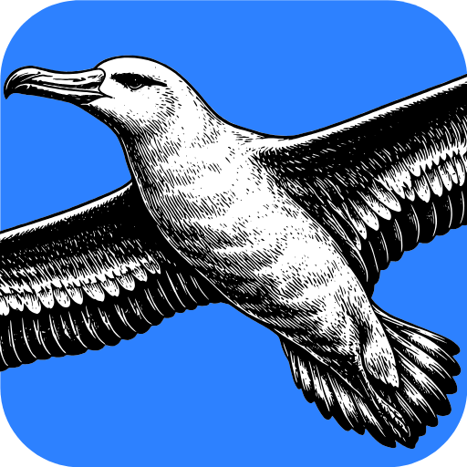

<p align="center">
  <a href="https://www.stkcraft.com">
    
  </a>
</p>

<h1 align="center">STKCraft</h1>

<p align="center">
  <a href="https://www.stkcraft.com"><b>www.stkcraft.com</b></a>
</p>

<p align="center">
  <b>Space mission analysis and visualisation; an open-source, pure-Rust platform.</b>
</p>

<p align="center">
  Build a scenario from satellites, ground stations, sensors and targets; propagate them over a
  timeline; and answer when something can see something else, and for how long. It runs
  natively on macOS, Windows, Linux and FreeBSD, and its analysis core compiles to
  WebAssembly; a browser shell is not shipped yet.<br>
  <i>An independent Craft-style project, applying to join the ArtCraft family.</i>
</p>

<p align="center">
  <a href="https://www.stkcraft.com"></a>
  
  
  
  
</p>

<br>

> [!NOTE]
> **Early alpha, and usable end to end.** Time, SGP4 propagation, frames, access, the scenario
> document, the 3D viewport, ephemerides, the MCP server and the knowledge base are shipped and
> verified against published references. The open work — bounded model context, the window's
> session and agent surface, and coverage analysis — is listed, with what "done" means, in
> [`ROADMAP.md`](ROADMAP.md). The crate map is in
> [`docs/design/architecture.md`](docs/design/architecture.md).

## Why STKCraft

- **Correct, not just plausible.** Mission analysis that is subtly wrong is worse than
  analysis that crashes, because nobody notices. Every numerical layer is verified against a
  published reference — the SGP4 verification vectors, the IAU SOFA test values, the IERS
  leap-second table — and every constant carries its source in a comment.
- **Types instead of discipline.** An angle is an `Angle`, not an `f64` that might be degrees.
  An instant carries the time scale it is in. A unit mix-up and a time-scale mix-up are both
  compile errors or explicit, named conversions.
- **Agent-native.** Every user-visible action is a command with an id and a documented
  parameter list. `stkcraft commands` lists them and `stkcraft run <id>` runs any one of them;
  the menus, the keyboard, the JSON control channel and the MCP server dispatch the same ids,
  so an agent can do anything a user can.
- **Everywhere.** One Rust codebase for desktop and the web. No subscription, no licence
  server, no telemetry.
- **Never crashes.** No panics in production code, no `unsafe`, and no NaN where an error
  belongs. An unfinished feature says so instead of returning a plausible number.

## Quick start

```sh
cargo run --release -p stkcraft                                  # the desktop app
cargo run --release -p stkcraft -- commands                      # every command id and parameter
cargo run --release -p stkcraft -- run access.compute --scenario mission.json --json
cargo xtask ci                                                   # the full gate
```

`cargo xtask` tasks:

| Task | What it does |
|---|---|
| `ci` | The full gate: `fmt --check`, clippy with `-D warnings`, tests, assets, i18n, the API reference, layers, wasm, version, and the lockfile check |
| `fmt` | `cargo fmt --check` over the workspace |
| `layers` | Enforces that a crate depends only on lower layers, and that analysis crates stay free of every GUI crate |
| `assets` | Every asset has a row in `ATTRIBUTION.md`, and every row names a file that exists |
| `wasm` | `cargo check --target wasm32-unknown-unknown` for the portable crates |
| `version` | Prints, or with `version set 0.2.0` updates, the single workspace version |

## Architecture

STKCraft is an engine-first Cargo workspace with enforced layering. The analysis crates never
see a window, an input event or a GPU handle, so the same code runs in the desktop app, the
CLI, the MCP server and the browser.

| Layer | Crates (all prefixed `stkcraft-`) |
|---|---|
| L0 | `framework-core` (units, errors, vectors), `framework-i18n` (catalogs) |
| L1 | `framework-time` (scales, leap seconds, epochs), `framework-storage` (record, cache, vectors) |
| L2 | `astro-body` (body constants, rotation models), `astro-frames` (frames, rotations), `astro-sgp4` (propagation) |
| L3 | `astro-access` (access geometry), `astro-ephemeris` (SPK kernels), `agent-knowledge` (the user's documents), `framework-extensions` (package contract) |
| L4 | `astro-engine` (scenario, commands, analysis) |
| L5 | `agent-mcp` (the registry as a protocol), `ui-viewport` (wgpu rendering) |
| L6 | `agent-runtime` (a model driving the registry), `agent-control` (a launcher driving it) |
| app | `apps/stkcraft` — the window, CLI, MCP server and assistant wiring |

- **Contributor and agent rules** (clean-room, asset policy, never-crash, the verification
  standard): [`AGENTS.md`](AGENTS.md)
- **Crate map and the reasoning behind it**: [`docs/design/architecture.md`](docs/design/architecture.md)
- **Bundled assets**: every one is listed with its licence in [`ATTRIBUTION.md`](ATTRIBUTION.md)

## Verifying the numbers

These are the references the numerical layers are held to, in the order they land:

| Layer | Reference |
|---|---|
| Time scales | IAU SOFA / ERFA test values; the IERS `tai-utc.dat` leap-second table |
| Frame rotations | IAU SOFA transformation checks |
| Orbit propagation | Official SGP4 verification vectors; independently published ephemerides |
| Access | Hand-computable geometry: a satellite directly overhead is visible, one below the horizon is not. Coverage analysis is not built |

A layer that cannot meet its reference returns an error rather than an approximation it
cannot justify.

## Status

Shipped, with the reference each numerical layer is checked against:

- **Time** — IAU scales, the IERS leap-second table, two-part Julian dates (SOFA/ERFA values).
- **Propagation** — SGP4/SDP4 (AIAA 2006-6753 verification vectors).
- **Frames** — reference frames and proper rotations (SOFA transformation checks).
- **Access** — satellite ↔ station, and planet-centred access on other bodies (hand-computable cases).
- **Scenarios and commands** — one command registry behind the menus, CLI, control channel and MCP;
  sensors and polygon targets are in the engine, and the window does not offer either yet.
- **Viewport** — a wgpu globe, ground tracks and an access overlay, with an offscreen screenshot path
  that checks the image numerically.
- **Ephemerides** — JPL SPK kernels, fetched and checksum-verified by `cargo xtask fetch-data`.
- **Knowledge** — the user's own documents, BM25 ranking, PDF citations, and the CCSDS/NAIF corpora.
- **i18n** — one English source, `zh` shipped, and a self-translation path using the person's key.

The next step is the window's session surface in [`ROADMAP.md`](ROADMAP.md) F2: a window that lists
stored sessions and resumes one. Size-triggered compaction with a model-written summary, and session
metadata, shipped in 0.1.46.

Not built yet, and named here so a reader does not have to infer it: a browser shell, coverage
analysis, the extension store and any third-party code execution, number/date localisation, and
DOCX/XLSX text extraction for the knowledge base.

## License and credits

STKCraft is dual-licensed under [MIT](LICENSE-MIT) or [Apache-2.0](LICENSE-APACHE), at your
option. Copyright (c) 2026 the STKCraft contributors. Required notices are
in [NOTICE](NOTICE).

Bundled assets, if any, keep their own open licenses; each one is listed with its author,
source and license in [ATTRIBUTION.md](ATTRIBUTION.md).

The ArtCraft name, wordmark and logos are trademarks of the ArtCraft Team and are not covered
by this license. STKCraft is an independent project applying to join the ArtCraft family and does
not claim these marks; forks and modified versions must remove them.

STKCraft is a clean-room implementation. It is built from published standards and public
papers; no commercial mission-analysis product's code, data files or artwork is used.

## Repository layout

```
crates/framework/   the platform — units, time, translations, extensions, storage (nothing here knows what an orbit is)
crates/astro/       the orbital-analysis domain — bodies, frames, ephemerides, propagation, access, engine
crates/agent/       the model-facing surface — the knowledge base, MCP, the runtime, the control channel
crates/ui/          presentation — the 3D viewport
assets/app-icon/    the albatross mark: vector master, PNG, ICO and their licence
apps/stkcraft/      the window, the CLI, the MCP server and the assistant
share/              content the app loads — interface catalogs and skill documents
docs/               the engineering record, indexed by docs/README.md
packaging/          installer inputs;  contributors/  credits;  xtask/  the build tool
data/  plan/        fetched bulk data and local notes, both gitignored
```

The map, and the rules that keep it honest, are in [docs/standards.md](docs/standards.md) §9.
